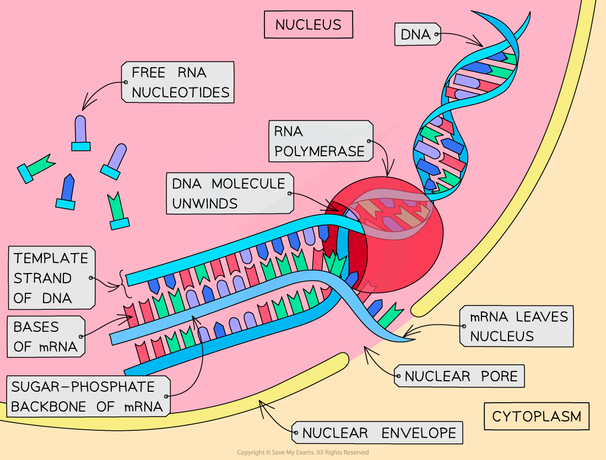
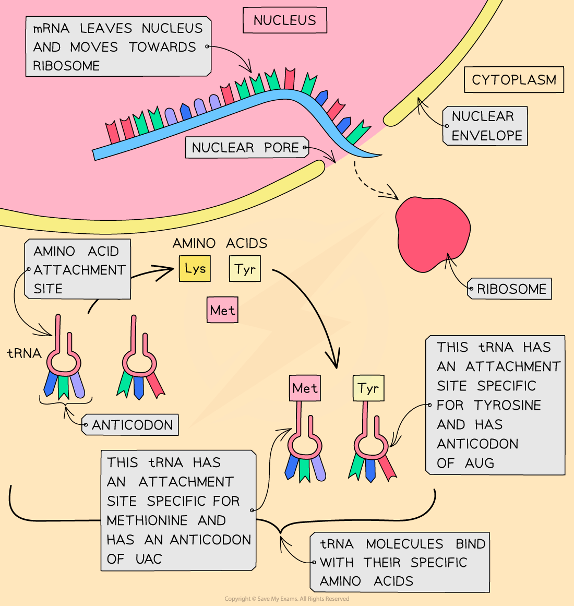
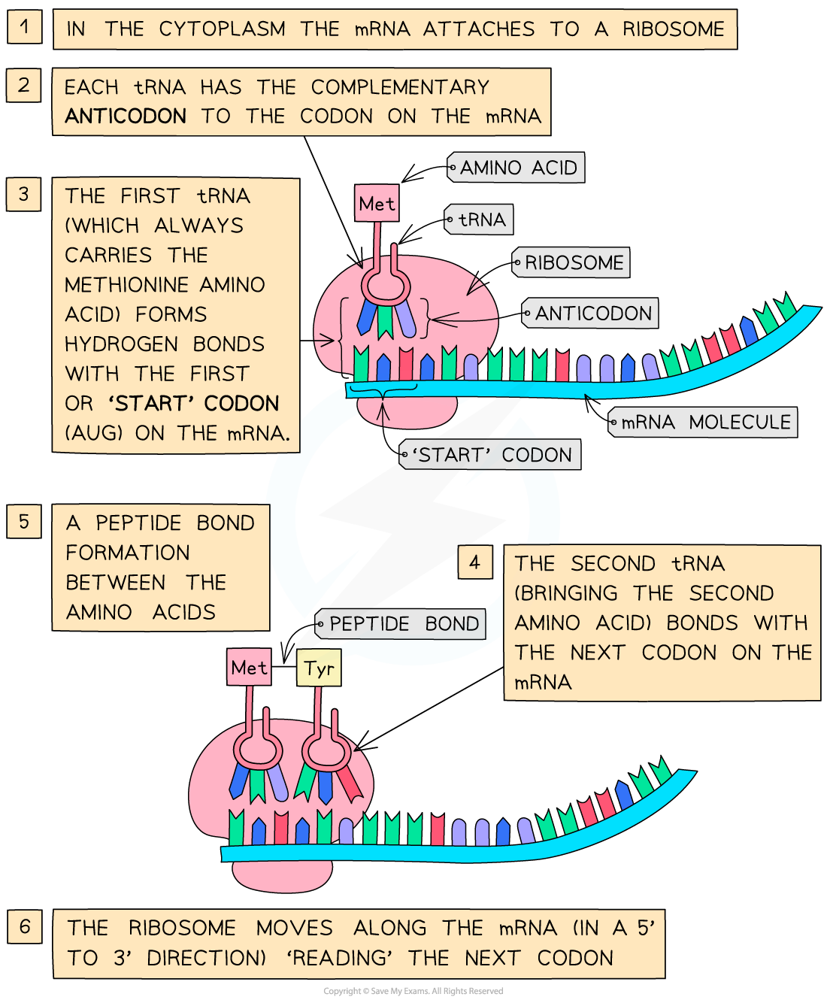
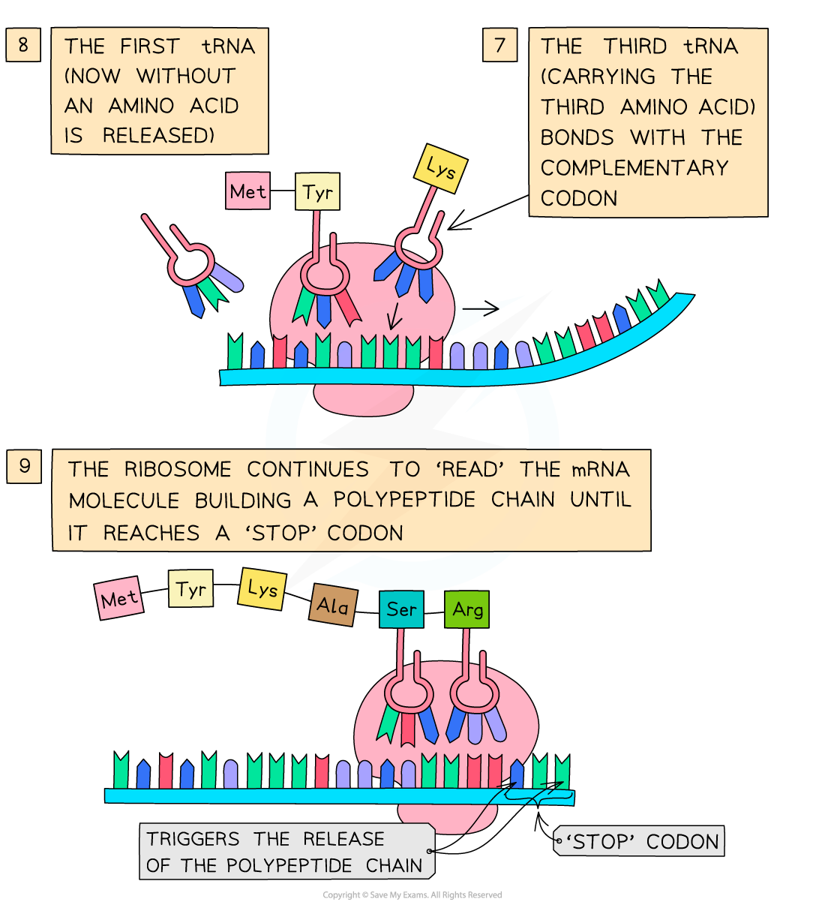

# Constructing Polypeptides

## Constructing Polypeptides: Transcription & Translation

> **Spec point** — `spcpt_48wB3w96cYSZdWdh` · describe how the information in DNA is used during transcription and translation to construct polypeptides, including the roles of:
• RNA polymerase
• messenger RNA (mRNA)
• codons
• transfer RNA (tRNA)
• anticodons
• ribosomes

## Constructing polypeptides: transcription & translation

- A **gene** is a **sequence of nucleotide bases **in a DNA molecule that **codes for the production of a specific sequence of amino acids**, that in turn make up a **specific polypeptide** (**protein**)
- This process of protein synthesis occurs in **two stages**:

  - **Transcription**:
  
    - **DNA** is transcribed and an **mRNA **molecule is produced
  - **Translation**:
  
    - **mRNA** (messenger RNA) is translated and an **amino acid sequence** is produced

### Transcription

- This stage of protein synthesis occurs **in the nucleus **of the cell
- Part of a DNA molecule **unwinds** (the **hydrogen bonds** between the complementary base pairs **break**)
- This exposes the **gene** to be transcribed (the gene from which a particular polypeptide will be produced)
- A complementary copy of the code from the gene is made by building a **single-stranded nucleic acid molecule known as mRNA** (messenger RNA)

  - The DNA triplets of bases are transcribed as mRNA *codons*
  - The single-stranded mRNA molecule can fit through the pores in the nuclear envelope, unlike double-stranded DNA
- **Free RNA nucleotides** pair up (via hydrogen bonds) with their complementary (now exposed) bases on one strand (the template strand) of the ‘unzipped’ DNA molecule
- The sugar-phosphate groups of these RNA nucleotides are then **bonded** together by the enzyme **RNA polymerase** to form the sugar-phosphate backbone of the mRNA molecule
- When the gene has been transcribed (when the mRNA molecule is complete), the hydrogen bonds between the mRNA and DNA strands break

  - The **double-stranded DNA molecule then re-forms**
- The mRNA molecule then **leaves the nucleus** via a pore in the nuclear envelope

*The transcription stage of protein synthesis—DNA is transcribed and an mRNA molecule is produced*

### Translation

- This stage of protein synthesis occurs **in the cytoplasm** of the cell
- After leaving the nucleus, the **mRNA molecule attaches to a ribosome**
- In the cytoplasm, there are **free molecules of tRNA** (transfer RNA)
- These tRNA molecules have:

  - A **triplet of unpaired bases at one end**,** **known as the *anticodon*
  - A region where a specific **amino acid can attach** at the other
- There are at least 20 different tRNA molecules, each with a specific anticodon and specific amino acid binding site
- The **tRNA molecules bind with their specific amino acids** (also in the cytoplasm) and bring them to the mRNA molecule on the **ribosome**
- The **anticodon** on each tRNA molecule pairs with a complementary **codon** on the mRNA molecule
- **Two tRNA molecules fit onto the ribosome at any one time**, bringing the amino acid they are each carrying side by side
- A **peptide bond** is then formed between the two amino acids
- This process continues until a **‘stop’ codon **on the mRNA molecule is reached

  - The 'stop' codon acts as a signal for translation to stop and at this point the amino acid chain coded for by the mRNA molecule is complete
- This amino acid chain then forms the final polypeptide

*The translation stage of protein synthesis—tRNA molecules bind with their specific amino acids*

*The translation stage of protein synthesis—an amino acid chain is formed*

> **Exam Hint**
> Make sure you learn **both stages** of protein synthesis fully.
> 
> Don’t forget—transcription occurs** **in the **nucleus** but translation occurs in the **cytoplasm**!
> 
> Be careful—DNA polymerase is the enzyme involved in DNA replication; **RNA polymerase** is the enzyme involved in **transcription**—don’t get these confused.
