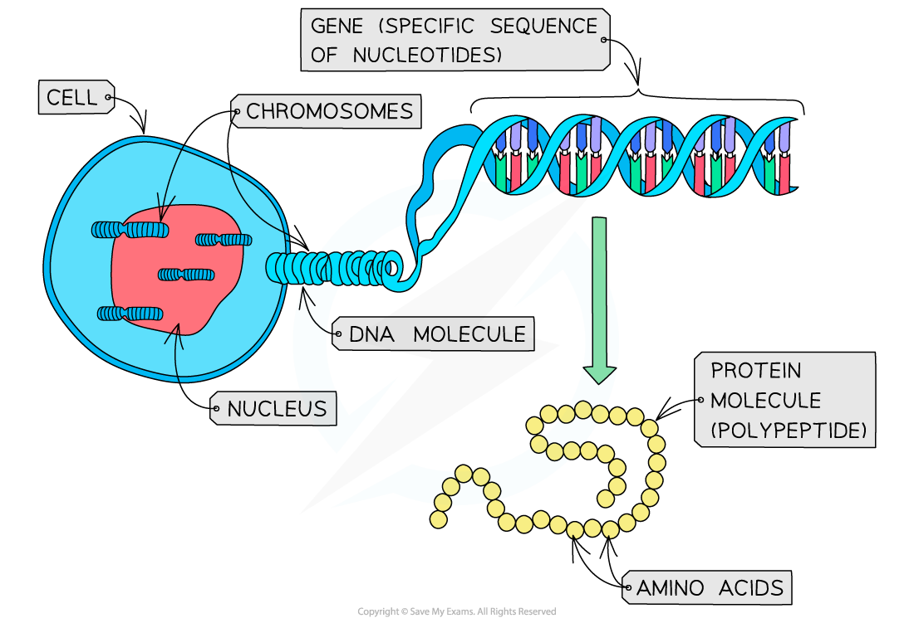

# From Gene to Polypeptide

## From Gene to Polypeptide

> **Spec point** — `spcpt_rywX8vsFJrYzhqJY` · state that a polypeptide is coded for by a gene and that a gene is a sequence of nucleotides that forms part of a DNA molecule

## From gene to polypeptide

- A **gene** is a **sequence of nucleotides **that forms part of a DNA molecule

  - One DNA molecule contains many genes
- This sequence of nucleotide bases (the gene) **codes for the production of a specific polypeptide** (protein)
- Protein molecules are made up of a series of **amino acids** bonded together
- The **shape** and **behaviour** of a protein molecule depend on the **exact sequence **of these amino acids

  - This means that the **genes in DNA molecules control protein structure** (and as a result, protein function)
  - This is because **genes determine the exact sequence in which the amino acids join together** when proteins are synthesised in a cell

*A gene is a sequence of nucleotides that codes for the production of a specific protein molecule (polypeptide)*

> **Exam Hint**
> One gene codes for one mRNA molecule, which codes for one polypeptide.
> 
> Remember—each chromosome in a human cell nucleus contains one very long DNA molecule.
> 
> This DNA molecule is made up of thousands of specific nucleotide sequences called genes that code for specific proteins.
> 
> Even though these genes are all found within the same DNA molecule and are therefore all linked up, each individual gene has a specific start and stop point.
> 
> This ensures that the DNA is read correctly and that the correct protein molecules are produced that are required by the cell to function properly.
