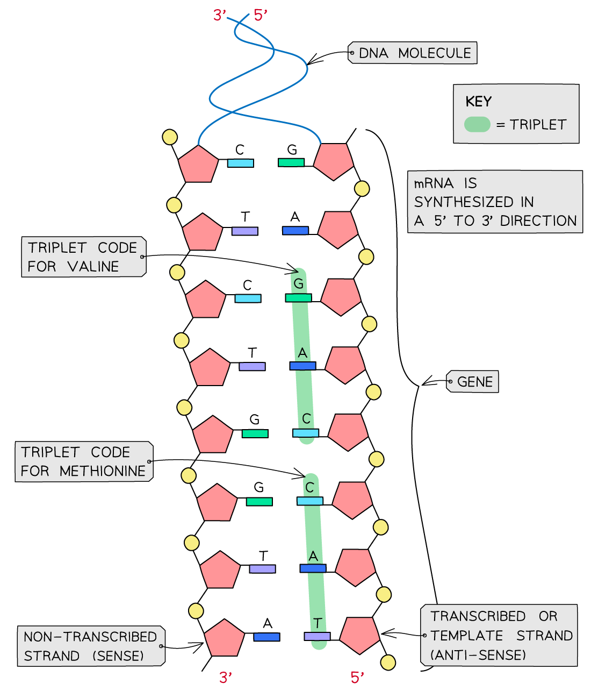

# The Universal Genetic Code

## The Universal Genetic Code

> **Spec point** — `spcpt_My4VjpFBBHWjJr3h` · describe the principle of the universal genetic code in which different triplets of DNA bases either code for specific amino acids or correspond to start and stop codons

## The universal genetic code

- A **gene** is a **sequence of nucleotide bases **in a DNA molecule that **codes for the production of a specific sequence of amino acids**

  - These amino acids in turn make up a **specific polypeptide** (**protein**)
- The DNA nucleotide base code found within a gene is a **three-letter**, or **triplet**, code
- Each sequence of **three bases** (in other words each triplet of bases) codes for **one amino acid**

  - There are 20 different amino acids that cells use to make up different proteins
- For example, on the template (transcribed) strand of DNA:

  - CAG codes for the amino acid valine
  - TTC codes for the amino acid lysine
  - GAC codes for the amino acid leucine
  - CCG codes for the amino acid glycine

- Some of these triplets of bases code for **start** and **stop signals**

  - These signals **tell the cell where individual genes start and stop**
  - This ensures the cell:
  
    - **Reads the DNA correctly** (the code is **non-overlapping**)
    - Can **produce the correct sequences of amino acids** (and therefore the correct protein molecules) that it requires to function properly
- The genetic code is **universal**, meaning that almost every organism uses the **same code**
- This means that the **same triplets code for the same amino acids in all living things**

  - This means that genetic information is transferable between species

*A DNA molecule with the triplet codes for two amino acids (methionine and valine)*
