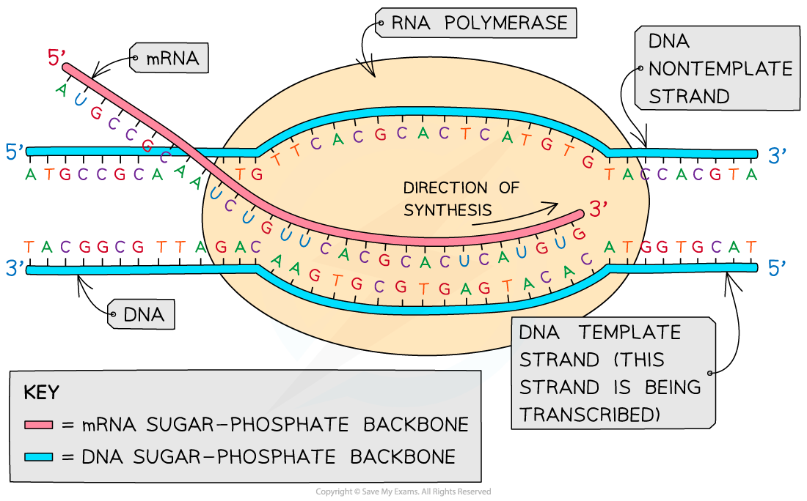
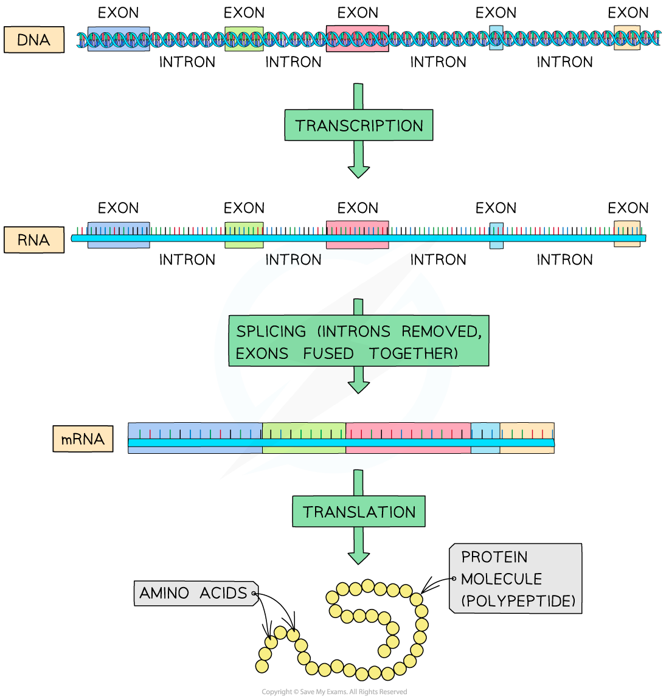

# Transcription

## Template & Non-Template Strands

> **Spec point** — `spcpt_RdT792PvtKnWCCgf` · state that the strand of a DNA molecule that is used in transcription is called the transcribed or template strand and that the other strand is called the non-transcribed strand

## Template & non-template strands

- In the **transcription** stage of protein synthesis, the section of the DNA molecule where the gene is located (the gene coding for a particular polypeptide) **unwinds**

  - The hydrogen bonds between the complementary base pairs break, causing the two DNA strands to ‘unzip’
- Free activated RNA nucleotides then pair up with the exposed bases on the DNA molecule but **only with those bases on one strand of the DNA molecule**
- This is the strand that is **transcribed **to form the **mRNA **molecule

  - This strand of the DNA molecule is called the **template strand** or the **transcribed strand**
- The other strand of the DNA molecule is **not transcribed**

  - This strand is called the **non-template strand** or the **non-transcribed strand**

*The template strand of the DNA molecule is the one that is transcribed*

> **Exam Hint**
> The mRNA codons have the same base sequence as the non-transcribed strand, and the tRNA anticodons have the same base sequence as the transcribed strand (**except** that Thymine in the DNA strands is replaced by the base Uracil in mRNA and tRNA).

## Post-Transcriptional Modification

> **Spec point** — `spcpt_CwByhMBkQ88whS4d` · explain that, in eukaryotes, the RNA molecule formed following transcription (primary transcript) is modified by the removal of non-coding sequences (introns) and the joining together of coding sequences (exons) to form mRNA

## Post-transcriptional modification

- Within eukaryotic genes, there are both **coding** and **non-coding sequences** of DNA

  - The coding sequences are called **exons**
  
    - These sequences will eventually be **translated** into the amino acids that will form the final polypeptide
  - The non-coding sequences are called **introns**
  
    - These sequences are **not translated** (they do not code for any amino acids)
- **When transcription of a gene occurs, both the exons and introns are transcribed**

  - This means the RNA molecule formed (known as the **primary transcript**) also **contains exons and introns**
- As the **introns** are not to be translated, they must be **removed** from the RNA molecule
- The **exons** are then all **fused together **to form a continuous RNA molecule called mature **mRNA** that is ready to be translated

  - This process is called RNA splicing (or gene splicing) and is part of the process of **post-transcriptional modification** (referring to the modification of the RNA molecule **after transcription** but before translation occurs)

*The RNA molecule produced from transcription of a gene contains introns that must be removed before translation can occur*
