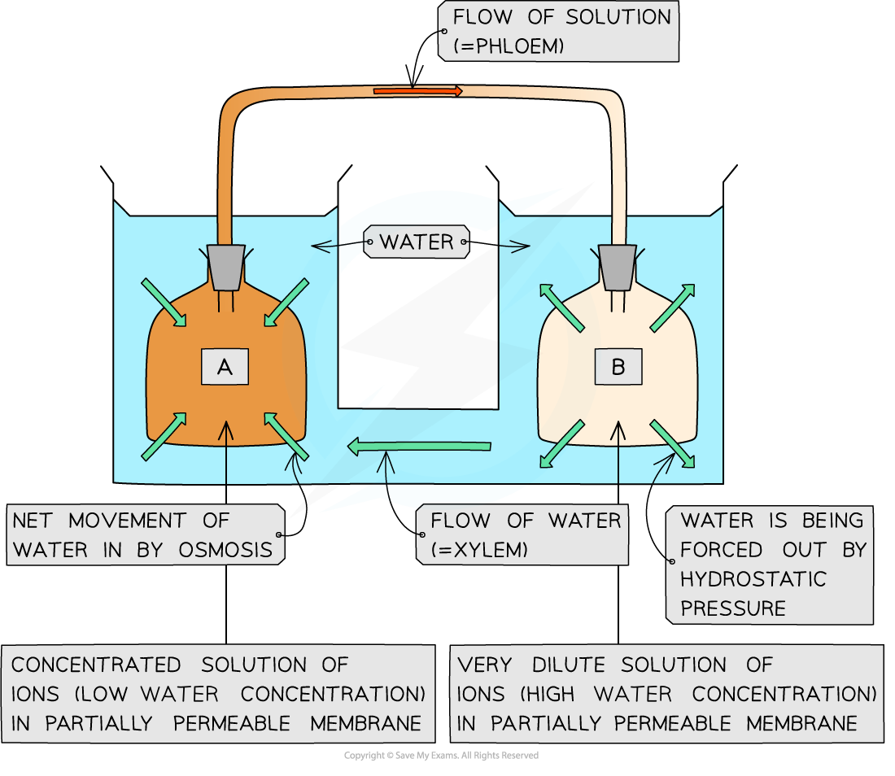
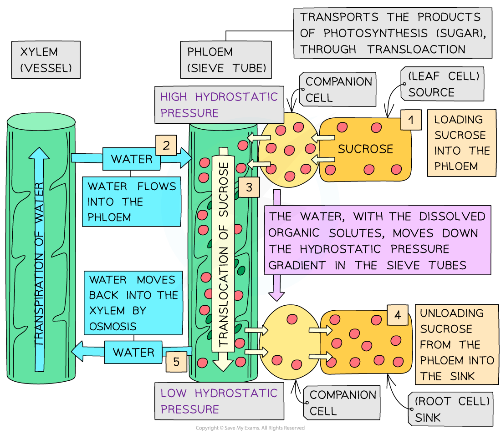

# Phloem: Mass Flow

## Phloem: Mass Flow

> **Spec point** — `spcpt_c7WvJRWQ94H2ySbz` · explain mass flow in phloem sieve tubes down a hydrostatic pressure gradient from source to sink

## Phloem: mass flow

- The **mass flow hypothesis** was the model initially used to explain the movement of assimilates in the phloem tissue
- The simple model consisted of:

  - Two partially permeable membranes containing solutions with **different concentrations of ions** (one dilute the other concentrated)
  - These two membranes were placed into two chambers containing water and were connected via a passageway
  - The two membranes were joined via a tube
  - As the membranes were surrounded by water, the **water moved by osmosis **across the membrane containing the more concentrated solution
  - This forced the solution towards the membrane containing the more dilute solution (where water was being forced out of due to **hydrostatic pressure**)
- Scientists now support a modified version of this hypothesis – the **pressure flow gradient**

*An illustration of Münch’s model for mass flow in phloem tissue*

### Pressure (hydrostatic) flow gradient

- Phloem sap (containing sucrose and other organic solutes) moves by **mass flow up and down the plant**

  - The **advantage **of mass flow is that it moves the organic solutes** faster than diffusion**
- In xylem tissue the pressure difference that causes mass flow occurs because of a **water potential gradient** between the soil and leaf (this requires no energy input by the plant)
- However in phloem tissue **energy is required** to create pressure differences for the mass flow of the organic solutes
- The pressure difference is generated by **actively loading sucrose** into the **sieve** **elements** at the **source** (usually a photosynthesising leaf or storage organ) which lowers the water potential in the sap
- This results in **water moving into** the sieve elements as it travels down the water potential gradient by **osmosis**
- The presence of water within the sieve elements **increases** the **hydrostatic** or turgor **pressure** at the **source** and as solutes (e.g. sucrose) are removed / unloaded from the sieve elements causing water to follow by osmosis at the **sink** (creating a **low hydrostatic pressure**), a hydrostatic pressure gradient occurs
- The pressure difference between the source and the sink results in the **mass flow** of water (containing the dissolved organic solutes) **from the high hydrostatic pressure area to the low hydrostatic pressure area**
- The mass flow of organic solutes within the phloem tissue occurs above and below the sources (which is typically photosynthesising leaves). Therefore sap flows upwards and downwards within a plant

*The translocation of phloem sap (sucrose and other organic solutes) due to a hydrostatic pressure gradient from the source to the sink*

> **Exam Hint**
> Remember that the source is not necessarily the leaves and the sink is not necessarily the roots.
> 
> Phloem sap moves up and down the plant (although it will only move in one direction per sieve tube).
> 
> The hydrostatic pressure gradient is dependent on water moving in and out of the xylem vessels by osmosis.
