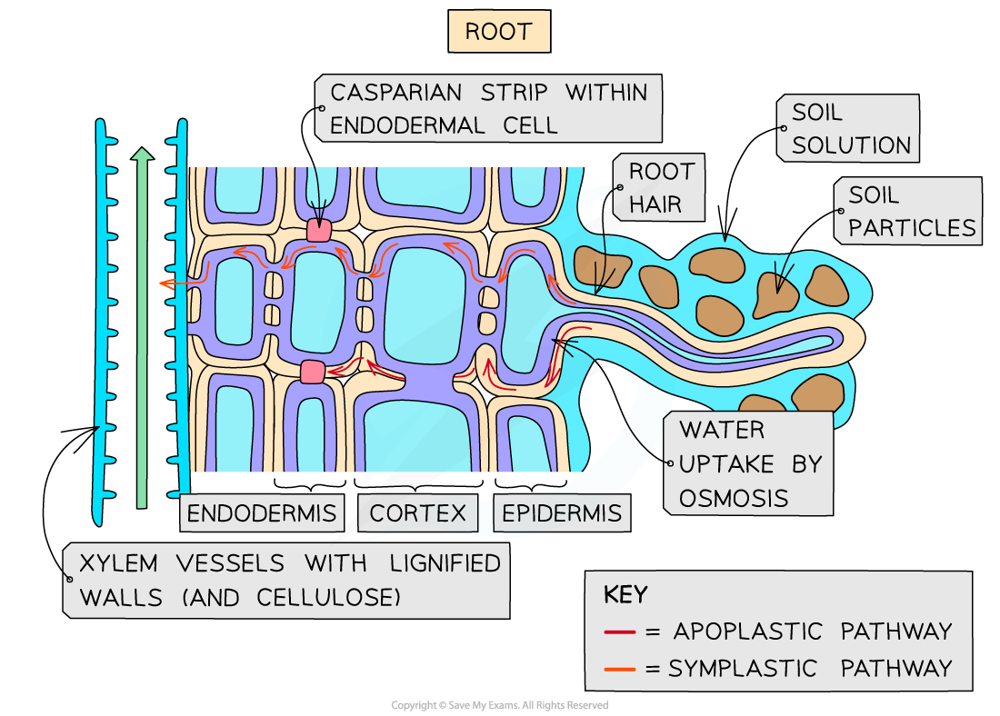

# Water & Mineral Ion Transport in Plants

## Water & Mineral Ion Transport: Pathways & Mechanisms

> **Spec point** — `spcpt_vyR4fjbqMxqz7c9m` · state that some mineral ions and organic compounds can be transported within plants dissolved in water
 describe the transport of water from the soil to the xylem through the:
• apoplast pathway, including reference to lignin and cellulose
• symplast pathway, including reference to the endodermis, Casparian strip and suberin

## Water & mineral ion transport: pathways & mechanisms

- Plant roots have **root hairs** to **increase the surface area** for absorption of water and mineral ions from the soil

  - Root hair cells take in mineral ions from the soil; this can occur either by diffusion or by active transport depending on the mineral concentrations in the soil
  - The uptake of minerals** lowers the water potential** of the root hair cells
  - The uptake of water then occurs by **osmosis**
- After the uptake of water and dissolved mineral ions into the root hair cells, the solution needs to move across the plant root and into the** xylem vessels**
- There are two pathways that water (and dissolved solutes) can take to move across the root cortex:

  - **Apoplast **(also known as apoplastic)
  - **Symplast **(also known as symplastic)

### The apoplast pathway

- Most water** **travels via the apoplast pathway, which involves the series of **spaces** running through the **cellulose cell walls**, dead cells, and the hollow tubes of the xylem

  - The cellulose cell walls form a network of **microscopic channels** and **pores **that allow water to move freely between cells
  - Their structure provides a** continuous, unbroken route** for water** **and dissolved minerals through the plant
- Water in the apoplast pathway moves by **diffusion**, as it does not cross any partially permeable membranes
- The movement of water through the apoplast pathway occurs **more rapidly **than in the symplast pathway
- When the water reaches the *endodermis* of the root, its progress is blocked by a waterproof, waxy band of **suberin** within the cell walls

  - This band is called the **Casparian strip**
- When the water and dissolved minerals reach the Casparian strip they move into the symplast pathway.

  - The presence of this strip is not fully understood, but it is thought that forcing water into the symplast pathway, and therefore across cell membranes, may help the plant control which mineral ions reach the xylem
- Within the xylem vessels, the cell walls are strengthened and waterproofed by **lignin**

  - This lignin **prevents water from leaking out of the vessels** and helps maintain the continuous column of water under tension, allowing efficient upward transport

### Symplast pathway

- A **smaller volume of water** travels via the symplast pathway, which involves the **cytoplasm**, *plasmodesmata***,** and vacuoles of the cells
- The water moves by **osmosis** into the cells and vacuoles, and by diffusion between cells through the plasmodesmata
- The movement of water in the symplast pathway is **slower **than the apoplast pathway

*The Casparian strip prevents the movement of water via the apoplast pathway and forces it to move via the symplast pathway*

> **Exam Hint**
> Remember water moves through the apoplast and symplast pathways in the leaves as well as the roots.
> 
> Water **does not move by osmosis** **in the apoplast pathway** as the molecules are in the cell wall, which is freely permeable.
