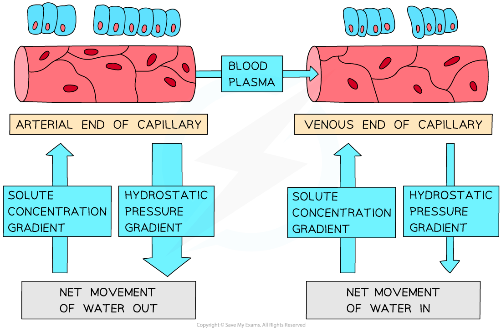

# Blood & Tissue Fluid

## Blood, Tissue Fluid & Lymph

> **Spec point** — `spcpt_kvhwZWC83KGRppZV` · state the functions of tissue fluid and describe the formation of tissue fluid in a capillary network

## Blood & tissue fluid

- **Plasma** is a straw-coloured liquid that constitutes around 55% of the blood
- Plasma is largely composed of water (95%)

  - **Water** is a good **solvent**, so many substances can dissolve in plasma, allowing them to be transported around the body
- As blood passes through **capillaries**, some plasma leaks out through gaps in the walls of the capillary to surround the cells of the body

  - This results in the formation o**f tissue fluid**
- The composition of plasma and tissue fluid are virtually the same, although **tissue fluid **does not contain large** proteins**

  - Large proteins are unable to fit through gaps in the capillary walls and so remain in the blood
- Tissue fluid bathes almost all the cells of the body outside of the circulatory system
- **Exchange** **of substances** between cells and the blood occurs via the tissue fluid

  - For example, carbon dioxide produced in aerobic respiration will leave a cell, dissolve into the tissue fluid surrounding it, and then diffuse into the capillary

### Tissue fluid formation

- How much liquid leaves the plasma to form tissue fluid depends on two opposing forces:

  - **hydrostatic pressure**
  
    - This is blood pressure; the pressure exerted by the blood on the walls of the blood vessels
    - Blood pressure pushes** outwards** from the blood vessels
  - **the solute concentration gradient**
  
    - Proteins dissolved in the blood lower the blood water potential, meaning that there is a water potential gradient** **between the capillary and the surrounding tissue
    - Water moves from high to low water potential by osmosis, so water is **drawn back in **from the tissues into the capillaries
- When blood is at the arterial end of a capillary the** hydrostatic pressure is greater **than the osmotic pull

  - This means molecules are forced out of the capillary down a pressure gradient
- At the venous end of the capillary the volume of fluid is lower and the blood is further from the heart, so the **hydrostatic pressure is reduced**
- The **solute concentration gradient** between the capillary and the tissue fluid remains the same as at the arterial end, so water begins to flow back into the capillary from the tissue fluid by osmosis

*The formation of tissue fluid is caused by the solute concentration and hydrostatic pressure gradients*

- Tissue fluid formation can be affected by factors such as:

  - **High blood pressure**: this can force extra fluid out of the capillaries, meaning that an increased volume of fluid is left behind after the effects of osmosis
  - **Low blood protein content**: this can increase the water potential of the blood and so reduce the effect of osmosis, also resulting in a build-up of fluid in the tissues
