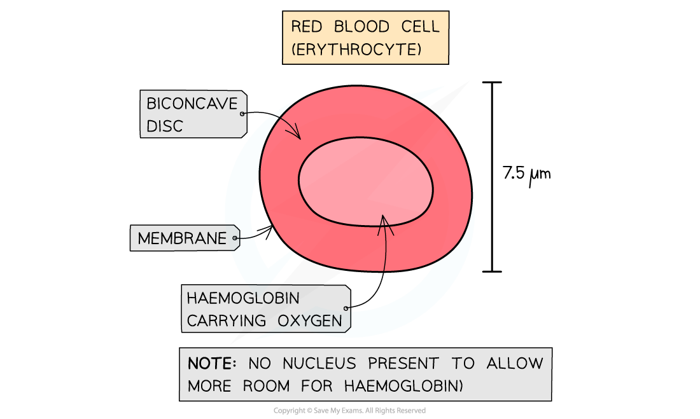
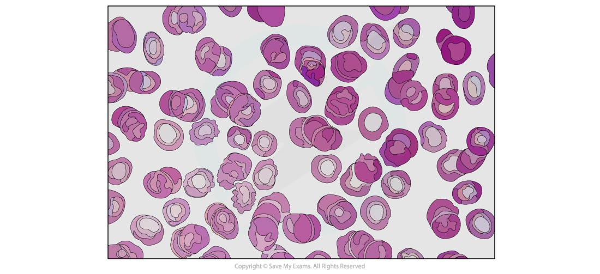
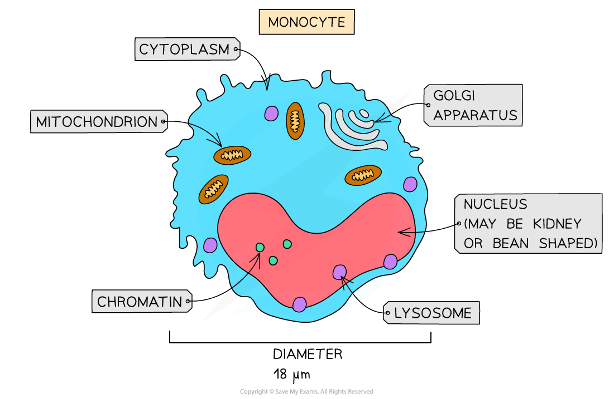
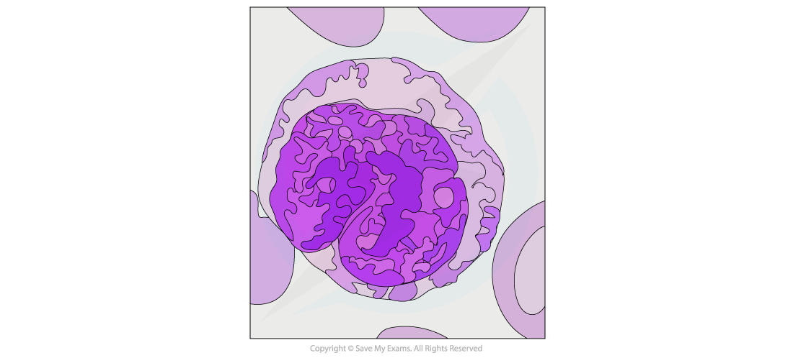
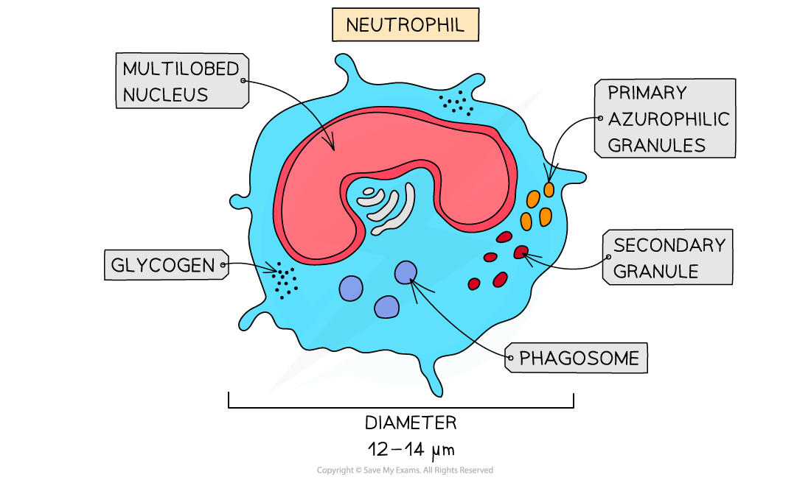
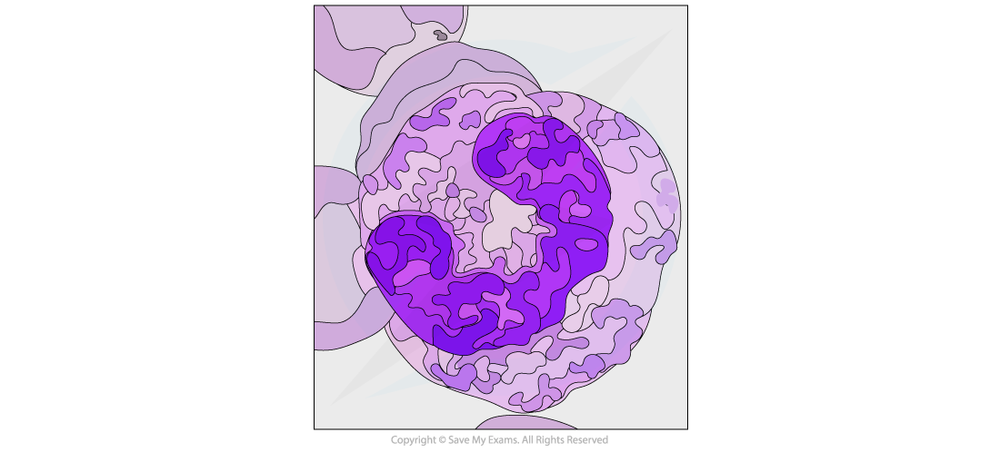
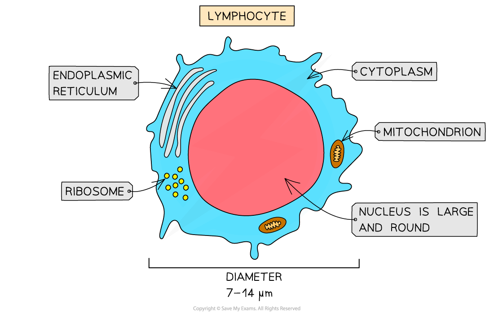
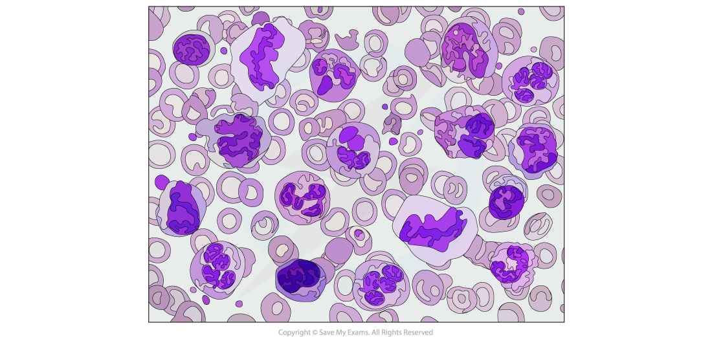

# Cells of the Blood

## Cells of the Blood

> **Spec point** — `spcpt_WPsCdSjf9t4pHVjq` · recognise and draw red blood cells, monocytes, neutrophils and lymphocytes from microscope slides, photomicrographs and electron micrographs

## Cells of the blood

- Blood is a tissue composed of a number of important specialised cells, including:

  - Red blood cells
  - Monocytes
  - Neutrophils
  - Lymphocytes
- These cells all have distinguishable structures which enable them to be recognised on microscope slides, in photomicrographs and in electron micrographs

*Diagram of the structure of a red blood cell*

- **Red blood cells **contain **haemoglobin**

  - This is a protein with a **quaternary structure** that contains haem iron groups which can bind reversibly to oxygen
- Distinctive features of red blood cells when viewed under a microscope, are their distinctive biconcave disc shape (caused by their lack of nucleus)

*Red blood cell micrograph*

*A monocyte is a type of white blood cell*

- **Monocytes** are identifiable by their size

  - They are the largest of the *leukocytes* and have a nucleus shaped like a kidney or a bean
- The nucleus of monocytes tends to appear lighter after staining than other leukocytes
- The nucleus should appear a light blue colour, while the chromatin inside is distinct and fine

*A micrograph of a monocyte cell*

- **Neutrophils** are distinguished by their multi-lobed nuclei
- Up to 70% of all leukocytes are neutrophils

  - This makes them easy to spot on a micrograph
- The granules of neutrophils typically stain pink or purple-blue

*A neutrophil is a type of white blood cell*

*A micrograph of a neutrophil cell*

- **Lymphocytes** are small leukocytes that are identifiable by their very large nuclei, which typically stains a dark colour
- Lymphocytes constitute around 20-25% of all leukocytes
- Lymphocytes are around the size of red blood cells

*A lymphocyte is a type of white blood cell*

*A micrograph of some lymphocyte cells*

> **Exam Hint**
> When looking at micrographs, ensure you distinguish between the kidney-shaped nucleus of a monocyte and the multi-lobed nucleus of a neutrophil, as these can appear similar at first. As with all things, practice is key here!
