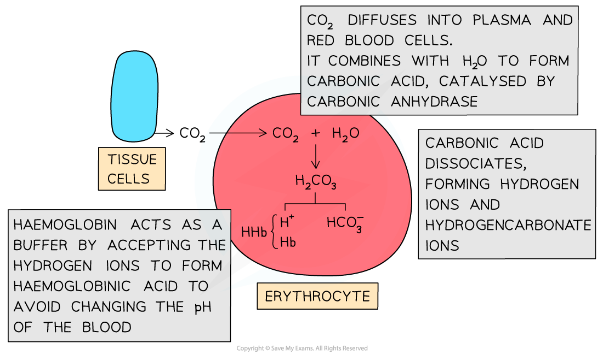

# Plasma & Carbon Dioxide

## Plasma & Carbon Dioxide

> **Spec point** — `spcpt_8XjK3kRVmYDY9jV4` · describe the role of plasma in the transport of carbon dioxide

## Plasma & carbon dioxide

- Waste carbon dioxide produced during *respiration* diffuses from the tissues into the blood
- This waste carbon dioxide is transported around the body in different ways:

  - Around 5 % of carbon dioxide dissolves directly in the blood plasma
  - Around 10 % of carbon dioxide is bound to haemoglobin as **carbaminohaemoglobin**
  - Around 85 % of carbon dioxide is found in the blood plasma in the form of **hydrogen carbonate ions** **(HCO****3****-****)**

### Carbon dioxide in the plasma

- Carbon dioxide released as a waste product from respiring cells **diffuses into the cytoplasm of red blood cells**
- Inside red blood cells, carbon dioxide **combines with water** to form carbonic acid (H2CO3)

**CO****2**** + H****2****O  ⇌  H****2****CO****3**

- Red blood cells contain the enzyme **carbonic anhydrase** which catalyses the reaction between carbon dioxide and water

  - Without carbonic anhydrase this reaction proceeds very slowly
- The plasma contains very little carbonic anhydrase hence H2CO3 forms **more slowly in plasma** than in the cytoplasm of red blood cells
- Carbonic acid dissociates readily into **hydrogen ions** **(H****+****)** and** hydrogen carbonate ions (HCO****3****-****)**

**H****2****CO****3 **** ⇌  HCO****3****–**** + H****+**

- Hydrogen ions can combine with haemoglobin, forming **haemoglobinic acid** and preventing the H+ ions from **lowering the pH** of the red blood cell

  - Haemoglobin is said to act as a **buffer** in this situation
- The hydrogen carbonate ions diffuse out of the red blood cells **into the plasma **to be transported in solution

*Hydrogen carbonate ions form inside red blood cells before diffusing into the blood plasma*

> **Worked Example**
> **Explain how carbon dioxide is transported in the form of hydrogen carbonate ions.**
> 
> - Carbon dioxide diffuses down a concentration gradient from respiring cells into the plasma, and diffuses again into red blood cells
> - In the red blood cells some carbon dioxide combines with water to form carbonic acid, in a reaction catalysed by the enzyme carbonic anhydrase
> - Carbonic acid dissociates to form hydrogen carbonate ions and hydrogen ions
> - The hydrogen carbonate ions diffuse out of the red blood cells into the plasma, where they are transported to the lungs
