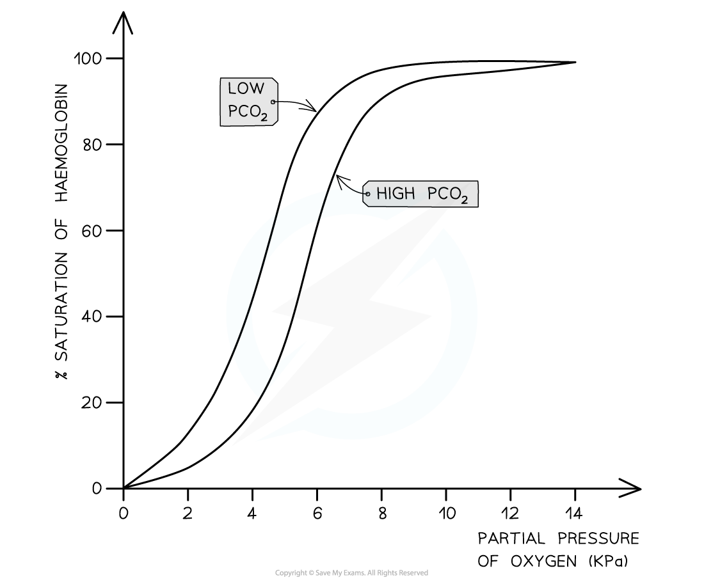

# The Bohr Shift

## The Bohr Shift 

> **Spec point** — `spcpt_tkbWgxMcb5R2Z2db` · describe the Bohr shift and explain the importance of the
Bohr shift

## The Bohr shift

- Changes in the oxygen dissociation curve **as a result of carbon dioxide levels **are known as the **Bohr effect**, or **Bohr shift**
- When the **partial pressure of carbon dioxide in the blood is high, haemoglobin’s affinity for oxygen is reduced**

  - This is the case in **respiring tissues**, where cells are producing carbon dioxide as a waste product of respiration
  - This occurs because **CO****2**** lowers the pH of the blood**
  
    - CO2 combines with water to form carbonic acid
    - Carbonic acid dissociates into hydrogen carbonate ions and hydrogen ions
    - Hydrogen ions bind to haemoglobin, causing the release of oxygen
- This is a helpful change because it means that **haemoglobin gives up its oxygen more readily** in the respiring tissues where it is needed
- On a graph showing the dissociation curve, the curve **shifts to the right** when CO2 levels increase

  - This means that **at** **any given partial pressure of oxygen, the percentage saturation of haemoglobin is lower at higher levels of CO****2**

*The dissociation curve shifts to the right as a result of the Bohr effect. This means that any given partial pressure of oxygen, the percentage saturation of haemoglobin is lower at higher CO2 levels.*
