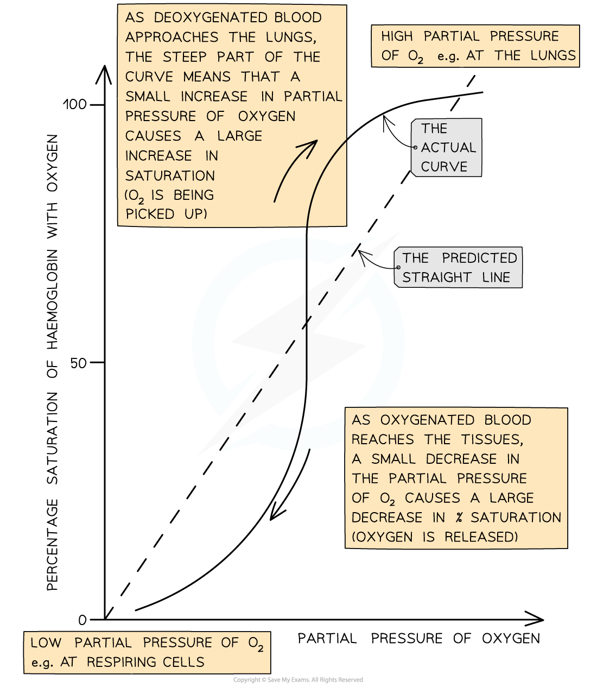

# The Oxygen Dissociation Curve

## The Oxygen Dissociation Curve

> **Spec point** — `spcpt_bcCNpbC8MpqrtN2k` · describe and explain the oxygen dissociation curve of adult haemoglobin

## The oxygen dissociation curve

- The oxygen dissociation curve shows the **rate at which oxygen associates and dissociates with haemoglobin** at different **partial pressures of oxygen (pO****2****)**

  - Partial pressure of oxygen refers to the **pressure exerted by oxygen within a mixture of gases**
  
    - It is a **measure of oxygen concentration**
  - Haemoglobin is referred to as being **saturated **when **all of its oxygen binding sites are taken up with oxygen**
  
    - This is when it contains **four oxygen molecules**
- The ease with which haemoglobin binds and dissociates with oxygen can be described as its **affinity** **for oxygen**

  - When haemoglobin has a high affinity it **binds easily** and **dissociates slowly**
  - When haemoglobin has a low affinity for oxygen it **binds slowly **and **dissociates easily**
- In other liquids, such as water, we would expect oxygen to become associated with water, or to dissolve, at a **constant rate**, providing a **straight line** on a graph
- However, with haemoglobin, **oxygen binds at different rates as the pO****2**** changes**

  - This results in a curve when plotted
  - It can be said that haemoglobin's **affinity for oxygen changes at different partial pressures of oxygen**

*The oxygen dissociation curve is a sigmoidal shape*

### Interpreting the curve

- When the curve is read from left to right, it provides information about the **rate at which haemoglobin binds to oxygen** at different partial pressures of oxygen

  - At **low pO****2** (in the bottom left corner of the graph) **oxygen binds slowly to haemoglobin**
  - This means that haemoglobin cannot pick up oxygen and become saturated as blood passes through the body's oxygen-depleted tissues
  
    - Haemoglobin has a **low affinity for oxygen at low pO****2****, **so saturation percentage is low
  - At **medium pO****2** (in the central region of the graph) oxygen **binds more easily to haemoglobin **and **saturation increases quickly**
  
    - At this point on the graph a** small increase in pO****2**** causes a large increase in haemoglobin saturation**
  - At **high pO****2** (in the top right corner of the graph) **oxygen binds easily to haemoglobin**
  - This means that haemoglobin can pick up oxygen and become saturated as blood passes through the lungs
  
    - Haemoglobin has a **high affinity for oxygen at high pO****2****, **so saturation percentage is high
    - Note that at this point on the graph, **increasing the pO****2**** by a large amount only has a small effect on the percentage saturation of haemoglobin**
    - This is because most oxygen binding sites on haemoglobin are already occupied
- When read from right to left, the curve provides information about the rate at which haemoglobin **dissociates **with oxygen at different partial pressures of oxygen

  - In the lungs, where **pO****2**** is high**
  
    - There is **very little dissociation** of oxygen from haemoglobin
  - At **medium pO****2****, oxygen dissociates readily from haemoglobin**, as shown by the **steep region of the curve**
  
    - This region **corresponds with the partial pressures of oxygen present in the respiring tissues** of the body, so release of oxygen is important for cellular respiration
    - At this point on the graph a **small decrease in pO****2**** causes a large decrease in percentage saturation** of haemoglobin, leading to easy release of plenty of oxygen to the cells
  - At **low pO2 dissociation slows again**
  
    - There are few oxygen molecules left on the binding sites, and the release of the final oxygen molecule becomes more difficult, in a similar way to the slow binding of the first oxygen molecule

## Explaining the Oxygen Dissociation Curve

> **Spec point** — `spcpt_3h3HvjtB2Xw2WqbZ` · explain the importance of the oxygen dissociation curve at partial pressures of oxygen in the lungs and in respiring tissues

## Explaining the Oxygen Dissociation Curve

- The curved shape of the oxygen dissociation curve for haemoglobin can be explained as follows

  - Due to the **shape **of the haemoglobin molecule it is **difficult for the first oxygen molecule to bind** to haemoglobin
  
    - This means that binding of the first oxygen occurs slowly
    - This explains the relatively **shallow curve at the bottom left** corner of the graph
  - After the first oxygen molecule binds to haemoglobin, the **haemoglobin protein changes shape**, or conformation
  
    - This makes it **easier for the next oxygen molecules to bind**
    - This speeds up binding of the remaining oxygen molecules and explains the **steeper part of the curve in the middle **of the graph
    - The shape change of haemoglobin leading to easier oxygen binding is known as **cooperative binding**
  - As the haemoglobin molecule approaches saturation it takes longer for the fourth oxygen molecule to bind due to the shortage of remaining binding sites
  
    - This explains the **levelling off of the curve in the top right** corner of the graph
