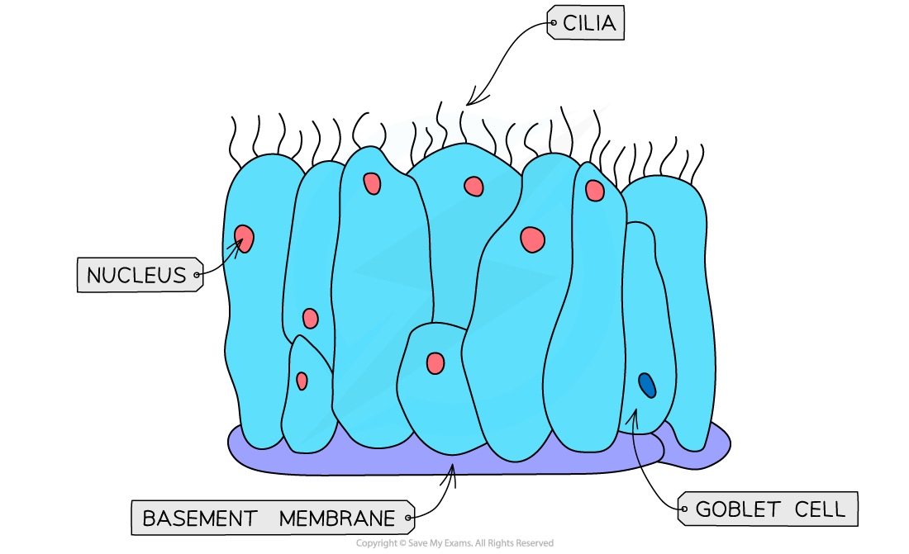

# Distribution of Tissues

## Distribution of Tissues in the Gas Exchange System

> **Spec point** — `spcpt_q3qTfdgqW88WdZCf` · describe the distribution in the gas exchange system of cartilage, ciliated epithelium, goblet cells, squamous epithelium of alveoli, smooth muscle and capillaries

## Distribution of tissues in the gas exchange system

### Cartilage

- **Cartilage** is a strong and flexible tissue found in various places around the body

  - Cartilage forms **'c' shaped rings** that are arranged along the **trachea**, called tracheal rings
  
    - These rings help to **support the trachea** and ensure it **stays open**, while allowing it to move and flex while we breathe
  - Cartilage **also supports the bronchi**, though it does not form c-shaped rings here
  - Cartilage is **not found in the bronchioles**

### Ciliated epithelium

- **Ciliated epithelium** is a specialised tissue which lines **all of the tubes of the airways**

  - Each cell has small projections of **cilia**
  - The cilia sweep mucus, dust and bacteria upwards and away from the lungs and the epithelium itself

*Ciliated epithelium showing cilia, basement membrane, goblet cell and nucleus*

### Goblet cells

- **Goblet cells** can be found scattered throughout the **ciliated epithelium in the trachea**, and also in the **bronchi, **though usually **not in the bronchioles**

  - They are **mucus-producing cells** that secrete viscous mucus
  - This mucus traps dust, bacteria and other microorganisms and prevents them from reaching the lungs
  - The mucus is then **swept along by the cilia** of the ciliated epithelium upwards and is swallowed
  - The mucus and any microorganisms will then be destroyed by the acid in the stomach

### Squamous epithelium of alveoli

- The alveoli have a lining of thin ***squamous epithelium***, that allows for gas exchange

  - The squamous epithelium forms the structure of the **alveolar wall **and is very thin and permeable for the easy diffusion of gases

### Smooth muscle

- **Smooth muscle** can be found in the walls of the **trachea, bronchi **and** bronchioles**

  - It helps to **regulate the flow of air** into the lungs by relaxing when more air is needed and constricting when less air is needed

### Capillaries

- Each alveolus is surrounded by an extensive **network of capillaries**

  - Carbon dioxide diffuses out of the capillaries and into the alveoli to be exhaled, while oxygen diffuses the other way from alveoli and into the capillaries to be carried around the body
  - These capillaries have a diameter of around 7 µm, which is only wide enough for red blood cells to pass through in single file
  
    - This ensures that there is sufficient time and opportunity for gas exchange to occur

> **Worked Example**
> **Explain how the lining of the trachea, bronchus and bronchioles provide protection against pathogens**
> 
> - Cilia beat to move mucus away from the lungs and up towards the mouth
> - Mucus is produced by goblet cells and acts as a barrier to pathogens from entering the ciliated epithelium
> - The mucus also traps bacteria and microorganisms, while blood vessels bring macrophages to engulf any pathogens in phagocytosis
