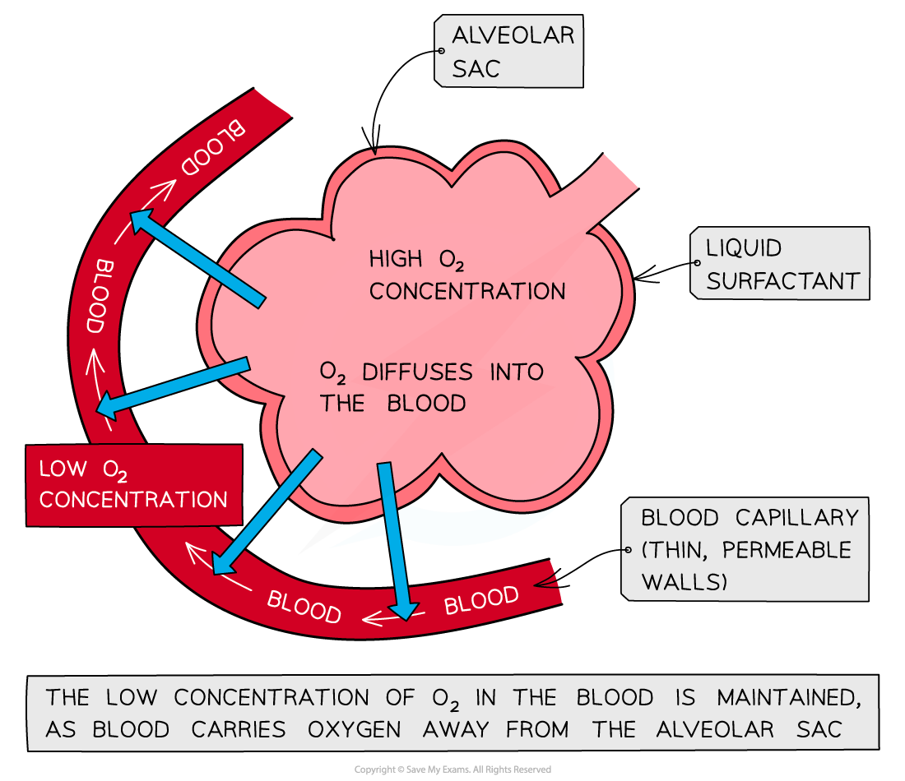

# Gas Exchange Processes

## Gas Exchange Processes

> **Spec point** — `spcpt_tnh77qNjJMGS9R49` · describe gas exchange between air in the alveoli and blood in the capillaries

## Gas exchange processes

- The exchange of oxygen and carbon dioxide occurs between the **alveoli** and the **capillaries** in the lungs
- Oxygen and carbon dioxide are exchanged in a process of simple** diffusion**

  - This is a passive movement from high to low concentration
- The air in the alveoli contains a **high concentration of oxygen**

  - The oxygen diffuses from the alveoli and into the blood capillaries, before being carried away to the rest of the body for aerobic respiration
- The blood in the capillaries has a relatively low concentration of oxygen and a high concentration of carbon dioxide

  - The carbon dioxide diffuses from the blood and into the alveoli and is then exhaled

*The movement of blood through the capillaries surrounding the alveoli maintains a concentration gradient to drive diffusion of oxygen into the blood*

| **Feature of alveoli** | **Importance** |
|---|---|
| Large surface area | The average human adult has around 480-500 million alveoli in their lungs  This equals a surface area of 40-75m2  This enormous surface area increases the space available for oxygen and carbon dioxide to diffuse |
| Thin walls | The walls of the alveoli are only one cell thick  This means that gases have a very short diffusion distance and so gas exchange is as quick and efficient as possible |

> **Exam Hint**
> Remember that blood arriving to the lungs in capillaries is deoxygenated, while blood leaving the capillaries is oxygenated and returns to the left side of the heart.
> 
> You don't need to know how many alveoli there are for your exam, or their total surface area—these are only included here to show you just how large a surface area they have in total!
