# Recognising Tissues

## Recognising Tissues in the Gas Exchange System

> **Spec point** — `spcpt_GjNN4GnN2hWNjFDp` · recognise cartilage, ciliated epithelium, goblet cells, squamous epithelium of alveoli, smooth muscle and capillaries in microscope slides, photomicrographs and electron micrographs

## Recognising tissues in the gas exchange system

### Cartilage

- The cartilage in the trachea has a ‘glassy’ appearance due to its translucent *protoplasm*
- It contains no nerves or blood vessels

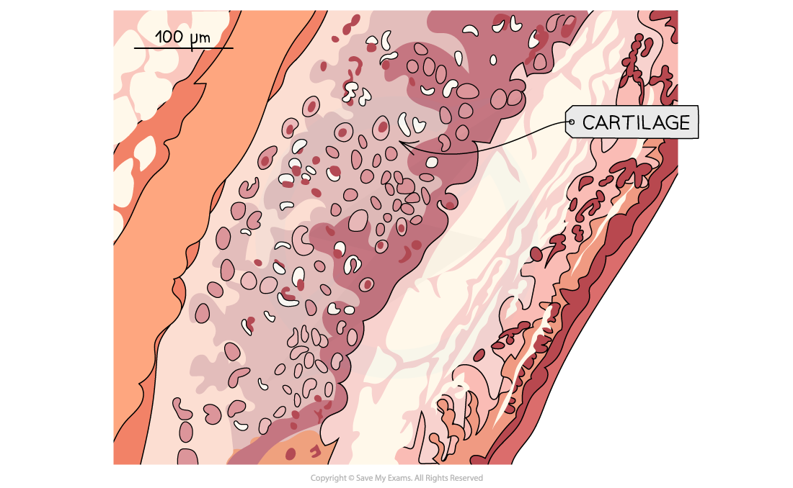

*Photomicrograph of cartilage tissue in the gas exchange system*

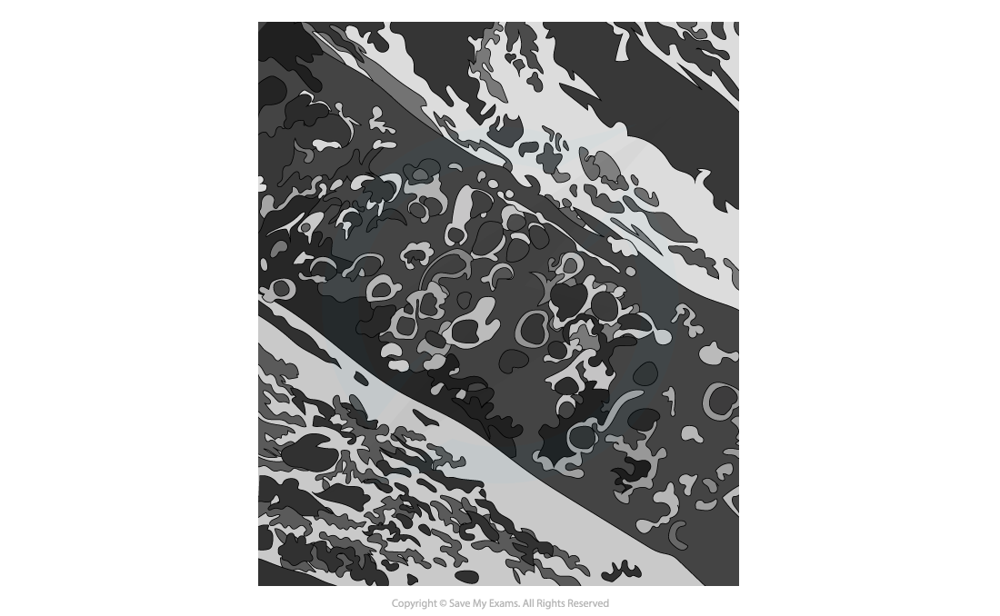

*Electron micrograph of cartilage tissue in the gas exchange system*

### Ciliated epithelium

- **Ciliated epithelial cells** are distinctive due to their:

  - Narrow cell bodies
  - Hair-like cilia located along the *apical layer*
- The cilia are tiny hair-like projections that beat to sweep mucus (with trapped dust and pathogens) up and away from the lungs

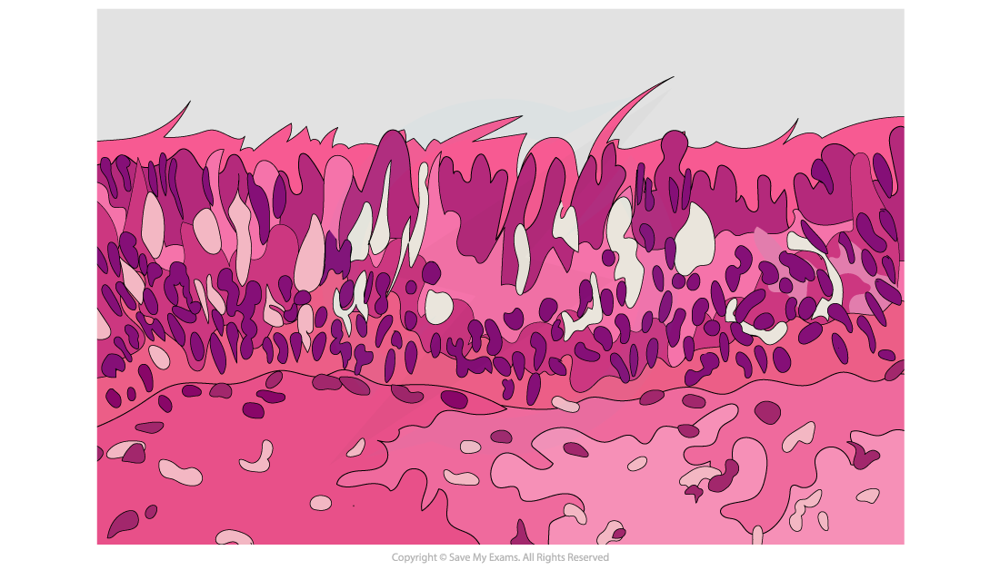

*Photomicrograph of ciliated epithelium tissue in the gas exchange system*

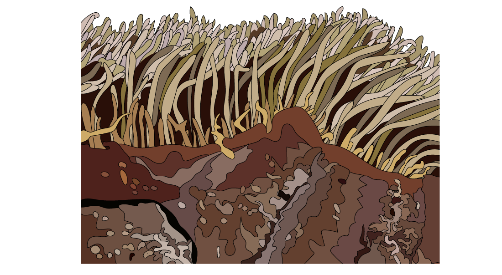

*Electron micrograph of ciliated epithelium tissue in the gas exchange system*

### Goblet cells

- **Goblet cells** can be found scattered among the ciliated epithelium of the trachea and bronchi
- They are distinctive in the epithelium due to their **lack of cilia**
- The nucleus is found towards the basal (bottom) layer of the cell, with a large Golgi apparatus and mucus granules found towards the apical layer

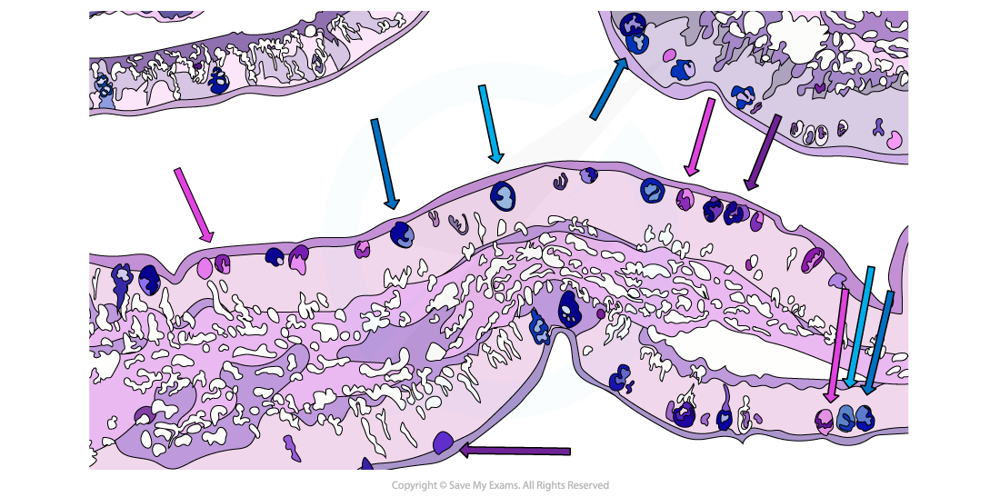

*Photomicrograph of goblet cells in the gas exchange system*

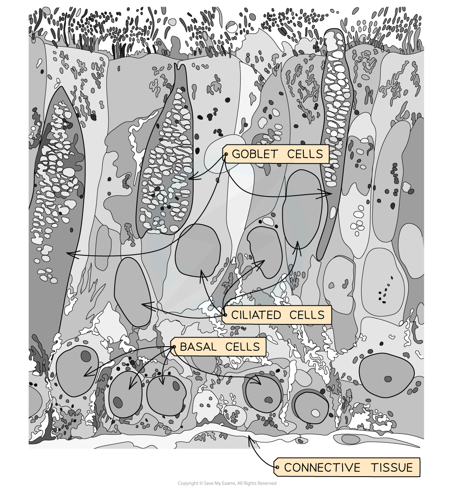

*Electron micrograph of goblet cells in the gas exchange system*

### Squamous epithelium of alveoli

- Squamous epithelium is made of thin, flat *squamous cells*

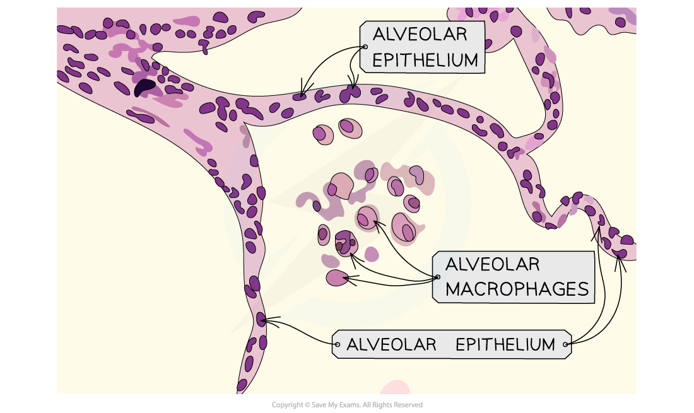

*Photomicrograph of squamous epithelium in the gas exchange system*

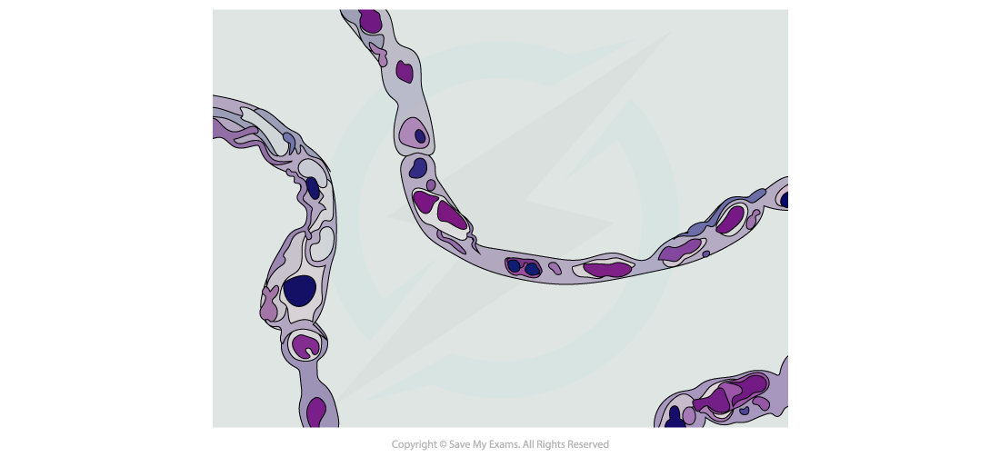

*Electron micrograph of squamous epithelium in the gas exchange system*

### Smooth muscle

- The cells of **smooth muscle** are tightly packed and are found beneath the ciliated epithelium
- Unlike skeletal muscles, they are **not striated** and so don’t show any cross stripes under a microscope

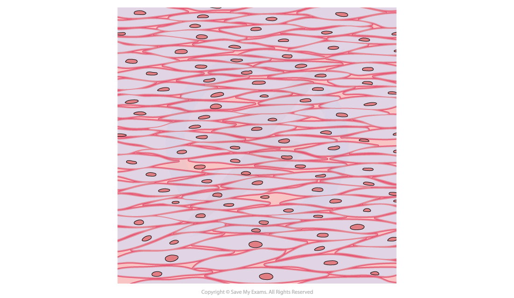

*Photomicrograph of smooth muscle in the gas exchange system*

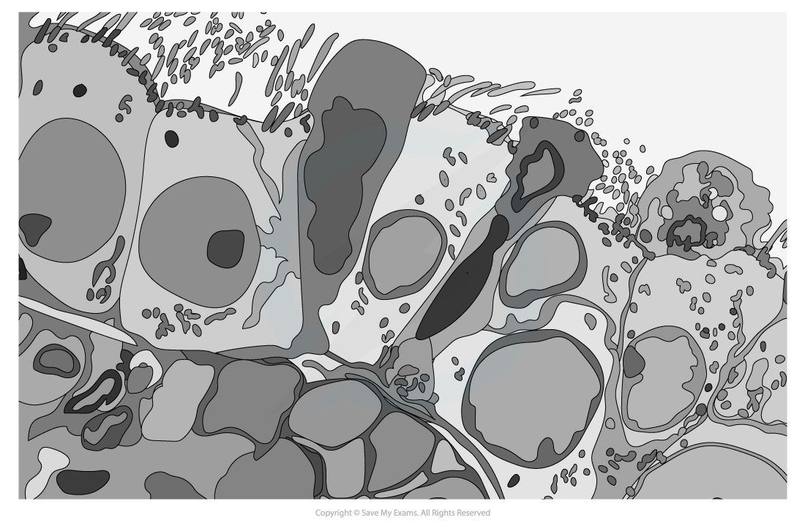

*Electron micrograph of smooth muscle in the gas exchange system*

### Capillaries

- **Capillaries** are distinctive from other blood vessels due to their tiny diameter (about 7 μm, roughly one red blood cell wide)
- Their walls consist of a single layer of epithelial cells

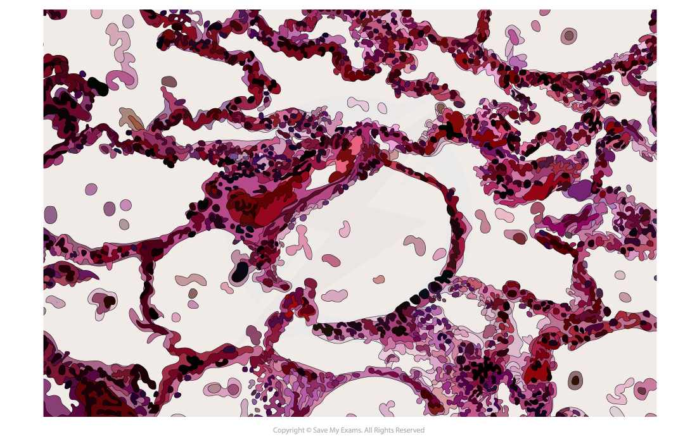

*Photomicrograph of capillaries in the gas exchange system*

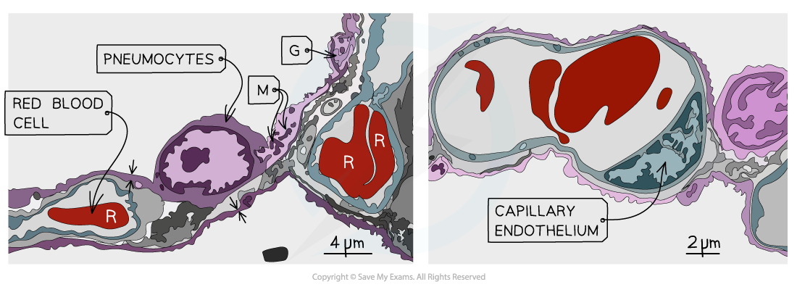

*Electron micrograph of capillary tissue in the gas exchange system*
