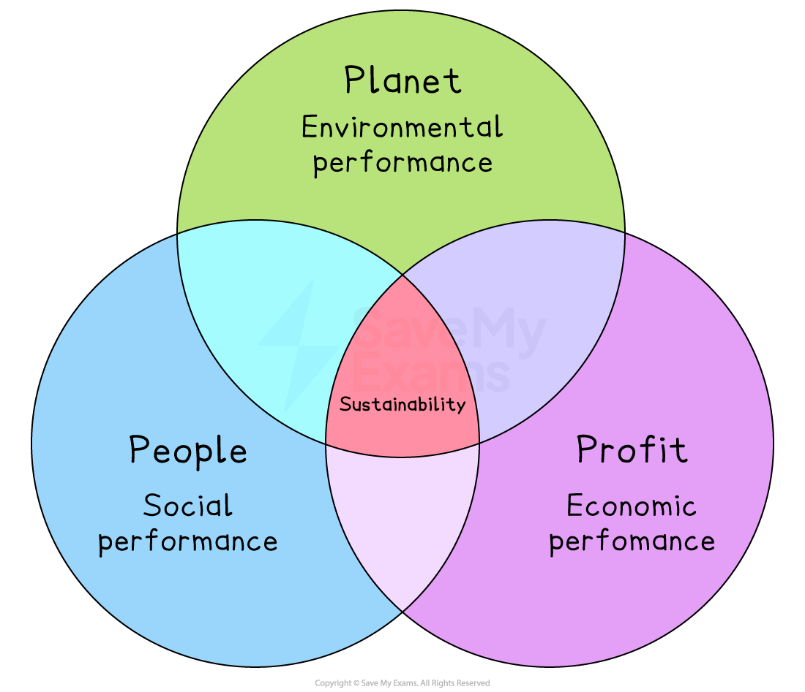

# Corporate Social Responsibility and Elkington's Triple Bottom Line

## An Introduction to Corporate Social Responsibility

> **Spec point** — `spcpt_jJ8xj93jK5SC2ZMF`

## An introduction to corporate social responsibility

- **Corporate Social Responsibility (CSR) **refers to the concept that businesses have a responsibility to consider and positively impact society** beyond their economic interests**
- It is a framework through which companies **voluntarily integrate social and environmental concerns** into their business operations and interactions with stakeholders

*Corporate social responsibility goals can be focused on a range of different stakeholders*

- CSR involves taking into account the** impact of business activities on various stakeholders**, including employees, customers, communities, the environment, and society at large
- CSR **goes beyond legal compliance** and strives for companies to actively contribute to sustainable development and societal well-being

### Examples of socially responsible activities

#### Sustainable sourcing of raw materials and components

- Japanese fashion retailer **Uniqlo** has moved towards an eco-friendly strategy in recent years, focusing on technologies that make the production of **new clothing from recycled materials** possible

#### Responsible marketing

- **Marks and Spencer **ensures that it never actively directs any marketing **communications to children under the age of 12 **and does not directly advertise any products high in fat, sugar or salt to children under the age of eighteen

#### Protecting the environment

- Multinational coffee chain **Starbucks** offers discounted coffee for customers
with a branded multi-use cup

#### Responsible customer service

- *John Lewis's* famous 'Never Knowingly Undersold' slogan refers to the company's commitment to **checking competitor prices regularly** to ensure that the price its customers pay is the lowest available in the local area at that time

## Reasons for Implementing CSR

> **Spec point** — `spcpt_JzK2cXxK79pqW7xS`

## Reasons for implementing CSR

- Business set ethical or socially responsible objectives for a range of sound **commercial **reasons
- Common reasons that support setting CSR objectives include:

1. **Improved reputation**

  - CSR can **enhance** the business image and reputation and improve its attraction to many **stakeholders**
  
    - Operating in a socially responsible way is likely to be attractive to both existing and potential **customers**
    - It should lead to positive **media** coverage
    - The business may be able to retain and attract quality **workers** to fill job roles
    - It may be looked upon favourably by **investors**, especially those who prefer ethical investment
2. **Added value**

  - CSR can be very profitable as it ***adds value***
  
    - In competitive markets, CSR can provide a differentiating **USP** that may mean the business can use** premium pricing**
    - E.g., Tony's Chocolate's, whose mission is to be commercially successful whilst being committed to using cocoa only from slavery-free sources,** is able to charge around 200% more** for its products than its mass market rivals
3. **Employee morale and motivation**

  - CSR may improve employee **motivation** and **productivity**
  
    - Workers are more likely to feel **connected** to a business that 'does the right thing' and may be more inclined to work hard to ensure that the business is a success
    - Employees are also **less likely to leave** the business or take time off work
4. **Solve social problems**

  - CSR may help to solve **social problems,** e.g. resource depletion
  
    - Businesses that adopt CSR objectives are likely to understand that they can play a key role in **solving some of the emerging social, ethical and environmental problems** faced by communities around the world
    - E.g., Businesses that look to minimise the use of fossil fuels in production processes will be making a small contribution to global efforts to combat climate change

## Elkington's Triple Bottom Line

> **Spec point** — `spcpt_875g57BKRC6wbmZv`

## Elkington's triple bottom line

- **The Triple Bottom Line model **highlights that business performance may be measured in a number of ways in relation to

  - Its** finances (Profit)**
  - Its** environmental impact (Planet)**
  - How **socially responsible** it is in relation to employees** (People)**
- Elkington argued that only a company that was measuring performance in all three areas of **people, profit and planet** was considering the **full costs of its activities**

  - If all these areas are measured, business owners and employees are likely to pay attention to them and **change their behaviour **accordingly,  rather than just focusing on profit
  - As a result, ***sustainability*** both within the business and, if adopted widely, across the economy as a whole, should be improved

#### Elkington's triple bottom line

*Elkington's Triple Bottom Line model suggests that businesses should consider their impact on people and the environment alongside financial metrics to fully understand their performance*

> **Exam Hint**
> You should consider both the short-term and long-term impacts of adopting a socially responsible approach. Whilst costs of implementing socially responsible policies may be significant in the short term and cause disruption as change is implemented, business sustainability is likely to be improved, and, over time, a better business reputation can be a key factor in increasing sales.
