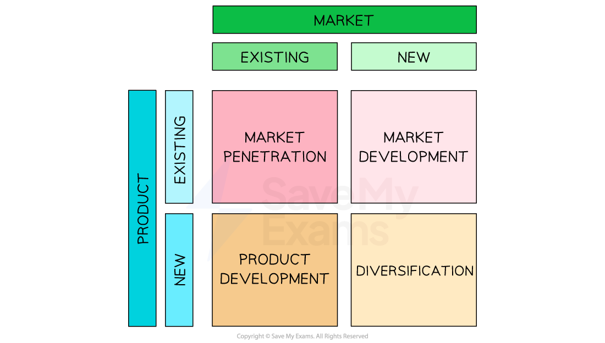

# Ansoff Matrix

## An introduction to the Ansoff Matrix

> **Spec point** — `spcpt_RJ7pFCGVKH6bzcbj`

## An introduction to the Ansoff Matrix

- Ansoff’s Matrix is a tool for businesses who want to grow quickly and have a **growth objective**
- It is used to identify an **appropriate strategic direction** and identify the **level of risk** associated with the chosen strategy
- The model considers four elements, which are broken down into two categories

  - **The market **- existing and new markets
  - **The product** - existing and new products

#### Ansoff's strategic matrix

*Ansoff’s strategic matrix identifies strategies for growth, depending on whether the product and market already exist or are new*

## Market penetration

> **Spec point** — `spcpt_Fr96RrnX7tbcgFbW`

## Market penetration

- Market penetration is the **least risky** strategy to achieve growth

  - It involves **selling more products to existing customers** by encouraging
  
    - **More regular use** of the product
    - **Increased usage** of the product
    - ***Brand loyalty*** of customers

> **Case Study**
> **Coca-Cola’s 'Share a Coke' campaign**
> 
> Instead of launching a new drink, Coca-Cola ran its “Share a Coke” campaign in existing markets (e.g. the USA, UK, Australia) which involved printing popular first names on Coke bottles
> 
> 
> 
> **Why it worked**
> 
> 1. **Increased purchase frequency**
> 
>   - Customers looked for bottles with their own name or their friends’ names, so they bought more Coke than before
> 2. **Free publicity and excitement**
> 
>   - People shared pictures of personalised bottles on social media, drawing in even more buyers without extra advertising costs
> 3. **Stronger brand loyalty**
> 
>   - Customers felt a personal connection to the brand, which made them choose Coke over other drinks more often
> 
> **Outcome**
> 
> - Coca-Cola achieved double-digit growth in mature markets

## Market development

> **Spec point** — `spcpt_WpCPCChkQM4HfXMk`

## Market development

- **Market development** involves finding and exploiting **new market opportunities for existing products **by

  - Entering new markets **abroad**
  - **Repositioning** the product by selling to different **customer profiles** (selling to other businesses as well as direct to consumers)
  - Seeking **complementary locations**
  
    - E.g. M&S Food has achieved significant growth since teaming up with fuel retailers such as BP and Applegreen and providing express retail outlets

> **Case Study**
> **Netflix expanding into new countries**
> 
> In 2016, Netflix launched its video-streaming service in over 130 new countries at once, using the same platform and content library it had in the US
> 
> 
> 
> **Why it worked**
> 
> 1. **Known brand and proven model**
> 
>   - Customers in new markets trusted a familiar name and understood how streaming worked
> 2. **Local partnerships**
> 
>   - Netflix struck deals to use regional payment systems and worked with local internet providers to ensure smooth playback
> 3. **Subtitle and dubbing**
> 
>   - By adding subtitles and voice-overs in many languages, Netflix made its existing shows accessible to viewers around the world
> 
> **Outcome**
> 
> - Within a year, Netflix gained millions of subscribers outside the US, turning international customers into a major source of revenue with limited changes to its product

## Product development

> **Spec point** — `spcpt_qRtQFZpJ2mGNHWVM`

## Product development

- **Product Development **involves selling** new or improved products to existing customers **by

  - Developing **new versions or upgrades** of existing successful products
  - **Redesigning packaging** and aesthetic features
  - **Relaunching heritage products** at commercially convenient intervals
  
    - E.g. Lindt relaunches Christmas-themed products each year, often with a subtle design change, to recapture the interest of customers

> **Case Study**
> **Lego launches Lego Boost**
> 
> After many families already bought classic Lego bricks, Lego introduced a robotics kit that lets children build and programme moving models using the familiar Lego system
> 
> **Why it worked**
> 
> 1. **Existing customer base**
> 
>   - Parents and children who already own Lego sets were eager to try a new, technology-driven Lego product
> 2. **Complementary features**
> 
>   - Boost combines traditional building with coding lessons, making it both a toy and an educational tool
> 3. **Brand trust**
> 
>   - Lego’s reputation for quality and creativity encouraged buyers to choose Boost over other robotics kits
> 
> **Outcome**
> 
> - Lego Boost sold strongly to families who already purchased standard Lego sets, increasing overall revenue without needing to find new customers

## Diversification

> **Spec point** — `spcpt_27cRP83KmDHKkvwy`

## Diversification

- **Diversification** is the **most risky** growth strategy as it involves** targeting new customers with entirely new or redeveloped products**

  - Examples of diversification include
  
    - UK supermarket** Tesco** launching a range of financial products including current accounts and credit cards
    - Café chain** Greggs **launching a range of **themed clothing products**

> **Case Study**
> **Tesco goes mobile**
> 
> In 2003, after becoming a leading supermarket chain, Tesco created **Tesco Mobile**, a mobile phone network that offers pay-as-you-go and contract plans
> 
> 
> 
> **Why it worked**
> 
> 1. **Trusted brand**
> 
>   - Shoppers who already liked Tesco felt comfortable signing up for a mobile service under the same name
> 2. **Convenience for customers**
> 
>   - Tesco Mobile bills and top‐ups can be managed online or at any Tesco store
>   - This made it easy for customers to handle both groceries and phone service in one place
> 3. **Cross‐promotion**
> 
>   - Tesco used Clubcard points to reward mobile customers, encouraging supermarket shoppers to try its phone plans
> 
> **Outcome**
> 
> - Tesco Mobile attracted millions of subscribers in the UK and became a successful new income stream from its existing customer base
