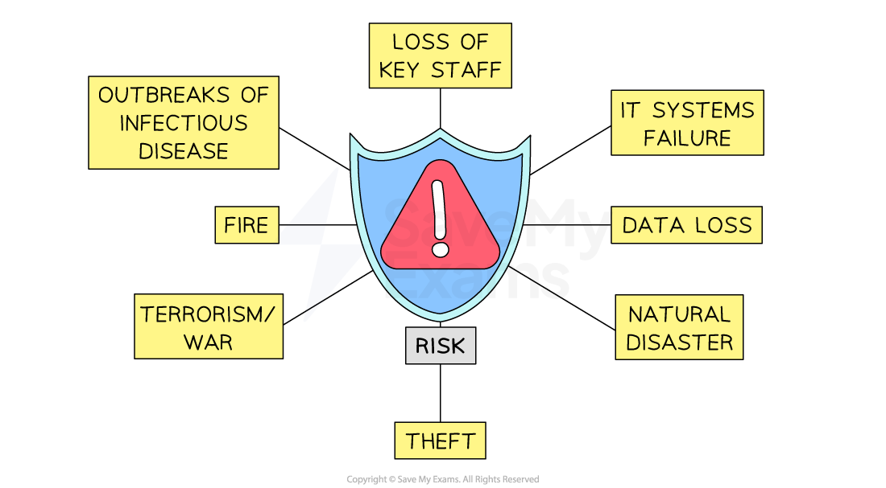

# Contingency Planning and Crisis Management

## Contingency planning

> **Spec point** — `spcpt_B923cz5QCqQBnwZf`

## Contingency planning

- **Contingency planning **involves a business  predicting risky or unwanted events, then developing a set of suitable responses

  - *R****isk assessments*** of potential disruptions and impacts are carried out
  - Procedures commonly cover risks such as fire or weather-related emergencies
  
    - Evacuation plans are drawn up and practised
    - Key staff are given emergency responsibilities
    - Alarm systems are tested
    - Preventative measures protect stock and equipment, e.g. installation of fireproof doors
- Contingency planning can **help a business to survive and recover** from a period of crisis

  - However, drawing up detailed contingency plans **requires** **time and investment**

#### Evaluating contingency planning

| **Factor** | **Benefits** | **Limitations** |
|---|---|---|
| **Time** | - Helps businesses to **respond immediately**    - Clear staff roles & responsibilities   - Resources are identified and available   - Procedures are shared in advance | - A **time-consuming** process    - Risk assessment takes valuable management time   - Plans need to be revisited regularly   - Staff require training |
| **Cost** | - Can **reduce costs**    - Emergency equipment/resources are **purchased in advance**   - Financial losses are likely to be lower | - Spending on resources needed in a crisis may be **wasted if not needed** - **Difficult to budget** for unknown crisis situations |
| **Safety** | - **Procedures** keep stakeholders such as staff and customers safe    - Training increases awareness   - Legal obligations should be met (e.g. fire regulations) | - ***Bureaucratic*** and difficult to implement swiftly - **Leadership and compliance** from staff or other stakeholders is needed |
| **Risk** | - **Most likely threats** are considered in detail    - Reduces **legal risks** if procedures are followed | - Requires **up to date **and **complete information** to be effective - **Human reactions** such as fear and panic cannot be fully mitigated |

## Crisis management

> **Spec point** — `spcpt_cMRfbn7Vc5n4JBfb`

## Crisis management

- **Crisis management** refers to the** immediate **handling of a **disruptive and unexpected event**

  - It includes communication, coordination, resource mobilisation and decision-making under pressure
  
    - Short-term **significant disruption** is likely and long-term business **survival **is affected
    - **Radical solutions** such as **autocratic leadership **and **centralised** **decision-making **could ensure **business continuity**
    - Work activity may need **rapid reorganisation**
    - E.g. many businesses swiftly implemented remote working for staff during the Covid-19 pandemic

#### Examples of crisis situations

*Businesses face threats from a range of sources including IT systems failure, natural disasters and theft*

- Crises do not have to be large-scale

  - The unexpected loss of a *CEO*, a warehouse fire, or an outbreak of infection within a business can cause a significant crisis that requires a prompt, transparent, and well-communicated response
  - Losing customers' data could be **classed as a crisis** requiring immediate response from management

#### Factors affecting crisis management

| **Speed** | **Transparency** |
|---|---|
| - A rapid response can **contain or reduce damage** - E.g. **Procter and Gamble**'s crisis team responded rapidly when a viral challenge encouraged teenagers to film themselves eating *Tide Pods* detergent    - It quickly published warnings and updated disclaimers on its website   - This quick response protected P&G from legal action | - Keeping customers informed and telling the truth can **protect reputation** - E.g. Supply issues in 2018 caused **KFC** to run out of chicken, leading to the temporary closure of half of its UK outlets    - It used humour on social media to keep customers informed   - It apologised and quickly addressed customer concerns, turning the negative story into positive PR |
| **Control** | **Communication** |
| - Ensuring that leaders have the **authority **and** resources** to perform at the highest level in a crisis - E.g. **Walmart**'s Emergency Operation Center** **operates 24 hours a day    - It manages the company's response to events that could affect operations   - Coordinated by senior Walmart leaders, it can assemble support teams immediately | - The rapid issue of press releases can **reassure stakeholders **and **reduce recovery time** - E.g. **Scandinavia Airlines (SAS)** used social media effectively during the 2010 Icelandic volcanic ash cloud crisis    - Customers were directed to SAS's Facebook page   - Staff responded to every message, comment and post   - Problems were solved immediately; regular updates kept customers satisfied |

- Crisis management and contingency planning **cannot eliminate the risk of business disruption**

  - Even the best plans can go wrong when a crisis hits
- The fact that businesses engage in this kind of planning does provide significant benefits, including

  - Business ***resilience ***can be improved
  - Negative impacts may be reduced
  - Stakeholders are likely to have greater** confidence** in the business
