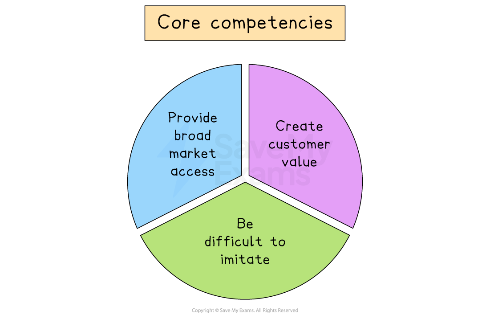

# Core Competence Framework

## The Core Competence framework

> **Spec point** — `spcpt_NZVyq5rmPFTtjzWh`

## The core competence framework

- **Core competencies** are the capabilities critical for a business to achieve competitive advantage by delivering real value to customers

  - **Collective learning**, which is the business's knowledge, including assets such as patents and designs as well as industry know-how, built up over time
  - **Technical skills**, which includes production skills, unique processes and applications of technology
- The combination of collective learning and technical skills create a unique package which **forms the basis of a business's core products**

### The features of core competencies

- A business may have numerous strengths, but they may not be true core competencies

  - In order to be considered core competencies, strengths must possess **three key features**

#### Features of core competencies

*Core competencies must provide broad market access, create customer value and be difficult to imitate*

1. **Provide broad market access**

  - A core competency must apply across a range of products, services or geographic markets, not just one niche
  
    - Spreading the cost of building that skill or technology over many products makes it valuable and efficient
    - E.g. **Sony**’s expertise in miniaturised electronics led to the Walkman, then the Discman and portable radios and finally to compact digital cameras, each product benefiting from the same engineering know-how
2. **Create customer value**

  - The competency must directly improve something that customers care about, such as performance, reliability, ease of use, brand prestige or cost savings
  
    - If it doesn’t translate into a clear advantage in the market, such as higher price, greater loyalty or stronger reputation, it won’t help achieve long-term success
    - E.g. **Dyson**’s digital motor technology gives its vacuum cleaners consistently higher suction power and energy efficiency, features that customers recognise and will pay a premium for
3. **Be difficult to imitate**

  - True core competencies are a combination of specific knowledge, unique culture, protected *intellectual property* or complex processes that rivals can’t copy quickly or cheaply
  
    - If competitors can replicate strengths overnight, a business loses its  advantage
    - E.g. **Google**’s search-ranking algorithms combine years of data-science research, a huge database of user-behaviour data and enormous server networks, components no newcomer can assemble easily or at low cost

#### Benefits of developing core competencies

| **Benefit** | **Explanation** | **Example** |
|---|---|---|
| **Sustainable differentiation** | - Core competencies give a business a unique strength that rivals find hard to copy, so its products stand out in the market | - **Lego** uses its creative design skills and partnerships to develop ranges, such as Star Wars and Harry Potter sets, offering toys no other company can match |
| **Cost efficiency and scale** | - Streamlined processes and shared know-how lower the *unit cost*, enabling the business to produce more cheaply | - **McDonald’s** standardised kitchen layouts, cooking methods and training mean it can serve millions of burgers at low cost worldwide |
| **Easier market expansion** | - Core competencies can be applied to launch new products or enter new markets quickly and with greater confidence | - **Unilever** uses its expertise in branding and *distribution *to introduce items like Dove deodorant or Ben & Jerry’s ice cream into new markets |
| **Continuous innovation** | - A strong core competence encourages ongoing *R&D* and experimentation, keeping the business ahead of changing trends | - **3M’s** innovation culture has produced inventions from Post-it Notes to advanced medical tape, helping it stay relevant over decades |

### Problems with developing core competencies

- **Loss of crucial skills through outsourcing**

  - Paying other firms to handle key tasks can mean losing in-house know-how needed to fix problems fast
  
    - E.g. **Boeing** outsourced large parts of its 787 Dreamliner and then struggled to solve quality issues when they arose
- **Becoming outdated as markets change**

  - Developing a core competency takes time and money
  - Rapid shifts in technology or tastes can make it useless
- **High initial cost with no guaranteed reward**

  - Large investments in new technology or processes may never pay off if rivals catch up or demand stays low
- **Inflexibility**

  - Over-focusing on one core competency can blind a company to new opportunities, making it slow to adapt
  
    - E.g **Nokia **stuck with its Symbian phones and was too late to the touchscreen smartphone market
