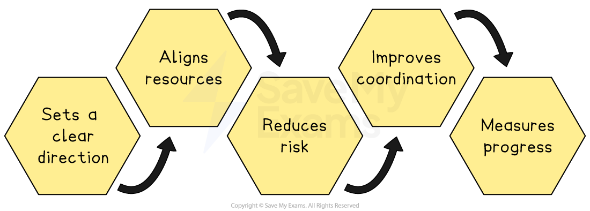
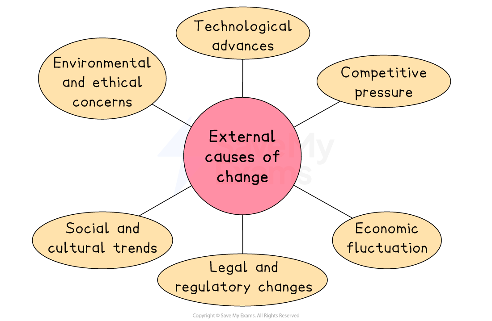

# Corporate Planning and Culture

## The importance of corporate planning

> **Spec point** — `spcpt_RK2KH7c6W2hQ6BnC`

## The importance of corporate planning

- Corporate planning is the process taken by senior managers to decide on **long-term goals**, such as growth targets, new products or entry into new markets
- They then draw up **broad plans** for how the **entire organisation** will achieve them

### Why corporate planning is important

*Corporate planning reduces risk, sets direction and improves coordination*

- **Sets a clear direction**

  - It tells every department what the company aims to do over the next few years, so everyone works toward the same goals
- **Aligns resources**

  - By knowing its main priorities, the firm can decide how to use its money, staff and equipment most effectively
- **Reduces risk**

  - Thinking ahead helps managers spot potential problems, such as a rival launching a similar product
  - They can then build in safeguards, such as securing *supply contracts *early
- **Improves coordination**

  - When marketing, production, finance and other areas all follow the same long-term plan, there are fewer conflicts and overlaps as each team understands its role
- **Measures progress**

  - With defined long-term targets in place, the business can track whether it is on course, spotting issues early and adjusting the plan if needed

## The management and control of strategic change

> **Spec point** — `spcpt_GWftNnhdB6nZpTdz`

## The management and control of strategic change

- Strategic change is a **major shift **in a company’s **long‐term direction**
- It involves altering the firm’s goals, core policies or scope, such as entering new markets, adopting new technology or changing how the business competes

#### Benefits of strategic change

| Change | Explanation |
|---|---|
| **Adapting to market change** | - Keeping up with new tastes, technologies or laws so products and services stay relevant, attractive and legal |
| **Continuous improvement** | - Regularly refining processes and products to cut costs and raise quality over time |
| **Driving innovation and growth** | - Using change to develop new ideas and open additional *revenue streams* or markets |
| **Managing risks** | - Updating systems and practices to prevent problems such as security breaches or supply chain breakdowns |
| **Engaging employees** | - Involving staff in improvement projects to build their skills and improve motivation |

### Types of strategic change

#### 1. Incremental change

- A series of small, gradual improvements to processes, products or structures rather than a single large overhaul
- Incremental change is valuable for several reasons

  - **Lower risk**
  
    - Small steps are easier to test and reverse if they don’t work
  - **Staff acceptance**
  
    - Gradual change gives employees time to adapt, so there is likely to be less resistance
  - **Cost-effective**
  
    - Small tweaks usually use existing resources, avoiding the need for significant capital expenditure
  - **Cultivates improvement**
  
    - The habit of regular review helps catch minor issues before they grow

#### 2. Disruptive change

- A radical shift that transforms an industry or market by introducing a new business model, technology or way of operating
- Disruptive change is valuable for several reasons

  - **First mover advantage**
  
    - Being the first with a major innovation can secure *market leadership* and build strong brand recognition
  - **Rapid growth potential**
  
    - Making a new market or completely changing an existing one can earn a business significantly more revenue
  - **Outpacing rivals**
  
    - Disruption can leave slower competitors struggling to catch up, increasing a business's market power
  - **Long-term resilience**
  
    - A bold reinvention can protect against future changes

> **Case Study**
> **Disruptive change at Netflix**
> 
> 
> 
> - In 2007, Netflix shifted from mailing DVD rentals to offering on-demand streaming online
> - Subscriber numbers surged, Netflix overtook traditional rental firms, and it built a platform for producing original shows, securing its long-term position

### Causes of change

#### 1. Internal causes of change

- **Leadership change**

  - New leaders often reshuffle teams and priorities to match their own ideas and goals
- **Technology upgrade**

  - Installing new software or machines to speed up tasks and meet customers’ digital needs
- **Poor performance**

  - Closing or overhauling parts of the business that keep losing money to protect overall profits
- **Employee-driven improvement**

  - Collecting staff suggestions for small, ongoing changes that boost quality and efficiency

#### 2. External causes of change

*Change can occur as a result of competitive pressure, legal or economic developments*

- **Technological advances**

  - New technologies, such as smartphones or *cloud computing*, create opportunities for new services and improved processes
- **Competitive pressure**

  - Actions by rival firms force a business to change its product range or operations to stay competitive
- **Economic fluctuations**

  - Shifts in the economy, like *recessions* or *booms*, require businesses to cut costs or increase capacity
- **Legal and regulatory changes**

  - New laws or regulations may require businesses to alter their processes, products or policies
- **Social and cultural trends**

  - Changes in consumer values and lifestyles prompt firms to adapt products or marketing to new expectations
- **Environmental and ethical concerns**

  - Pressure to reduce environmental impact or act responsibly leads to changes in materials, processes or products

### Resistance to change

- Resistance to change is the **unwillingness to adapt to new circumstances or ways of doing things **as a result of

  - **Self-interest**
  
    - People worry that change could threaten their job, status or pay.
    - It’s natural to protect what you value most.
    - If staff feel little loyalty, they’ll put their own needs first
  - **Fear and misunderstanding**
  
    - Employees may not know why change is needed or have the wrong facts.
    - Without a clear reason, it’s easy to believe  that everything’s fine as it is
    - Sometimes people convince themselves the old way works better than it actually does
  - **Different assessments**
  
    - Not everyone agrees on what the problem is or how to fix it
    - Some may back a completely different solution
    - This isn’t just self-interest; it’s genuine debate over what’s best for the business
  - **Prefer things as they are**
  
    - Many prefer routine and feel uneasy about new ways of working
    - Past bad experiences can make people extra wary
    - If it feels risky, staff tend to resist even small changes

#### Overcoming resistance to change

- Managers can take a range of steps to overcome workers' resistance to change

| **Steps** | **Explanation** |
|---|---|
| Meet one-on-one with concerned employees | - Talk privately to understand their specific worries and build trust |
| Listen to and address fears | - Hear out concerns about job security or increased workload and explain how the change can help |
| Show how change benefits individuals | - Explain personal gains, such as new skills, safer equipment or clearer career paths |
| Offer incentives for early adopters | - Provide *bonuses*, public praise or other rewards to those who support and champion the change |

## The importance of corporate culture

> **Spec point** — `spcpt_Nwy4kfbz4w5FGP9Y`

## The importance of corporate culture

- Culture refers to the **personality** of an organisation

  - This includes **shared values, beliefs, attitudes and practices** that shape the **way people work together **within an organisation

- In businesses with a **strong culture**, it is likely that employees

  - Are **united** and **support the mission** of the business
  - Have a **'can do' attitude** and are **enthused** by their work
  - Have a strong **belief **that the business is a force for good
- In a **business with a weak culture,** these **signs may be difficult to identify**

  - A '**them and us' attitude** may exist between workers and management
  - Employees may **doubt the sincerity** of the corporate mission
  - High levels of **staff turnover** and **low commitment **amongst staff may exist

### How culture affects decisions

- Corporate culture acts like a set of** unwritten rules**
- It can speed up or slow down decisions, shape how bold managers are, and determine whether ethics and staff views matter

| **Effect of culture** | **Explanation** |
|---|---|
| **Risk appetite and innovation** | - A culture that values creativity encourages managers to try new ideas (e.g. launch a bold product) - A very cautious culture may delay decisions or stick with familiar products, even if the market changes |
| **Speed of decision-making** | - When people trust each other and communicate openly, decisions can be made quickly without many approvals - In a *hierarchical culture*, every choice may need to be signed off by a senior manager, slowing the response to competitors or market shifts |
| **Ethical and social responsibility** | - If the culture stresses honesty and caring for the community, managers consider ethics, such as choosing fair-wage suppliers or limiting pollution - If profit is the only focus, ethical issues may be ignored, risking legal trouble or bad publicity |
| **Employee morale and involvement** | - A supportive culture that listens to staff ideas leads to better decisions, as employees often spot problems or opportunities first - If staff feel ignored, managers miss useful feedback, leading to lower motivation and poorer choices |
| **Consistency and brand image** | - A strong culture ensures that all departments follow the same principles - E.g. If exceptional customer service is part of the culture, both marketing and operations will train staff to keep customers happy, strengthening the company’s reputation |

## Transformational leadership

> **Spec point** — `spcpt_V9ZvMyC8WtZYNCY8`

## Transformational leadership

- **Transformational leadership** is a style where leaders inspire and motivate employees to exceed normal expectations by creating a clear, positive vision of the future
- Rather than simply managing day-to-day tasks, a transformational leader

  - **Communicates a strong sense of purpose**
  
    - They explain why change or a new goal matters
  - **Encourages teamwork and creativity**
  
    - They invite everyone’s ideas on how to improve processes or products
  - **Builds trust and confidence**
  
    - They show genuine concern for employees’ development and wellbeing
  - **Leads by example**
  
    - They demonstrate commitment, enthusiasm and the behaviours they expect from everyone else

> **Case Study**
> Daniel Ek co-founded Spotify in 2006 and led it from a small Stockholm start-up into a global streaming service with over 200 million users by 2020.
> 
> 
> 
> **Key characteristics**
> 
> - **Visionary communicator**
> 
>   - Ek framed Spotify as a movement against piracy, not just an app: “Make all the world’s music instantly accessible"
> - **Empowering and inclusive**
> 
>   - Ek organised small  *cross-functional teams *with freedom to innovate
>   - Anyone could pitch ideas during 'hack weeks' and successful concepts moved into full development
> - **People-centered**
> 
>   - He hired staff who shared Spotify’s mission and held regular Q&A sessions so employees could raise concerns directly
> - **Calm under pressure**
> 
>   - Faced with rivals like Apple Music and legal disputes, Ek renegotiated record-label deals and changed the services Spotify offered quickly
> 
> **Outcomes of Ek's leadership**
> 
> - **Rapid global growth**
> 
>   - By 2021, Spotify operated in over 170 countries with more than 165 million subscribers, outpacing rivals
> - **High employee engagement**
> 
>   - Spotify ranked among Europe’s top workplaces, with *staff retention *exceeding industry averages
> - **Brand resilience**
> 
>   - Spotify’s image remained positive by promoting fair pay for artists and transparent reporting
>   - Its agile culture allowed quick pricing changes and  adjustments to features when markets changed
