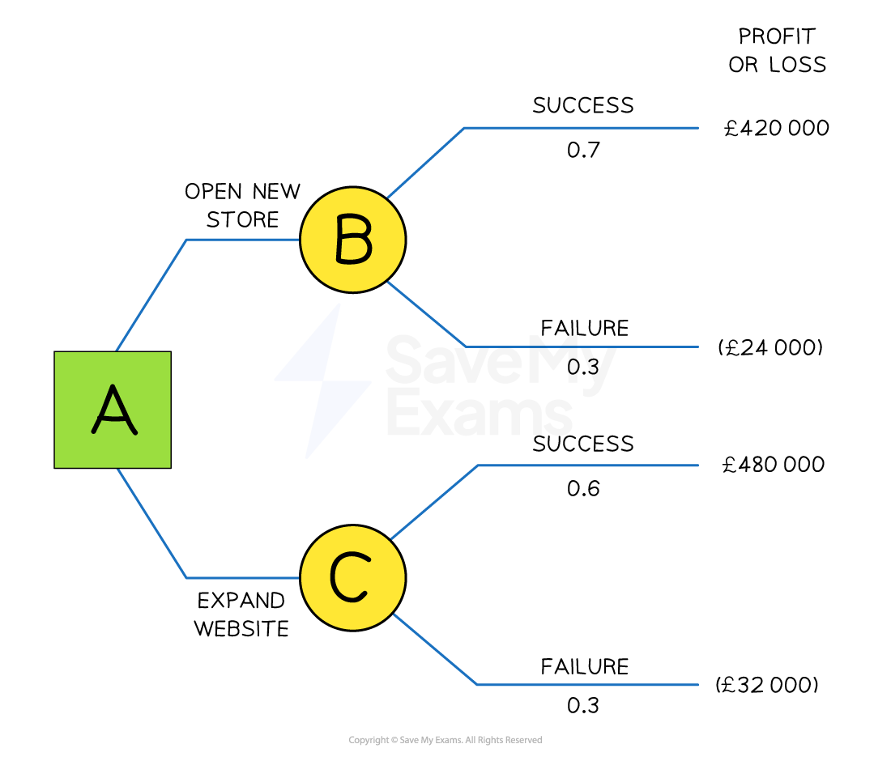
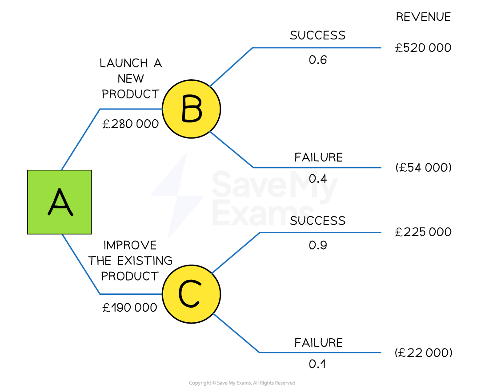

# Decision Trees

## An introduction to decision trees

> **Spec point** — `spcpt_FmcmZvckcx4ptc2K`

## An introduction to decision trees

- A decision tree is a **quantitative method** of tracing the outcomes of a decision so that the most profitable decision can be identified

  - **Research-based estimates** and** probabilities** are used to calculate likely outcomes
  - The **net gain from a decision** can be identified and used to consider whether an investment is worthwhile

### Advantages of using decision trees

- Constructing a decision tree diagram may **reveal options** that haven't previously been considered
- Managers are forced to **consider the risks** associated with their choice, ahead of implementation
- The quantitative approach requires **deep research** to be carried out

### Limitations of using decision trees

- Constructing decision trees that can support effective decision-making **requires skill **to avoid bias and it takes **time to gather reliable data**
- **Estimates** rarely take full account of **external factors** and **cannot include all possible eventualities**
- **Qualitative elements** such as human resource impacts are not considered, which may **affect the probability of success** of a decision
- The** time lag** between the construction of a decision tree diagram and the implementation of the decision affects the **reliability of expected values**

## Constructing and interpreting decision trees

> **Spec point** — `spcpt_hbXJRC99Y8gznGMt`

## Constructing and interpreting decision trees

- The **key elements** in a decision tree diagram are

  - Decision points
  - Outcomes
  - Probabilities
  - Expected monetary values

#### A simple decision tree diagram

*A simple decision tree based on the choice of whether to invest in opening a new store or expand its website*

### Decision points

- Points where **decisions** need to be made are called **decision points** and are represented by **squares**

  - Square A represents the fact that a choice is required on opening a new store or expanding the website

### Outcomes

- Points where there are different **outcomes** are represented by **circles **called **nodes**

  - Circles B and C represent points at which the different options have a range of outcomes – success or failure

### Probability

- The **probability** or likelihood of each outcome is shown on the diagram

  - A certain outcome has a probability of 1
  - An impossible outcome has a probability of 0
  
    - Opening a new store has a 0.7 probability of success and a 0.3 probability of failure
    - Expanding the website has a 0.6 probability of success and a 0.4 probability of failure

### Monetary values

- The **monetary value** of each decision is based on the expected profit or loss of the outcome

  - If opening a new store is successful, a £420,000 profit is expected
  - If opening a new store is unsuccessful, a £24,000 loss is expected
  - If expanding the website is successful, a £480,000 profit is expected
  - If expanding the website is unsuccessful, a £32,000 loss is expected

#### Calculating expected monetary values

- To compare the options, a business should take into account the **expected values of each decision** presented in the decision tree diagram
- The following formula is used to calculate the **expected monetary value** of a decision

**(Expected value of success x Probability) + (Expected value of failure x Probability)**

- Using the example above, the expected value of opening a new store is

`equals space left parenthesis £ 420 comma 000 space cross times space 0.7 right parenthesis space plus space left parenthesis negative £ 24 comma 000 space cross times space 0.3 right parenthesis space space

equals space £ 294 comma 000 space plus space minus £ 7 comma 200 space

equals space £ 286 comma 800 space`

- Using the example above the expected value of expanding the website is

`equals space left parenthesis £ 480 comma 000 space cross times space 0.6 right parenthesis space plus space space left parenthesis negative £ 32 comma 000 space cross times space 0.4 right parenthesis space

equals space £ 288 comma 000 space space plus space minus £ 12 comma 800

equals space £ 275 comma 200`

- As the expected value of opening a new store is higher, at £286,800, than that of expanding the website  at £275,200, the business **should open a new store**

### Variations in the decision tree diagram

- In some cases, the decision tree diagram **provides expected revenues rather than profit or loss** for the range of outcomes

  - In these diagrams, **the costs related to each outcome are also provided**
  - To calculate the expected value of each outcome, **costs must be deducted from expected revenues**

*A decision tree based on a decision whether to launch a new product or improve an existing product*

#### Explanation

- To calculate the **expected monetary value** of a decision, revenues and costs are included in the diagram

**(Expected value of success x Probability)  + ( Expected value of failure x Probability)  - Cost**

- The expected value of launching a new product is

`equals space left parenthesis £ 520 comma 000 space cross times space 0.6 right parenthesis space plus space left parenthesis negative £ 54 comma 000 space cross times space 0.4 right parenthesis space minus space £ 280 comma 000 space space

equals space £ 312 comma 000 space plus space minus £ 21 comma 600 space minus space £ 280 comma 000 space space

equals space £ 290 comma 400 space minus space £ 280 comma 000 space space

equals space £ 10 comma 400`

- The expected value of improving the existing product is

`equals space left parenthesis £ 225 comma 000 space cross times space 0.9 right parenthesis space plus space left parenthesis negative £ 22 comma 000 space cross times space 0.1 right parenthesis space minus space £ 190 comma 000 space space

equals space £ 202 comma 500 space plus space minus £ 2 comma 200 space minus space £ 190 comma 000 space space

equals space £ 200 comma 300 space minus space £ 190 comma 000 space space

equals space £ 10 comma 300 space`

- As the expected value of launching a new product is marginally higher, at £10,400 ,than that of improving the existing product, at £10,300, the business should choose the option to **launch a new product **

  - However, there is **little between the two options** and the business should **look at other factors** to inform their decision

> **Worked Example**
> *Caramelac* is a lactose-free chocolate product manufactured by a large multinational confectionery business. In recent years increased competition from other well-known brands has started to impact on sales of the product and managers are determined to maintain *Caramelac’s* market share.
> 
> Market research has shown that the business has two options:
> 
> 1. Redevelop the product
> 2. Create a new advertising campaign
> 
> The expected outcomes and the probabilities of success and failure are shown in the decision tree below
> 
> 
> 
> **Calculate **the expected values of each option and decide, on financial grounds, which option the *Caramelac's* brand managers should choose.
> 
> [6 marks]
> 
> **Step 1: Calculate the expected value of redeveloping the product**
> 
> `equals space left parenthesis £ 840 comma 000 space cross times space 0.5 right parenthesis space plus space space left parenthesis negative £ 84 comma 000 space cross times space 0.5 right parenthesis space
> 
> equals space £ 420 comma 000 space space space space space space space plus space space space space minus £ 42 comma 000 space space
> 
> equals space £ 378 comma 000 space space space space space space space space space space space space space space space space space space space space space space space space space space space space`    **(2)**
> 
> **Step 2: Calculate the expected value of the advertising campaign**
> 
> `equals space left parenthesis £ 660 comma 000 space cross times space 0.6 right parenthesis space plus space left parenthesis negative £ 76 comma 000 space cross times space 0.4 right parenthesis space space
> 
> equals space £ 396 comma 000 space plus space minus £ 30 comma 400 space space
> 
> equals space £ 365 comma 600 space space space space space space space space space space space space space space space space space space space space space space space space space space space space`**   ** **(2)**
> 
> **Step 3: Interpret the outcomes and make a decision**
> 
> - As the expected value of redeveloping the product is higher, at £378,000, than that of the advertising campaign, at £365,600 **(1 mark)**, the business should choose the option to **redevelop the product ****(1 mark).**

> **Exam Hint**
> Expected values are not the same thing as profit or revenues generated by a choice.
> 
> In the above example, launching a new product is expected to either generate a positive revenue figure of £520,000 or generate a negative revenue figure of £54,000. It is never forecast that a revenue figure of £200,300 will be achieved
> 
> This is purely a figure used in making the choice between this option and the alternative and does not represent the actual amount of revenue that is expected to be achieved.
