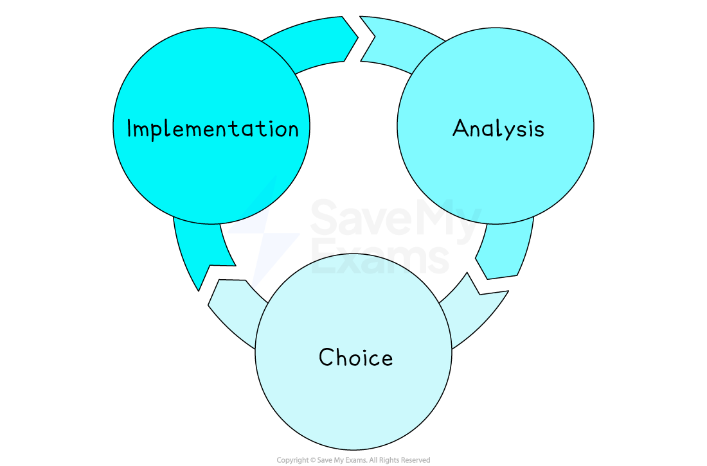

# Developing Business Strategy

## The meaning and purpose of business strategy

> **Spec point** — `spcpt_JFkqkGCgCvz4rXmj`

## The meaning and purpose of business strategy

- A business strategy is a **medium- to long-term plan** that shows **how **a company will reach its main goals

  - It sets clear priorities, chooses the markets or products to focus on and guides the use of people, money and technology

| **Purpose of business strategy** | Explanation |
|---|---|
| **Direction and focus** | - Gives everyone a common goal, so departments pull in the same direction |
| **Resource allocation** | - Helps managers decide where to spend time and money and use staff to get the best results |
| **Competitive advantage** | - Outlines how the firm will stand out, through low costs, innovation, service  or a niche market |
| **Risk management** | - Anticipates threats, such as new rivals or regulations and plans how to reduce or avoid them |
| **Performance measurement** | - Provides targets against which progress can be tracked and improvements made |

## The meaning and purpose of strategic management

> **Spec point** — `spcpt_TxJf2wCkcTFRgKj6`

## The meaning and purpose of strategic management

- Strategic management is the **ongoing process** of choosing long-term goals, planning how to reach them, putting plans into action and regularly reviewing results to keep the business on course

#### The strategic management process

*Strategic management is a continuous process of analysis, making and implementing choices*

- **Analysis**

  - External factors, such as markets, competitors, laws and the economy
  - Internal factors, such as employees' skills, costs and culture
  
    - Tools such as SWOT or PESTLE can help organise the findings
  - E.g. A sports shoe business checks trainer fashion trends, compares its costs with Nike’s and lists its strengths (a strong brand) and weaknesses (slow delivery)
- **Choice**

  - Senior managers turn the mission into clear targets
  
    - They pick the best way to reach them, such as cost leadership, differentiation or targeting new markets
  - E.g. The sports shoe business sets a goal to raise online sales by 30 % in three years. It chooses a differentiation strategy which will involve launching eco-friendly trainers made from recycled plastic
- **Implementation**

  - Resources are allocated and departments set their own objectives
  
    - Staff are trained, and new systems or contracts are put in place
    - E.g. Operations buys recycling equipment,  marketing schedules a social-media campaign and HR recruits designers with sustainability skills
  - Progress is measured against targets
  
    - Managers investigating gaps and tweaking the strategy when needed.
    - E.g. After a year, online sales of eco-trainers increase by only 15 %, so the firm boosts advertising to close the gap

| **Purpose of strategic management** | `equation`E**xplanation** |
|---|---|
| **Clear direction** | - Everyone knows where the business is going and why |
| **Effective use of resources** | - Money, people and machines are placed where they earn the best return |
| **Competitive advantage** | - The firm plans how to compete with rivals through lower costs, new products or stronger brand image |
| **Quick response to change** | - Regular scanning of markets, technology and laws helps managers adjust plans before problems grow |
| **Performance control** | - Targets and reviews show what is working and what needs fixing, keeping the business on track for long-term success |

> **Case Study**
> ** FabTex India – A Strategic Shift to Sustainable Fashion**
> 
> **FabTex India Pvt Ltd** is a midsized textile manufacturer based in **Tiruppur**, Tamil Nadu. It supplies fabrics and garments to major Indian retailers and exports to buyers in Europe.
> 
> In 2024, FabTex faced rising competition from low-cost producers in Bangladesh and growing pressure from European customers to cut carbon emissions in the supply chain
> 
> 
> 
> **Strategic Management in Action**
> 
> **🔍 Analysis**
> 
> FabTex’s leadership team carried out a **SWOT and PESTLE analysis**:
> 
> - **External factors** included EU environmental rules, trends in sustainable fashion, and weak demand in India’s domestic market.
> - **Internal analysis** showed strong technical expertise and efficient mills, but poor brand recognition and high energy costs.
> 
> **🎯 Choice**
> 
> The company set a **strategic goal**:
> *“Increase revenue from sustainable fabric exports by 40% within 3 years.”*
> 
> To achieve this, managers chose a **differentiation strategy**, focusing on **organic cotton and recycled fibre fabrics** with traceable, low-emission processes.
> 
> **🛠️ Implementation**
> 
> - The operations team invested ₹12 crore in **solar panels and low-water dyeing machines**.
> - The marketing team developed a **“Green Fab” brand**, targeting eco-conscious buyers in Germany and the Netherlands.
> - HR hired **two textile engineers** with expertise in sustainable fabric blends.
> - Sales staff received training in **eco-certification standards** and new export regulations.
> 
> After one year, sustainable fabric sales had grown by 22% — **below target** — so the firm increased its presence at European trade fairs and introduced **online sampling tools** to speed up buyer decisions
