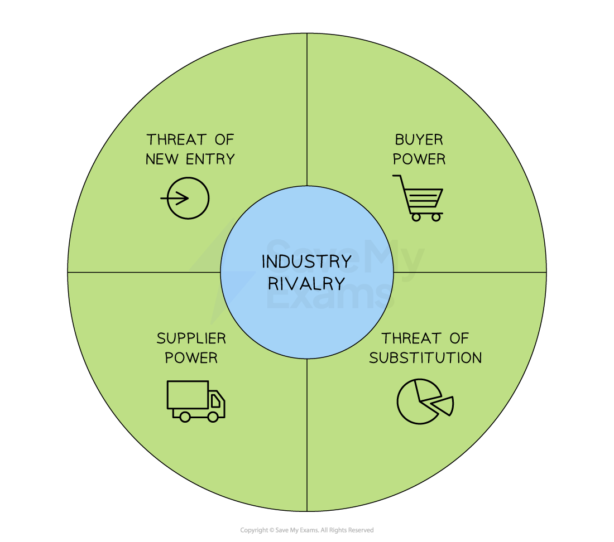
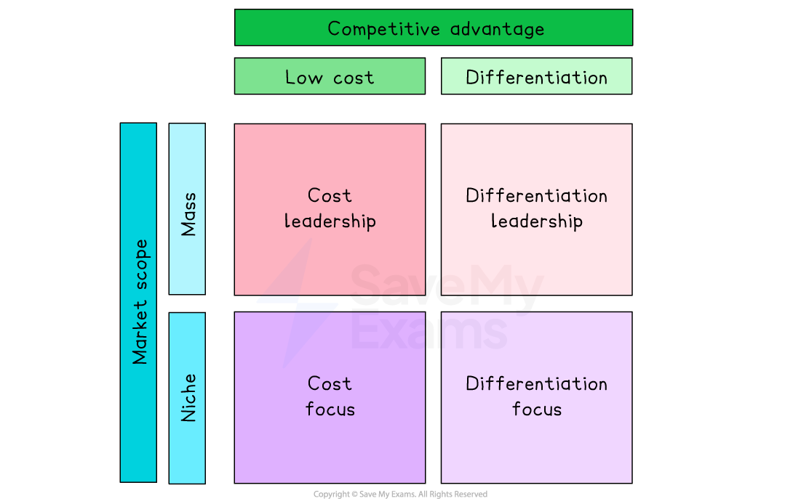
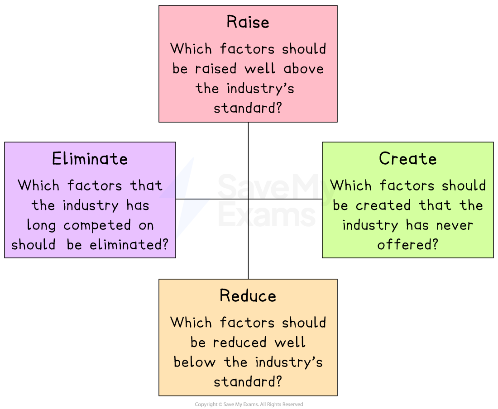

# Porter's Five Forces and Blue Ocean Strategy

## An introduction to Porter's Five Forces model

> **Spec point** — `spcpt_KzsbfHS77CgbHw83`

## An introduction to Porter's Five Forces model

- Porter’s Five Forces identify the **key pressures** on an industry that impact the **ability of a business to compete with rivals**

  - It helps managers think strategically **about the environment **in which the business operates

#### Porter's five forces

*Porters five forces are linked factors that affect a business's ability to compete with rivals*

- Once a business **fully understands these pressures in their context, **they can **take strategic decisions** to achieve and sustain a  ***competitive advantage***

#### Explanation of Porter's five forces model

| **Force** | **Explanation** | **Example** |
|---|---|---|
| **Industry rivalry** | - Many similar competitors mean little control over price or market share - Few rivals allow firms to set higher prices and dominate | - In the UK energy sector, takeovers have reduced suppliers - Fewer firms now charge high prices and earn large profits |
| **Threat of new entry** | - Low barriers let new firms enter easily, increasing competition - High barriers keep rivals out, preserving power for existing businesses | - Online TV channels launched cheaply after 1980s deregulation, yet big players like **Netflix **and **Sky **still dominate |
| **Buyer power** | - When few customers buy most output, they can demand lower prices - Many customers reduce their individual power, letting firms charge more | - Airlines ordering many jets from Boeing negotiate steep discounts and favourable deals |
| **Supplier power** | - If many suppliers exist, firms can pick cheaper options - If few suppliers offer unique inputs, they dictate terms and charge higher prices | - In retail, UK supermarkets force small suppliers to accept lower prices - **Heinz**’s 2022 demand forced Tesco to pay 51% more. |
| **Threat of substitution** | - Easy substitutes force firms to compete on price or innovate - Rare substitutes let firms keep prices high and focus less on changing products | - Smartphones replaced devices like cameras and calculators - Camera makers now sell only premium models for serious photographers |

## Porter's Generic Strategies

> **Spec point** — `spcpt_8MDv4dHqVmnkwGyN`

## Porter's generic strategies

- Once a business has **applied the Five Forces model **to its own circumstances, Porter recommended a range of **generic strategies** to increase its chances of competing

  - On the basis of **cost **or through ***differentiation***
  - In the ***mass market*** or within a smaller ***niche market***
- It emphasises the importance of developing ***distinctive capabilities*** and avoid being 'stuck in the middle'

#### Porter's generic matrix

*Porter's generic matrix identifies suitable strategies for mass and niche markets*

### Mass market strategies

- **Cost Leadership**

  - Most suitable for businesses that have a **significant cost advantage** over rivals
  - **Cost leadership with parity** is where a business has lower costs than rivals but charges the same price
  
    - Examples include hotel chains such as *Premier Inn* and *Ibis Styles*
  - **Cost leadership with** proximity is where a business has lower costs and charges a lower price than rivals
  
    - Examples include budget airlines such as *Southwestern* and *Ryanair*
- **Differentiation**

  - Businesses that cannot be the most competitive on cost should **make its products distinct** from those of rivals
  - This allows a business to **charge a** ***premium price*** and achieve a** high** ***profit margin***
  - Examples of businesses that adopt a mass market differentiation strategy include
  
    - **Coca Cola, **whose* *trusted* *and well-known* *branding includes its logo, brand colours and characters such as the *Coca Cola* truck
    - **Samsung**'s cutting-edge mobile phones have the most advanced package of technical features in the mass market
    - **Volvo**'s focus on safety and build quality allows it to charge premium prices in the mass market

### Niche market strategies

- Businesses that operate in a *niche markets* should adopt one of two **focus strategies** that closely meet the needs of its specific group of customers
- **Cost focus strategy **

  - This involves being the **lowest cost competitor within the market niche**
  
    - **Carnival Cruises** sells cruises to locations including the Caribbean and Europe and is well-known for it's eye-catching low fares that can be offered due to its fleet of smaller vessels that operate at full ***capacity***
    - **Glasses Direct **is an online retailer of spectacles that sells popular styles of lesser-known brands at very low prices as a result of its low ***overhead*** costs
- **Differentiation focus strategy**

  - A **differentiation focus** involves offering **specialised products within the niche market**
  
    - **Hotel Chocolat** sells a range of **premium, fair-trade celebration confectionary** in its chain of beautifully-designed retail outlets
    - **Brompton Bicycle Retail** sells **innovative products,** such as the folding bicycle, that closely meet the needs of its **wealthy commuter target market**

### Stuck in the middle

- Failing to adopt one of the strategies would result in being **unable to compete successfully** with rivals

  - A business should **select its strategy and concentrate its resources on pursuing it** rather than simply responding to its competitors' actions
- Pursuing a **mixture** of strategies is also **not feasible in the long term**

  - Cost leadership and differentiation are not compatible
  
    - Low prices combined with high quality can negatively affect consumer perceptions of the product

#### Evaluation of Porter's generic strategies

| **Benefits** | **Drawbacks** |
|---|---|
| - It encourages businesses to make strategic choices that are **difficult for competitors to copy** - Pursuing one strategy forces a business to **make explicit choices** about its direction and concentrate on it | - It does not offer guidance to businesses on **specific tactics **or** implementation** - It overlooks **external factors **such as technological change, economic conditions and changes in laws which could impact competitive position |

> **Exam Hint**
> Although Porter's Generic Strategies are not explicitly listed within this specification, it is important that you understand that Five Forces Analysis allows a business to determine its competitive strategy. For this reason it is included here.
> 
> Additionally, as Blue Ocean Strategy is an alternative to Porter's acceptance of competitive forces in his Generic Strategies (Kim & Mauborgne consider these to be Red Ocean Strategies) it is appropriate to understand the concept.

## Blue Ocean Strategy

> **Spec point** — `spcpt_ntzyThJ5vWmTG5Jz`

## Blue ocean strategy

- **Blue Ocean strategy** is the **simultaneous** pursuit of **differentiation and low-cost **strategies

  - This opens up a **new market space** and creates new demand, so there is less fighting over existing demand
  - **Uncontested market space** is captured by products that other businesses have not yet adopted, making **competition irrelevant**
  - There is ample opportunity for **profitable and rapid growth**
- Businesses pursuing this strategy follow the **Four Actions Framework** to identify a new ***value curve*** which **combines cost and differentiation in a new, innovative way**

#### The four actions framework

*The Four Actions Framework asks four key questions of businesses that adopt a Blue Ocean Strategy*

- The four actions in the framework are:

  - **Raise**
  
    - Question which features or products should be better than the industry standard
  - **Create**
  
    - Question which features or products have never existed and should be created
  - **Reduce**
  
    - Question which features of products should be downplayed to levels below industry standards
  - **Eliminate**
  
    - Question which features or products have been overcompeted and eliminate them

> **Case Study**
> **Nintendo's Blue Ocean strategy**
> 
> In the early 2000s, **Nintendo** was struggling as industry giants Sony and Microsoft dominated the market
> 
> 
> 
> *The Wii was the result of Nintendo's Blue Ocean strategy*
> 
> - In 2006, the company took a **blue ocean approach**
> 
>   - It researched the needs of non-gamers rather than customers who already owned games consoles
>   - It **eliminated or reduced** factors that were thought to be vital in the market, such as high-definition graphics, fast chips, controllers with many buttons and violent, lifelike games
>   - It **raised and created factors** that appealed to non-gamers, such as more accessible games and a focus on fun and intuitive controls
> 
> - The result was the **Nintendo Wii**, a console based on simplicity, functionality, and interactivity, which opened up a new market that went on to outsell all Sony and Microsoft gaming products combined

> **Exam Hint**
> - The choice of business strategy will be determined by the attitudes, experience, and leadership skills of key decision-makers in a business
> 
>   - Risk-averse senior managers are unlikely to pursue blue ocean strategies, for example.
> - Look for clues in the case study to establish the leadership style of senior managers, as this could help you build a strong chain of analysis and make a justified recommendation.
