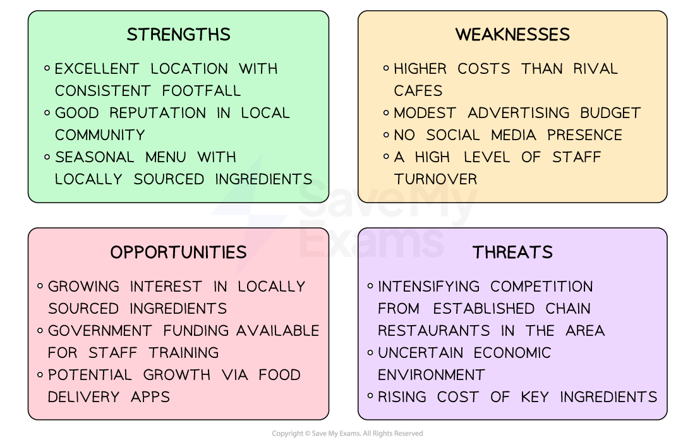

# SWOT Analysis

## Conducting a SWOT Analysis

> **Spec point** — `spcpt_WDtNSYBxSGrD9qZb`

## Conducting a SWOT analysis

- SWOT Analysis is an analytical tool used by businesses to identify

  - Internal **strengths** and **weaknesses**
  - External **opportunities** and **threats**

- It can help senior managers **understand the current business position** and **future changes that may occur **so that **appropriate strategic decisions** may be made

- Before a SWOT analysis can be compiled

  - Managers should decide whether the **whole business**,** a specific product **or a **new project **is to be analysed
  - Financial and operations data and staff or customer feedback should be reviewed carefully rather than rely on ***hunches***
  - Economic, social, technological and competitive trends should be carefully reviewed to identify expected opportunities and threats
  - Findings should be cross-checked with independent reports before the most important factors are considered

#### Factors considered in a SWOT analysis

| **Strengths** | **Weaknesses** |
|---|---|
| - **What the business is good at**    - Qualities that separate the business from rivals   - Internal resources such as skilled staff or a particular ***innovation***   - Possession of assets such as capital, ***patents*** or ***intellectual property***   - A loyal customer base   - Effective leadership | - **What the business does poorly**    - Ways in which the business lags behind competitors   - Resource or capital limitations, including labour and finance   - Lack of a competitive advantage   - Lack of a **unique selling proposition (USP)**   - Poor online presence |
| **Opportunities** | **Threats** |
| - **Options a business may exploit to enjoy further success**    - Developing markets for specific products become apparent   - Few competitors exist   - A changing legal or political environment positively impacts on business processes and decisions   - Social or** technological developments** create an emerging need for the businesses' products   - Economic indicators becoming more favourable   - A potential for positive media coverage of the business | - **Hazards that have the potential to damage business performance**    - New or emerging competitors are **gaining market share**   - A changing legal or political environment negatively impacting on business processes and decisions   - Social or technological developments threaten **obsolescence of products**   - Economic indicators becoming less favourable   - Negative press coverage   - Changing customer attitudes towards the business |

## Using the information from a SWOT analysis

> **Spec point** — `spcpt_ZPDKxdrdhP2TV5mK`

## Using the information from a SWOT analysis

- Once a SWOT Analysis has been completed by a business, appropriate decisions can be made to improve performance

  - Strengths should be **harnessed**
  - Weaknesses should be **eliminated**
  - Opportunities should be **seized**
  - Threats should be **mitigated**

#### Example SWOT analysis

*An example of a SWOT Analysis for a small cafe business*

- Having compiled the SWOT analysis, the cafe owner  may

  - Seize the **opportunity** presented by the growing interest in locally sourced ingredients by promoting the cafe's **strength** of its seasonal, locally sourced menu, especially given the** threat** from large competitors
  - Make use of the government funding for staff training to attempt to reduce staff turnover
  - Target a geographically wider target market by teaming up with delivery apps and establishing a social media presence

## Strengths and weaknesses of SWOT analysis

> **Spec point** — `spcpt_nCpKdqs8tB5dpcm9`

## Strengths and weaknesses of a SWOT analysis

- Understanding what the tool does well and where it falls short helps a company judge whether a SWOT analysis is suitable for its planning needs

### Strengths of using SWOT analysis when planning strategy

- **Easy to understand**

  - Listing strengths, weaknesses, opportunities and threats is straightforward
  - Managers and employees at all levels can join in
- **The big picture in one place**

  - SWOT shows both internal and external factors together
  - This helps businesses see how everything connects
- **Helps set priorities**

  - Matching strengths to opportunities and threats to weaknesses helps managers decide which goals to tackle first
- **Low-cost and flexible**

  - It needs only discussion and basic research
  - A business can update the analysis quickly when conditions change

### Weaknesses of using SWOT analysis when planning strategy

- **Too basic**

  - A simple four-box list can leave out important details
  - Managers may miss hidden problems or opportunities
- **Depends on opinions**

  - The points written in each box reflect who is in the room
  - Personal bias can make the analysis less accurate
- **Only a snapshot**

  - SWOT shows conditions at one moment in time
  - If markets change quickly, the analysis can go out of date fast
- **No clear action steps**

  - SWOT highlights issues but does not tell managers **how **to fix weaknesses or use strengths
  - Extra tools and planning are often still needed

### Factors affecting the usefulness of SWOT analysis

| **Factor** | **Explanation** |
|---|---|
| **Quality and relevance of data used** | - If the information used for analysis is **outdated, incomplete **or** biased,** it can lead to flawed conclusions and ineffective decision-making |
| **Objectivity and bias** | - If the analysis is influenced by personal biases, preconceived notions or subjective opinions, it can undermine the usefulness of the analysis |
| **Depth of analysis** | - Superficial analysis may **overlook important factors** or fail to capture the complexity of the organisation's environment |
| **Stakeholder involvement** | - **Diverse perspectives **can provide a broader understanding of the organisation's strengths, weaknesses, opportunities and threats, increasing the usefulness of the analysis |
| **Dynamic nature of the business environment** | - Market conditions, technology and consumer preferences change over time, so **regular updates and revisions** to the analysis are necessary to ensure its usefulness |
