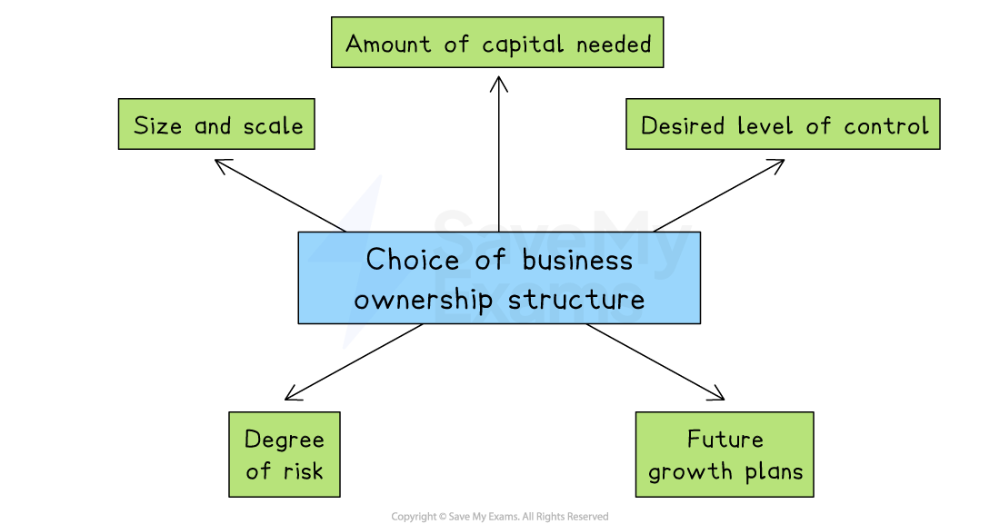

# Choosing the Right Business Ownership

## The appropriateness of different types of business ownership

> **Spec point** — `spcpt_Md53DJVQJSvndsJ8`

## The appropriateness of different types of business ownership

- When starting or growing a business, it is important to choose the **right type** of ownership
- Businesses consider several factors when deciding which ownership structure is best suited to their needs and goals

#### Factors affecting the choice of ownership type

*The choice of ownership structure depends on factors including size, scale, degree of risk and future growth plans*

#### 1. Size and scale of business

- The size of the business (small, medium, or large) helps determine the most suitable ownership type
- Smaller businesses often choose simpler structures, while larger firms may require more complex forms like public limited companies

  - E.g., A small local café would likely operate as a sole trader, whereas a multinational company like Samsung operates as a public limited company (Plc)

#### 2. Amount of capital needed

- Different ownership types allow businesses to raise different amounts of money
- Businesses needing large amounts of capital typically choose structures that allow share sales

  - E.g., Public limited companies raise large amounts of capital by selling shares publicly, whereas a local hair salon (sole trader) usually needs only a small initial investment

#### 3. Desired level of control

- Business owners must consider how much control they wish to maintain
- Some structures offer complete control, while others involve sharing decision-making responsibilities

  - E.g., A sole trader has full control over all business decisions, while a franchise owner must follow strict rules set by the franchisor

#### 4. Degree of risk (liability)

- The choice of ownership determines the level of personal financial risk
- Limited liability protects owners’ personal assets, whereas unlimited liability could mean personal assets are at risk

  - E.g., Owners of private limited companies (Ltd) have limited liability, protecting personal possessions. In contrast, sole traders face unlimited liability, risking personal property if the business fails

#### 5. Future growth plans

- Businesses planning rapid growth or international expansion must choose a structure that supports raising funds and managing growth effectively

  - E.g., A fast-growing technology startup might choose a private limited company to attract investors easily, while businesses intending to stay small, like family-run restaurants, might remain as partnerships or sole traders

#### The appropriateness of different ownership types

| Type | Appropriate for |
|---|---|
| **Sole Trader** | - Small local businesses such as cafés, hairdressers, plumbers and market stalls |
| **Partnership** | - Professional services    - E.g. accountants, doctors, lawyers and architects |
| **Private Limited Company (Ltd)** | - Family-run businesses or SMEs aiming to expand    - E.g., local manufacturing companies, independent restaurants |
| **Public Limited Company (Plc)** | - Large companies needing significant investment    - E.g. Apple, Samsung, Toyota |
| **Franchise** | - Entrepreneurs preferring established business models    - E.g., Subway, Domino’s Pizza, Hilton Hotels |
| **Joint Venture** | - International market entry, large-scale projects    - E.g., car companies developing electric vehicles together |
| **Cooperative** | - Community-based businesses, farming groups, retail cooperatives    - E.g., Arla Foods, The Co-operative Group (UK), agricultural cooperatives in Kenya |
| **Social Enterprise** | - Organisations aiming to solve social or environmental problems    - E.g., The Big Issue (UK), Grameen Bank (Bangladesh), TOMS Shoes (USA) |

## The concepts of unlimited liability and limited liability

> **Spec point** — `spcpt_swMK5kZbYwqzdG95`

## The concepts of unlimited liability and limited liability

- When an entrepreneur starts a business, they need to consider **what kind of legal structure** they want for their business
- **Sole traders and partnerships** offer no legal protection to the owners in that the business assets and the owner's personal assets are viewed as being the same **(unlimited liability)**
- The other forms of business ownership offer **limited liability** in which the assets of the owners are considered to be separate from those of the business

#### Comparing unlimited and limited liability

| **Liability** | **Description** | **Implications** |
|---|---|---|
| **Unlimited liability** | - Sole proprietors and partnership owners are fully responsible for all debts owed by the business  - Owners are also legally responsible for any unlawful acts committed by those connected to the business | - There is no legal distinction between owners with unlimited liability and the business  - As a result, these business owners may have to use their own  ***personal assets*** to pay debts or legal fees  - E.g. a sole proprietor may need to sell their home to pay  ***creditors*** if their business fails |
| **Limited liability** | - Owners (shareholders) of private limited companies and public limited companies can only lose the **original amount** they invested in the business if it fails  - Shareholders are not responsible for business debts  - In most cases, the shareholders **cannot be held responsible** for unlawful acts committed by those connected with the business | - Companies are  ***incorporated*** and owners are considered a separate legal entity to the business  - This means that if a company fails, the owners would **lose their investment** (shares) but would not have to use their assets to meet additional debts or legal fees  - E.g. In 2018 construction company Carillion entered ***liquidation*** and the shareholders lost their investments |

## The advantages and disadvantages of changing the type of business ownership

> **Spec point** — `spcpt_228VNPQcgCJTyVM8`

## The advantages and disadvantages of changing the type of business ownership

- Businesses sometimes change their type of ownership as they grow or when they seek new opportunities

### Changing from sole trader or partnership to private limited company

- As a business grows, the owner may need **more capital to expand** or want to reduce their personal financial risk
- Switching to a private limited company offers limited liability and allows the business to raise money through selling shares privately

  - E.g. A local bakery that started as a sole trader may become a private limited company to open more branches and attract investors to help fund expansion

| Advantages | Disadvantages |
|---|---|
| - Limited liability reduces personal financial risk for owners | - Increased administrative work and legal obligations, such as registering the business and filing accounts publicly |
| - Easier to raise capital through private share issues | - Potential loss of full control as shareholders may influence decisions |
| - More stable structure that can attract investors | - Set-up and operating costs tend to be higher than sole traders or partnerships |

### Buying a franchise

- Entrepreneurs who want to expand a business with less risk may choose to buy a franchise
- It allows them to run a business with an existing *brand*, support and customer base rather than growing a less well-known brand

  - E.g., A fast food entrepreneur may choose to buy a Subway franchise because the brand is well known and the franchisor provides training and equipment

| Advantages | Disadvantages |
|---|---|
| - The established brand and proven business model reduce risk | - Franchise fees and ongoing royalties must be paid to the franchisor |
| - Training and support is provided by the franchisor | - The owner is likely to have limited control over business operations and decisions |
| - It is likely to be easier to attract customers due to brand recognition | - Profits might be lower due to fees and restrictions |

### Changing from private limited company to public limited company

- A successful private limited company may **want to raise large amounts of money** quickly for major expansion
- Becoming a public limited company allows it to sell shares to the public on the stock exchange

  - E.g. **Facebook **began as a private limited company and later became Meta Plc to raise billions of dollars for global growth and development

| Advantages | Disadvantages |
|---|---|
| - Access to substantial amounts of capital by selling shares publicly | - Risk of losing control due to a potential takeover bid or pressure from external shareholders |
| - Higher public profile enhances brand awareness and market presence | - Greater regulatory requirements, higher costs, and increased complexity, such as detailed annual reports and compliance costs |
| - Increased ability to attract top-quality management | - The company becomes accountable to numerous shareholders and market pressures |

### Forming a joint venture

- Sometimes two or more businesses want to work together on a project, especially if it involves entering a new market or sharing expertise
- A joint venture lets them share the risks, costs, and skills

  - E.g. **Sony** and **Ericsson **formed a joint venture to combine their strengths in electronics and mobile phone technology and create competitive mobile phones for the global market

| Advantages | Disadvantages |
|---|---|
| - Risk and costs are shared, reducing financial pressure | - There is potential for conflicts between partners about goals or strategy |
| - Allows pooling of expertise and resources for better project outcomes | - Profits are shared, which might limit overall earnings per business |
| - Easier entry into new markets, especially internationally | - Limited lifespan of the joint venture, requiring renegotiation or an exit strategy |
