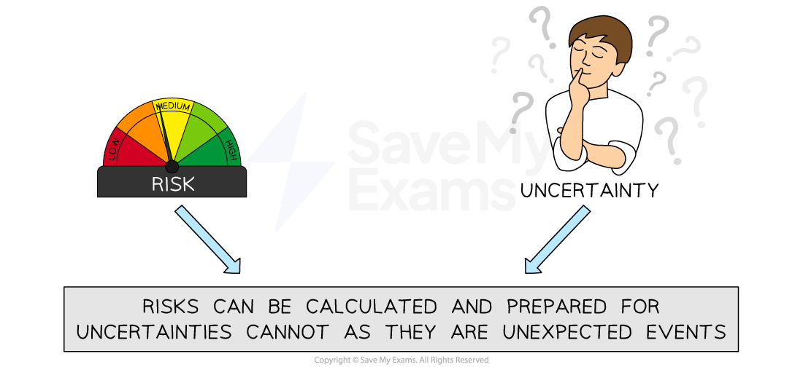

# Risk, Uncertainty and Business Enterprise

## The distinction between risk and uncertainty

> **Spec point** — `spcpt_rYchF4bmFBfSKzPK`

## The distinction between risk and uncertainty

### Uncertainty

- Business uncertainty is when a business **cannot predict what is going to happen** or directly influence it

  - Uncertainty **cannot be prepared for** because it is unknown and cannot be measured
  - Factors that typically cause uncertainty include:
  
    - **Environmental factors **such as the Japanese Tsunami in March 2011
    - **Economic changes** such as Covid lockdowns, Brexit or collapses in the banking system
    - The entry of new competitors
    - Changes in local and national **legislation (laws)**
    - Changes in the **political party** governing the country

### Risk

- Risk can be **measured**, allowing business owners to make informed decisions before taking action

  - Research, market insight and creating a ***business plan*** can help to reduce risk
  - E.g. Awareness of increased demand for music on vinyl, extensive market research and a strong business plan convinced entrepreneurs Joel Magill and Will Greenham to set up **Smugglers Records** in the small seaside town of Deal

#### Risk versus uncertainty

*The difference between risk and uncertainty*

- Entrepreneurs have varying **levels of risk** they are willing to accept

  - **Risk-averse** entrepreneurs may prefer to start small and achieve slow growth
  - Some entrepreneurs may prefer to **share risks** with others in a ***partnership*** or protect their personal assets by forming a ***private limited company***
- Successful entrepreneurs can **manage risk and quickly respond to uncertainty** in the business environment

#### An example of entrepreneurial response to uncertainty

| **Brian Chesky (Airbnb Co-founder)**  ** Airbnb Response to the Covid-19 Pandemic** |
|---|
| - In 2020, the COVID-19 pandemic caused many people to **cancel their travel plans** and stay home to avoid exposure to the virus - This had a major impact on Airbnb's business - Rather than wait for the pandemic to pass, Chesky quickly** pivoted their business strategy** to meet the changing needs of their customers - They launched a new service called** "Online Experiences," **which allowed people to participate in virtual tours, cooking classes and other experiences **from the comfort of their own homes** - Airbnb also took steps to address the health and safety concerns of its customers by **implementing enhanced cleaning protocols** and providing hosts with a guide on how to **prepare their homes for guests** during the pandemic - By quickly pivoting his business strategy and addressing the concerns of his customers, he was able to drive his business forward and **position Airbnb for continued success** in the future |

## Business enterprise and the development of a country

> **Spec point** — `spcpt_FDz9NB7bM43qmNPj`

## Business enterprise and the development of a country

- Government policy often includes support to entrepreneurs to encourage them to set up new businesses or take steps to grow their business

  - The **Philippine** government recognises the contribution that small businesses make to its economy and offers a range of **incentives** to entrepreneurs, including
  
    - **Training programmes** to equip business owners with the skills they need to operate an enterprise
    - A streamlined application process for **low cost government-supported loans**
    - **Mentor initiatives** where entrepreneurs are partnered with an expert who can provide advice on training and business development services
    - The Go Loka! project, which provides product development training, access to a **marketing platform and promotional events**
    - **Exemptions** from income tax and minimum wage law for a limited period

#### How small businesses contribute to a country's economic development

| **Increase the country's level of output to achieve economic growth** | **Improve choice and service for consumers** |
|---|---|
| - This results in higher living standards and raises tax revenues for governments to spend on improved ***public services*** - E.g. The Ugandan government has remodeled its education system to include entrepreneurship as a core subject in secondary schools and has established innovation hubs to help entrepreneurs launch successful startups | - Competition for existing businesses can lead to greater ***innovation*** and better customer service - E.g., **Robinhood** offers a commission-free share trading platform that makes investing accessible and affordable for a broader range of individuals and has challenged traditional financial institutions in a market that had changed little in many decades |
| **Reduce the level of *****unemployment*** | ***Social enterprises***** often support disadvantaged groups** |
| - New or growing businesses create jobs and increase labour skills - This is particularly important for African youth (15-24 years) who constitute around 37% of the working age population but account for about 60% of the continent's jobless total | - E.g. During the Covid-19 pandemic **Fuzzlab** provided its chatbot free of charge to UK social housing organisations - This meant tenants could continue to access 24/7 support for any housing-related enquiry at a time when customer service staff were unable to carry out their work |
