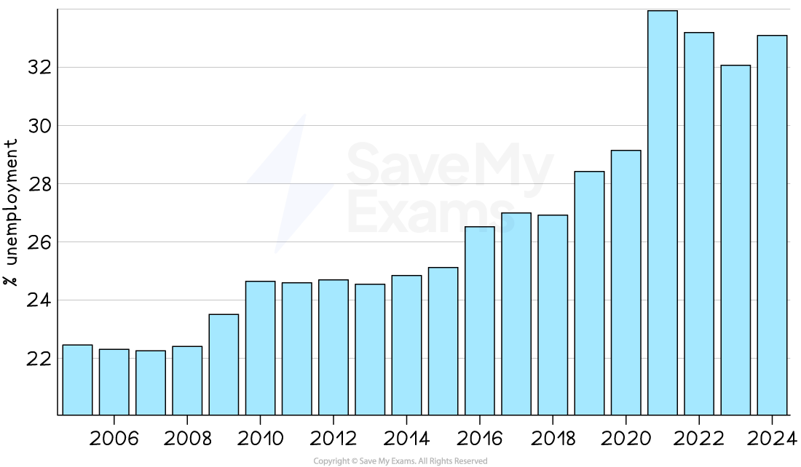
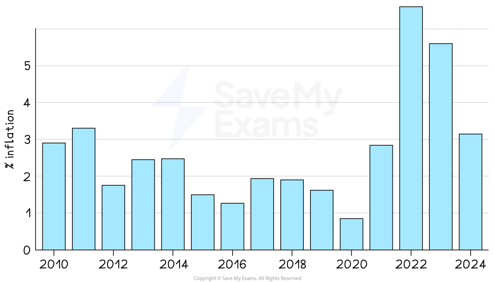
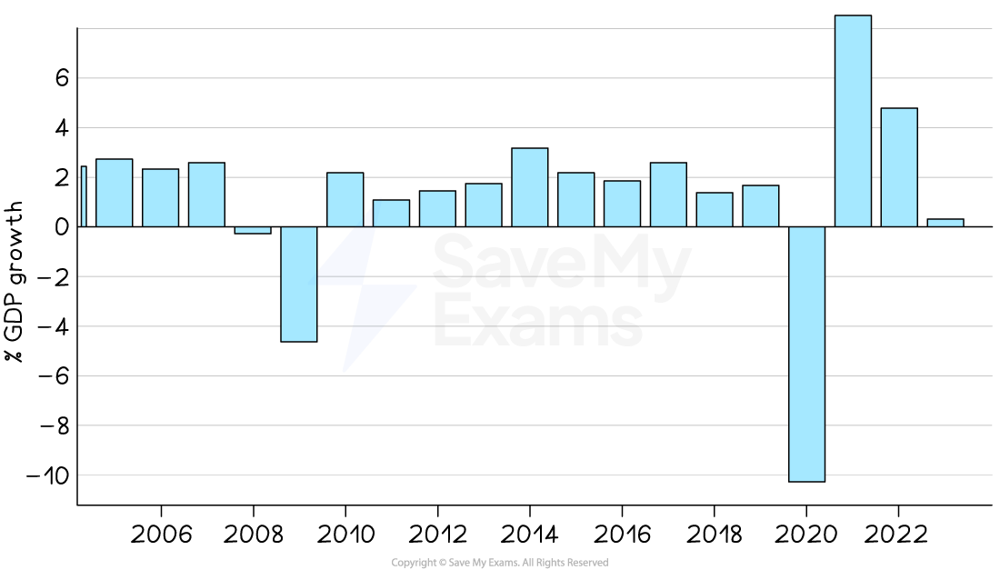

# Economic: Government Macroeconomic Objectives

## An introduction to macroeconomic objectives

> **Spec point** — `spcpt_RWtGyYDkjhJfYmNZ`

## An introduction to macroeconomic objectives

- Macroeconomic objectives are the main **goals that a government tries to achieve in the wider economy** to keep the economy stable and growing
- Successfully meeting the objectives helps **improve living standards** and create a **strong business environment**
- Macroeconomic objectives usually include

  - **Economic growth** – increasing the total output of goods and services in the country (measured by GDP)
  - **Low unemployment** – making sure most people who want to work can find a job
  - **Low and stable inflation** – keeping prices from rising too quickly

## Low unemployment

> **Spec point** — `spcpt_5QVVfDxSXRb842sx`

## Low unemployment

- The **target unemployment rate **for many economies is between 2-5%

  - In December 2022 the unemployment rate in the USA was 3.7% and in Singapore it was 2.6%
- Low unemployment rates like this are close to the **full employment level **of labour

  - There will always be a level of ***frictional***, seasonal and ***structural unemployment***
  - This makes it **impossible to achieve 100% employment**
- Different economies have **different unemployment rates** that are considered to be close to the full employment level of labour

  - E.g. Japan's level is about 2.5% while India's is about 5.7%
- There is an **increased emphasis** on the unemployment rate within different **sections of the population**

  - E.g. **Youth unemployment**, ethnic/racial unemployment by group
  
    - In 2021, black unemployment in the UK was 11% and white unemployment was 4.%

*South Africa's unemployment rate peaked in 2021 at 34%. Source: Macrotrends *

- Unemployment tends to be **inversely proportional to real GDP** growth

  - When real GDP increases, unemployment falls
  - When real GDP decreases, unemployment rises

### Impact on business activity

- Higher employment levels mean more people have income to spend, which increases **consumer demand** for goods and services
- Lower unemployment reduces the availability of labour, making it harder for firms to recruit – this may **push up wage costs**
- High employment increases **business confidence**, encouraging firms to invest and expand
- In areas or sectors with high unemployment, demand may fall, leading to **lower sales** and possible business closures
- Businesses may be able to recruit workers more cheaply during periods of high unemployment, improving **labour cost competitiveness**

## Low and stable Inflation

> **Spec point** — `spcpt_NDwFQTjrCVqtRvYb`

## Low and stable inflation

- Many economies have a **target** ***inflation*** rate of 2% using the ***Consumer Price Index (CPI)***
- A low and stable rate of inflation is desirable, as it is a **symptom of economic growth**
- The different causes of inflation (***cost push*** or ***demand pull***) require different policy responses from the Government

  - ***Demand-side policies*** ease demand pull inflation
  - ***Supply-side policies*** ease cost push inflation

*Australia's inflation rate peaked in 2022 at 6.59%. Source: Macrotrends*

- In the UK, a **significant deviation** from the target of 2% would **not be considered stable**

  - An inflation ratea of 3% is considered to be unstable, eroding household ***purchasing power***
  - By October 2022 the inflation rate in Australia had risen to 6.59%
- A **low and stable rate of inflation** is important as it

  - Allows firms to **confidently plan** for future investment
  - Offers **price stability** to consumers

### Impact on business activity

- Low and stable inflation helps businesses **plan ahead** with greater confidence in costs and pricing strategies
- High inflation increases **input costs** (e.g., wages, raw materials), reducing **profit margins** unless firms can raise prices
- Unstable inflation creates **uncertainty**, making it harder to budget, forecast, or make investment decisions
- Inflation may erode **consumer purchasing power**, reducing demand for non-essential goods and services
- In countries with high inflation, businesses may face pressure to **increase wages**, which can increase overall operational costs

## Economic growth

> **Spec point** — `spcpt_tYZYMdkk9VDSNjPT`

## Economic growth

- ***Economic growth*** is a central macroeconomic aim of most governments
- Many developed nations have an annual target rate of 2-3%

  - This is considered to be **sustainable growth**
  - Growth at this rate is **less likely** to cause excessive ***demand pull inflation***
- **Politicians** use the economic growth rate as a measure of the effectiveness of their **policies** and leadership
- Economic growth has **positive impacts** on confidence, consumption, investment, employment, incomes, living standards and government budgets

*The impact of Covid on economic growth is clearly seen in 2020, along with the subsequent rebound in 2021. Source: Macrotrends*

### Economic growth trends in the UK since 1998

**1998 - 2007**

- **Steady growth** fluctuating between 2-4%

**2008 - 2015**

- **Global financial crisis **followed by a rapid bounce back due to **government intervention** - and then steady growth

**2016 - 2019**

- Gradual ***disinflation*** possibly due to future expectations regarding the impact of the **Brexit **vote

**2020 - 2021**

- Covid resulted in significant economic slumps on a global basis during 2020

  - These created a **deep** ***recession***** **(short-lived due to government intervention)
- Many economies rebounded in 2021

**2022 - 2025**

- Supply chain issues due to Covid and Brexit continued
- Increases in the interest rate reduced the level of economic activity

### Impact on business activity

- Growth boosts **consumer incomes** and spending power, increasing demand for most goods and services
- Rising demand encourages businesses to **expand capacity**, **hire more workers**, and invest in **new products or technology**
- Economic booms can lead to **higher profits** for firms, improving shareholder returns and business sustainability
- High growth can also cause **overheating**, leading to labour shortages or inflationary pressures, which may affect **input costs**
- A lack of growth (or recession) can lead to **lower consumer confidence**, reduced investment, and declining **business revenues**
