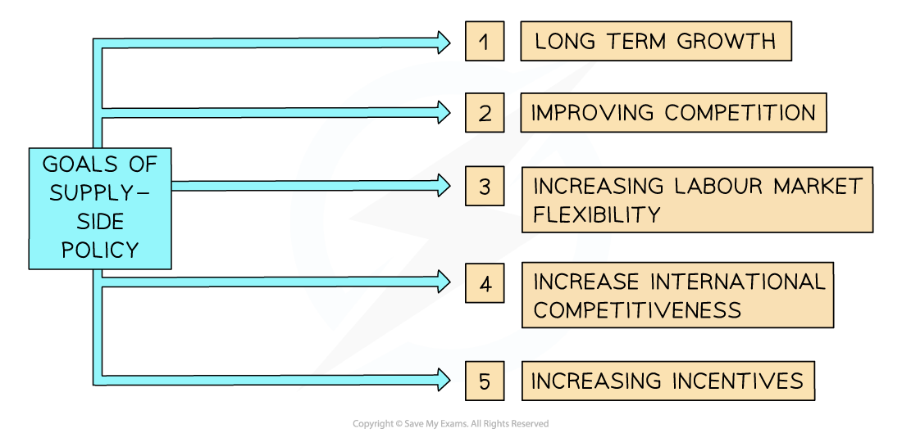

# Economic: Government Policies

## Monetary policy

> **Spec point** — `spcpt_KJ9GxZ2gbtf3MSvf`

## Monetary policy

- **Monetary policy** is the process by which a country's **central bank** (such as the Bank of England or the Federal Reserve in the US) **manages the money supply and interest rates** to influence the business** activity in the economy**
- **Monetary policy **helps the government achieve its **macroeconomic objectives**
- It aims to achieve

  - A low and stable rate of inflation
  - Low unemployment
  - Reduce ***business cycle*** fluctuations
  - Promote a stable economic environment for long-term growth
  - To control the level of exports and imports

### Expansionary monetary policy

- **Monetary policy** can be ***expansionary*** to generate economic growth

  - Expansionary policies include
  
    - Reducing interest rates: encourages borrowing and this helps to drive demand for goods and services
    - Increasing* quantitative easing*: increases the money supply in the economy which means families have more money to buy goods and services
    - ***Depreciating*** the exchange rate: encourages foreigners to buy goods and services from our country which can increase the supply of money

#### Example: expansionary monetary policy in the USA

| **The USA Federal Reserve Bank commits to an extra \$60bn a month of quantitative easing** |   |
|---|---|
| **Effect on the economy** | - Commercial banks receive cash for their bonds so liquidity in the market increases    - Commercial banks lower their lending rates, so consumers and firms borrow more, leading to increased **consumption and investment** and economic growth |
| **Impact on macroeconomic aims** | - **Economic growth** increases - **Inflation** rises - **Unemployment** may fall as output is increasing and more workers are required - With higher price levels** exports may decrease** and with rising incomes, **imports may increase** |

### Contractionary monetary policy

- **Monetary policy** can also be ***contractionary*** to slow down economic growth or reduce inflation
- **Contractionary** policies include

  - Increasing interest rates: discourages borrowing and this helps to lower demand for goods and services
  - Decreasing or pausing quantitative easing:  stops an increase to the money supply in the economy which means the amount of money in the economy is not increasing
  - *A****ppreciating*** the exchange rate: discourages foreigners from buying goods and services from our country which can decrease the supply of money. Imports are also more expensive which means households have less money available for other purchases

#### Example: contractionary monetary policy in the UK

| **The Bank of England increases interest rates** |   |
|---|---|
| **Effect on the economy** | - Existing** loan repayments** for households become more expensive    - *Discretionary income* reduces, so **consumption** decreases and total demand falls - Firms are less likely to borrow    - Less **investment** in capital takes place, leading to lower growth - The **exchange rate** appreciates, so  exports become more expensive and imports cheaper    - Net exports reduce, leading to lower economic growth |
| **Impact on macroeconomic aims** | - **Economic growth** slows down - **Inflation** eases - **Unemployment **may increase as output is falling and fewer workers are required - Both exports and imports reduce  as exports are more expensive due to higher exchange rate and imports cheaper (but households have less income for imports) |

### The impact of monetary policy changes on business decisions

- When a Central Bank changes the base rate of interest, it changes the price of borrowing for everyone, from families with *mortgages *to firms financing new equipment
- Businesses take a range of decisions to keep borrowing affordable, steady sales, and stay ahead of rivals whenever rates change

#### Business decisions and interest rate changes

| The Central Bank **raises interest rates** | The Central Bank **cuts interest rates** |
|---|---|
| - Money becomes costly , so firms try to pay off debt or borrow less - Projects that require big loans (new factory, extra shops) may be delayed - Customers have less to spend on items typically purchased on *credit*, such as cars or furniture, so firms may offer smaller product ranges or discounts - Businesses may look to stabilise borrowing costs by moving from variable to fixed-rate loans | - Cheap credit may mean delayed growth plans can now be implemented - Businesses may look to take out long-term loans before rates rise again - Companies offering credit may run cheap finance deals to tempt buyers - Businesses may stock up on extra inventory ready for higher sales |

## Fiscal policy

> **Spec point** — `spcpt_fBQtF9g5SV7rPZqk`

## Fiscal policy

- Fiscal Policy involves the use of **government spending and** **taxation **(revenue) to influence *aggregate demand* in the economy

### Expansionary fiscal policy

- **Expansionary** fiscal policy is intended to generate further economic growth
- Policies include

  - Reducing taxes
  - Increasing government spending

#### Examples of expansionary fiscal policy

| Policy | Impact on growth | Inflation | Unemployment |
|---|---|---|---|
| **Cut corporation tax** | - Higher after-tax profits leads to more investment | - Inflation increases as firms now have more money to spend | - Unemployment decreases as businesses hire more workers to meet the increased demand for goods and services |
| **Raise unemployment benefits** | - Higher household income leads to more consumption | - Inflation increases as households now have more money to spend | - Unemployment decreases as businesses hire more workers to meet the increased demand for goods and services |

### Contractionary fiscal policy

- **Contractionary **fiscal policy** **is intended to slow down economic growth or reduce inflation
- Policies include

  - Increasing taxes
  - Reducing government spending

#### Examples of contractionary fiscal policy

| Policy | Impact on growth | Inflation | Unemployment |
|---|---|---|---|
| **Raise income tax** | - Higher tax reduces households’ disposable income and consumption | ↓ | ↑ |
| **Freeze public sector pay** | - Pay restraint lowers purchasing power, so consumer spending falls | ↓ | ↑ |
| **Cut government spending** | - Government buys fewer goods and services, directly shrinking demand | ↓ | ↑ |

### The impact of fiscal policy change on business decisions

- When the government changes tax rates or public-spending programmes, the potential for profit and demand shift

#### Business decisions when tax and government spending change

| **Government raises corporation taxes** | **Government cuts VAT for a short time** | **Government offers grants or subsidies** |
|---|---|---|
| - Firms delay or move investment abroad - Some split into smaller companies to stay in a lower-tax band - Prices or dividends may rise to cover the extra tax | - Shops drop prices and run flash sales so people buy sooner - Extra stock is ordered and more staff put on the rota - Sales brought forward help cash-flow | - Businesses invest where cash support is offered - Local joint ventures are set up if the grant insists on home-grown suppliers - Big public projects pull whole supply chains to the region |

## Supply-side policy

> **Spec point** — `spcpt_35VsCYRSsfvRMKQq`

## Supply-side policy

- Supply-side policies try to help the economy produce more in the long run
- They are focused on **generating long term growth**, lowering average price levels, and creating new jobs

#### The goals of supply side policy

*Goals of supply side policy*

### Interventionist supply-side policies

- Interventionist supply-side policies require **government intervention **in order to increase the** full employment level of output**

  - These are mainly used to correct ***market failure***

#### Explanation of interventionist supply-side policies

| **Supply-side policy** | **Explanation** | **Effects** |
|---|---|---|
| **Education and training** | - Increasing government spending on** education** raises the quality of the workforce, resulting in *productivity *improvements | - Skills increase, leading to productivity improvements    - The cost of production falls so selling prices can be lower, leading to improved international competitiveness |
| **Improving quality, quantity and access to health care** | - Increasing government spending on** healthcare** so that productivity improves | - Healthier workforce can improve productivity    - Output increases, so businesses can better meet demand, leading to business growth |
| **Research and development** | - Increased **government spending** on *innovation *increases the supply of potential jobs in the economy | - New industry emerges, leading to improved  infrastructure    - More jobs are created leading to long-term economic growth |
| **Provision of infrastructure** | - Increased government spending on *infrastructure *helps to facilitate the **movement of people and goods**, which increases supply | - New infrastructure is developed helping reduce costs of production    - Supply increases so firms lower selling prices, leading to improved competitiveness |
| **Industrial policies** | - Industrial policies are direct and targeted support to firms or industries in the form of ***subsidies *** | - Businesses receive subsidies so their costs of production decrease    - Increased profit is generated, allowing more investment in innovation |

### Market-based supply-side policies

- **Market-based supply-side policies** aim to remove obstructions in the **free market** that are holding back improvements to the long-run potential of an economy

#### Explanation of market based supply-side policies

| **Market based policy** | **Explanation** | **Effects** |
|---|---|---|
| **Increase incentives** | - Reducing **income/corporation tax** rates incentivises workers to work harder - This provides firms with extra funds which they can use to invest in new machinery or technology | - Taxes decrease, so firms and individuals retain more money for themselves - Incentives increase, leading to increased productivity and long-term growth |
| **Improve competition and efficiency** | - ***Deregulation ***decreases costs, which may result in greater supply - ***Privatisation*** encourages new firms to enter the market and compete, thus increasing supply in the economy - **Anti-monopoly regulations** help increase competition, leading to a more efficient allocation of resources | - Regulation on firms decreases, so the cost of production falls    - Firms can lower selling prices, improving international competitiveness - State owned firms are privatised, so more firms enter the market to compete, leading to more competition and efficiency |
| **Reduce labour costs and create labour market flexibility** | - Decreasing **trade union power** so wages can be decreased - Decreasing or abolishing **minimum wages** to lower costs of production - Restructuring the **unemployment benefits** system to incentivise the unemployed to seek work | - Wages decrease so the cost of production falls    - Firms can lower selling prices, leading to greater international competitiveness |

### The impact of supply-side policy change on business decisions

- Long-term schemes such as training vouchers, R&D tax breaks or deregulation aim to make the whole economy more efficient
- Firms react by cutting costs and scaling up output faster than they otherwise could

#### Business decisions when supply-side policy changes

| Examples of supply side policy changes | **How businesses respond** |
|---|---|
| Provision of **training subsidies** | - **Upskill staff** because courses cost less - Shift workers onto new tech or processes faster - Higher skills leads to fewer mistakes, less wastage and higher output per employee |
| **Innovation grants for new technology** | - **Boost research budgets** and start projects that looked too risky before - Bring **new products to market sooner** than rivals - Adopt cutting-edge tech (AI, robotics) because the payback period is shortened |
| **Deregulation** | - **Enter markets** that used to need costly licences or long paperwork - Redesign products or services now that rules are simpler - Save compliance time and money, freeing cash for growth or price cuts |

## Exchange rate policy

> **Spec point** — `spcpt_skvS6qTMCK2pCPvb`

## Exchange rate policy

- **Exchange rate policy** is the way a country’s government or central bank tries to manage the **price of its currency** in terms of other currencies

### Reasons to manage exchange rates

- **Protect jobs and growth**

  - A cheaper currency can make exports easier to sell abroad, supporting factories and service firms at home
- **Control inflation**

  - A stronger currency makes imported goods cheaper, which can help keep prices from rising too quickly
- **Financial stability**

  - Exchange-rate volatility can rattle businesses and investors, so managing the rate can steady the economy

### Currency appreciation and depreciation

#### Currency Appreciation

- The **value of a country's currency increases** compared to other currencies

  - E.g. £1 = \$1.20 → £1 = \$1.30 (the pound has appreciated)
- **Exports become more expensive** for foreign buyers. This may reduce demand for UK exports
- **Imports become cheaper** for UK consumers. This can lower business costs and retail prices
- May **worsen the trade balance** if exports fall and imports rise
- Can help reduce **cost-push inflation** (cheaper imported raw materials)

#### Currency Depreciation

- The **value of a country's currency falls** compared to other currencies

  - E.g. £1 = \$1.30 → £1 = \$1.10 (the pound has depreciated)
- **Exports become cheaper** for foreign buyers. This can boost overseas sales
- **Imports become more expensive** for UK businesses and consumers
- Can **improve the trade balance** if export growth outweighs higher import costs
- May **increase inflation** due to costlier imported goods and materials

### The impact of exchange rate policy change on business decisions

- A change in a currency’s value instantly changes the price of exports and the cost of imported inputs
- Exporters and importers adopt a range of tactics to safeguard their profit margins and market share

#### Business decisions when exchange rate policy changes

| **Weaker currency** | **Stronger currency** |
|---|---|
| - A business's exports look cheaper overseas → exporters ramp up marketing and output - Imported raw materials cost more → firms search for local inputs or trim ranges | - A business's exports look dearer → firms may cut prices or shift some production abroad - Imported machinery and parts get cheaper → firms bulk-buy equipment or upgrade plants - Retailers pass on lower import costs with special offers |

> **Case Study**
> **SeaSalt Apparel Ltd – Responding to a Weaker Pound**
> 
> **SeaSalt Apparel Ltd** is a UK-based fashion brand specialising in coastal-inspired clothing. It operates from Cornwall and sells through high-street stores and a growing online presence, with 20% of its annual revenue coming from international customers in Europe and North America.
> 
> In early 2025, the pound (£) weakened by 15% against both the euro and US dollar following weak UK growth data and political uncertainty. This sudden currency movement had mixed effects on SeaSalt’s business.
> 
> **Impact on the business**
> 
> - **Import costs rose sharply.** Around 40% of SeaSalt’s materials — including fabric from Italy and buttons from India — became more expensive in pound terms. This put pressure on the company’s profit margins and forced it to raise prices on some items sold in the UK
> - **Export sales became more profitable.** At the same time, the weaker pound made SeaSalt’s prices more competitive overseas. The company saw a **30% increase in EU online orders**, especially from France and Germany, as its products became cheaper in euro terms
> - **Expansion plans faced uncertainty.** SeaSalt had recently signed leases for two new stores in Paris and Amsterdam. The weaker pound raised questions about the cost of fitting out these stores and the price competitiveness of imported stock sold in Europe
> 
> **How SeaSalt responded**
> 
> To reduce the risks and make the most of the opportunities, SeaSalt took several actions:
> 
> - **Launched a “Made in Britain” collection** using locally sourced materials to lower exposure to currency-linked import costs and attract patriotic domestic buyers
> - **Agreed forward contracts** with key overseas suppliers to lock in exchange rates for the next 12 months, protecting against further cost increases
> - **Opened a fulfilment hub in Rotterdam** to handle EU orders more efficiently and reduce customs delays and shipping costs
> - **Adjusted its marketing** to highlight the value of its products for international customers, especially those shopping in euros and dollars
> 
> **Outcome**
> 
> Within one year, **total revenue rose by 11%**, and **international sales grew to 27% of total turnover**. Profit margins were maintained through careful cost control, and the new EU stores performed in line with expectations. SeaSalt’s flexible response to the weaker pound helped it turn a potential threat into an opportunity for growth
