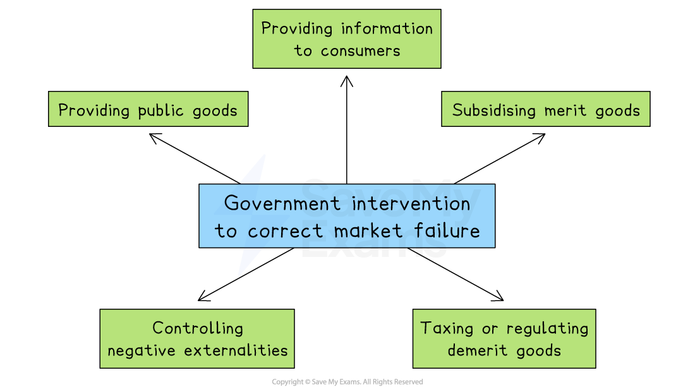

# Economic Influences

## How government might intervene to help businesses and encourage enterprise

> **Spec point** — `spcpt_WgWPj6gCZnj4Qdsg`

## How government might intervene to help businesses and encourage enterprise

- Governments often intervene in the economy to:

  - Promote **economic growth**
  - Create** jobs**
  - Encourage *innovation *and *enterprise*
  - Increase** international competitiveness**
- By helping businesses, especially start-ups and small firms, governments aim to build a strong and stable economy

#### Ways governments support businesses and encourage enterprise

| **Support** | **What it involves** | **Example** |
|---|---|---|
| **Finance** | - *Grants*, *subsidies*, tax relief and low-interest loans to reduce start-up and operating costs | - A government gives a grant to a new tech firm to develop medical software |
| **Training and education** | - Courses, mentoring schemes, and partnerships with schools to develop entrepreneurial and business skills | - A local enterprise centre runs free workshops on writing business plans |
| **Infrastructure investment** | - Improving transport, internet, and energy supply - Creating *enterprise zones* and business parks | - A government builds a business park with high-speed internet to attract digital start-ups |
| **Cutting red tape** | - Making it easier to register a business, apply for *licenses, *or comply with legal requirements | - A new online system allows start-ups to register and pay taxes in one place |
| **Export and trade support** | - Helping firms enter global markets through advice, t*rade fairs,* and international *trade agreements* | - A small food exporter gets help from a trade agency to expand into Asian markets |

## How government might intervene to constrain business activity

> **Spec point** — `spcpt_CYMSX57DyQKh7mJm`

## How government might intervene to constrain business activity

- Governments also have a duty to **protect the public, the environment, **and **the economy**

  - They may limit or control certain business activities that are seen as harmful, unfair, or against the wider interests of society
- These interventions can **increase business costs**, limit certain actions or block business plans altogether

#### Examples of government interventions

| **Intervention** | **What it involves** | **Example** |
|---|---|---|
| **Legal regulation** | - Laws cover areas including health and safety, employment, consumer protection and the environment | - A factory is fined for polluting a river in breach of environmental regulations. |
| **Competition law enforcement** | - Prevention of  monopolies, price fixing and uncompetitive practices | - A proposed merger between two telecoms companies is blocked to maintain market choice |
| **Taxation policy** | - Taxes on profits, imports or harmful products | - A government increases tobacco tax to reduce sales and health costs |
| **Planning and zoning controls** | - Where businesses can operate and the activities allowed in different areas | - A fast food chain is refused permission to build near a school due to health concerns |
| **Trade restrictions** | - Import *tariffs*, *quotas *or bans on certain goods to protect domestic industries | - A country imposes tariffs on foreign steel to support local producers |

## How government might deal with market failure

> **Spec point** — `spcpt_B8dq8W3TbFCsPyw7`

## How government might deal with market failure

- **Market failure** happens when the free market **fails to allocate resources efficiently** or fairly
- This happens when the market does not produce the right amount of goods and services or does so in a way that is unfair or harmful to society

  - Some goods or services are **underprovided** (like healthcare or education)
  - Others are **overproduced**, causing harm (like pollution or drugs)
  - **Not everyone can access** what they need (like clean water or housing)

#### Ways governments correct market failure

*Governments intervene in a range of ways to correct market failure*

### Solutions to market failure

#### 1. Providing public goods

- **Public goods**, like street lighting or national defence, wouldn’t be provided by private firms because there’s no way to make a profit
- The government funds and provides these directly using tax revenue

  - E.g. Most countries provide publicly funded **defence**, as private business would be able to charge individuals to stay safe from attack

#### 2. Subsidising merit goods

- **Merit goods** (like education or vaccines) are under-consumed in a free market because people may not understand their full benefits
- Governments subsidise these goods or provide them for free to encourage greater use

  - E.g. Ghana's government introduced free secondary education to ensure that more young people stay in school and contribute to economic development

#### 3. Taxing or regulating demerit goods

- **Demerit goods**, like tobacco or sugary drinks, are over-consumed because consumers ignore or underestimate the harm they cause
- Governments introduce taxes or regulations to reduce consumption and raise awareness

  - E.g. Mexico introduced a sugar tax in 2014 to tackle rising obesity levels; soft drink sales dropped as a result

#### 4. Controlling negative externalities

- **Negative externalities **occur when businesses cause harm to others, like air or water pollution
- Governments enforce regulations, set limits or fine businesses for pollution and environmental damage

  - E.g. China has introduced stricter emissions controls and shut down high-polluting factories to reduce air pollution in major cities like Beijing

#### 5. Providing information to consumers

- Consumers often lack full information to make good choices about, for example, health, finance or environmental impact
- Governments can launch **public awareness campaigns** or require businesses to **label products** clearly

  - E.g. In Chile, food packaging must carry clear warning labels for high sugar, salt, or fat content to help consumers make informed choices
