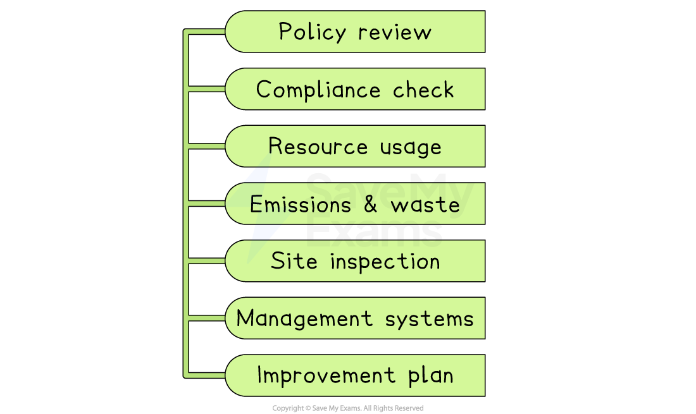

# Environmental Influences

## Environmental issues and business decisions

> **Spec point** — `spcpt_z7KYnDFCCh77BmCr`

## Environmental issues and business decisions

- Businesses can have a range of negative impacts on the environment

#### Business impacts on the environment

*Negative business impacts on the environment include noise, air, visual and water pollution, traffic congestion and dereliction*

- **Pollution** is caused by industrial processes that release harmful gases into the air or harmful substances into the ground
- **Land** and buildings may become unusable when businesses process dirty or toxic materials, leading to ***dereliction***
- **Traffic congestion** is caused by vehicles delivering materials to and from businesses, as well as by commuting employees
- **Visual pollution** is caused by unattractive buildings or business works that worsen inhabitants' views of their surroundings

#### Ways businesses reduce their environmental impact

| **Method** | **Example** |
|---|---|
| **Increasing the amount of waste they recycle or reuse** | - Two-thirds of **LUSH Cosmetics**' products, including bath bombs and shampoo bars, are sold without packaging, which has saved over 4,000 tonnes of plastic |
| **Encouraging employees to use public transport or walk/cycle to work,** | - Recognising that cycling improves<u> </u>employees' health and cuts time spent commuting, **Great Ormond Street Hospital** has hundreds of bicycle parking spaces at its site in central London and provides free bicycle maintenance to its staff |
| **Switching to electric vehicles for staff** | - Construction company **Tarmac** has committed to converting its whole car and van fleet and will install charging infrastructure at locations across the UK by 2030 |
| **Becoming carbon-neutral** | - **Marks and Spencer** became carbon neutral in 2012 by using renewable energy, such as solar, to power their buildings and ensures that none of their internal waste goes to landfill |
| **Improving the appearance of their surroundings** | - Packaging company **Maxpack **involved employees in the **planting of hundreds of pine trees** at its head office in Shropshire so as to make a positive contribution to tackling climate change |
| **Responding to climate change** | - **IKEA** owns wind farms and solar parks that now generate more electricity than its stores use each year |
| **Responding to water scarcity** | - **Coca-Cola**’s bottling plants in India reuse process water and fund local rain-harvesting projects to return as much water as they take |

- **Governments **encourage businesses to** reduce their environmental impact**

  - Strict regulations dictate the way businesses dispose of waste to avoid **pollution**
  
    - Higher charges for disposal, as well as limits on the volume of permitted waste, increase business costs
    - ***Fines*** for businesses that break environmental regulations and **order** them to **clean up** environmental damage
    - Banning of **hazardous materials** in manufacturing processes means alternatives must be sourced or developed
  - Some governments are focused on the switch from fossil fuels to **green energy** production, such as solar and wind power
  
    - In the long term, this should mean that businesses are likely to enjoy lower and more consistent energy costs
  - Many governments have introduced ***curbs***** **on business activities that cause environmental damage
  
    - E.g. **Pollution permits** allow businesses to pollute up to a certain limit

> **Exam Hint**
> Chains of analysis should link an issue to a business decision, leading to an outcome
> 
> For example, 'As water is scarce (issue), the brewery invests in water recycling equipment (decision), cutting both costs and environmental risk (outcome)'

## Environmental audits

> **Spec point** — `spcpt_j5f2DwcgjHFMMcZ2`

## Environmental audits

- An environmental audit is a **systematic check **of how a business affects the environment

  - Independent reviewers compare what the firm actually does with laws, company policies, and best-practice standards, then report the findings

### What an environmental audit includes

*Environmental audits check resource usage, waste and legal compliance*

1. **Policy review**

  - Does the firm have clear environmental goals and responsibilities?
2. **Legal compliance check**

  - Is it meeting all relevant regulations on air, water, waste and chemicals?
3. **Resource use assessment**

  - Measurement of energy, water, and raw-material consumption
4. **Emissions and waste analysis**

  - Quantities of greenhouse gases, effluent, waste, and recycling rates
5. **Site inspection**

  - Examination of equipment, storage areas and emergency procedures
6. **Management-system evaluation**

  - How well staff training, record-keeping, and monitoring systems work
7. **Improvement plan**

  1. Recommendations, targets, and deadlines for reducing the business’s environmental impact

#### How businesses and stakeholders use environmental audits

| **Business use** | **Stakeholder use** |
|---|---|
| - **Set clear environmental targets**    - Measure energy, waste, and emissions to see if goals are met and fix problems early | - **Assessing risk**    - Investors look at the audit to see if poor environmental practices could cost the company money later |
| - **Improve day-to-day checks**    - The data collected for the audit feeds into daily reports, so managers spot issues quickly and keep improving | - **Shoppers and jobseekers compare firms**    - People use audit results to choose where to buy or work, often favouring greener companies |
| - **Build trust**    - An outside expert or well-known standard (e.g. ISO 14000) shows the company’s environmental reputation can be believed, improving its image | - **Communities and regulators track progress**    - They use the audit to see pollution levels and push the business to meet higher standards |

## The importance of sustainability

> **Spec point** — `spcpt_ZBbwdxNc5T6zsr3v`

## The importance of sustainability

- **Sustainability** means meeting our current needs without compromising the ability of future generations to meet their own needs
- Businesses can contribute to sustainability by changing their operations in a variety of ways

#### Improving sustainability

*Businesses can contribute to sustainability in a range of ways*

#### Using renewables in production

- More than 99% of the wood used in **IKEA**'s furniture products is either sourced from sustainable sources or recycled

#### Reducing water use in industrial processes

- Introduced in 2011, **Levi's** Water<Less programme reduces the use of water in the manufacture of the company's denim products, so far saving over 4.2 billion litres of water in shortage areas

#### Using green transportation, such as electric vans

- Almost 40% of delivery company **Evri**’s London vehicles are zero-emission and the company operates e-cargo bikes across four UK cities

#### Avoiding the use of toxic substances

- Home accessories brand **Parachute** uses organically-grown textiles, with no harmful chemicals used at any stage of production

#### Using renewable energy, such as solar

- **Unilever** uses 100% renewable electricity across all its factories, offices, ***R&D*** facilities, data centres, warehouses and distribution centres. They also generate their own solar power at production facilities in 23 countries.

#### Implementing recycling

- **Revive Innovations Ltd** recycles compact discs, turning them into beautiful items of furniture and home accessories

## Trade-offs between sustainability and profits

- Adopting sustainable practices can involve significant upfront costs and operational expenses

  - Sustainable raw materials and ***components*** may be more expensive
  - Adapting production processes and machinery may require significant ***capital investment***
- These additional costs can potentially **reduce *****profitability***, at least in the short term
- On the other hand, prioritising short-term profits over sustainability can lead to long-term consequences, such as **resource depletion **and **environmental damage**

  - This can create **legal issues** or cause damage to a business's reputation
- These factors undermine a company's long-term ***viability*** and profitability
