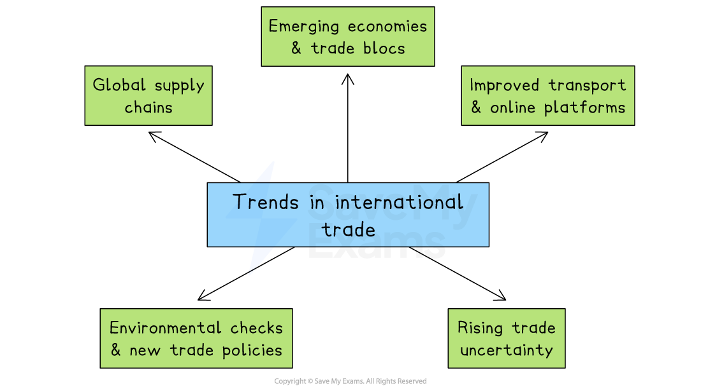

# International Trade

## An Introduction to international influences

> **Spec point** — `spcpt_BXmCXM2RpF9rT6VR`

## An introduction to international influences

- **International trade** is the exchange of goods and services across national borders

  - **Exporting **is the selling of goods or services from the home country to a customer in another country
  
    - E.g. A UK chocolate manufacturer ships bars to supermarkets in Germany
  - **Importing **is buying goods or services from producers in another country for use or resale at home
  
    - E.g. A Mexican furniture shop sells flat-pack desks manufactured by a producer in Poland

- Exports generate **extra sales revenue** for businesses selling their goods abroad
- Imports result in money leaving the country, which generates **extra revenue for foreign businesses**

### Trends in international trade

*International trade is changing, with the growing importance of emerging economies, global supply chains and improved transportation*

#### Global supply chains and digital services

- Many products are made in several countries before they reach the customer.

  - E.g. A smartphone can be designed in the United States, use chips from Taiwan, be assembled in Vietnam and sold  around the world

#### Emerging economies and trade blocs

- China, India and Mexico now produce much of the world’s manufactured goods
- *Trade blocs* like the EU and USMCA lower *tariffs* for members, but businesses must follow each bloc’s rules

#### Improved transport and online platforms

- Container ships and air freight make international delivery faster and cheaper
- Even small firms can sell online to customers in other countries

#### Environmental checks and new trade policies

- Customers and governments examine *carbon footprints*, working conditions and data security before buying or approving goods
- New trade rules encourage firms to adjust their *supply chains* to meet these higher standards and reduce risk

#### Rising trade uncertainty

- *Exchange rates*, tariffs and political tensions change more often, making international trade less predictable

  - E.g. The USA has recently applied high levels of tariffs to a wide range of consumer goods manufactured in China
- This encourages firms to develop more flexible supply chains

#### Benefits of increased international trade

| **Benefit** | Explanation |
|---|---|
| Larger customer base | - Selling in many countries boosts potential sales and spreads revenue sources beyond the home market |
| Economies of scale | - Higher global output lets factories run more efficiently, lowering the *unit cost* |
| Lower input costs | - Importing cheaper or higher-quality materials reduces overall production costs and can improve product quality |
| Risk spreading | - If demand falls in one country but rises in another, total revenue stays more stable over time |
| Access to new ideas and technology | - Working with overseas partners brings innovative designs and processes that can improve products and operations |

## The importance of international trade links

> **Spec point** — `spcpt_TRCZDr6VYtmHsDNr`

## The importance of international trade links

- International trade links, such as ** shared markets**,** digital agreements **and **transport routes**, lower *barriers to trade* and reduce risk when trading internationally
- They can help managers make decisions, including

  - Where to source supplies
  - Where to produce
  - How to distribute goods or services

#### International trade links and business decisions

| **International trade link** | **How it shapes business decisions** |
|---|---|
| - **Transport corridors and port networks**    - Examples include        - The Suez Canal and Panama Canal     - China's Belt & Road project     - Major air-cargo hubs such as Dubai     - Mega ports such as Rotterdam | - Firms choose suppliers and customers located on fast, reliable routes to cut delivery times. - They may build factories near big ports or rail hubs to save on shipping. |
| - **Digital trade agreements**    - Examples include        - Singapore–Australia Digital Economy Agreement     - UK–Japan Digital Partnership | - Clear rules on data transfer and online payments encourage companies to sell software, streaming or other digital services across borders - Businesses can confidently invest in secure cloud systems that meet the agreement’s data-protection rules |
| - **Regional supply chain clusters**    - Examples include        - The auto parts network across Thailand, Malaysia and Indonesia | - Manufacturers split production stages among neighbouring countries to use each one’s strengths (labour cost, skills, raw materials) - Managers plan *just-in-time*'  deliveries and have extra suppliers in the region to avoid stoppages |

## The impact of trade agreements on business

> **Spec point** — `spcpt_8Wr5pGV5DHv7VtS6`

## The impact of trade agreements on business

- International trade agreements set the ground rules for buying and selling across borders

  - By lowering tariffs, standardising product rules or protecting foreign investors, these agreements reduce risk and cost for firms
- As a result, managers decide **where to locate factories, how to price products and which new markets to enter** based on the protection and opportunities each agreement offers

#### Examples of trade agreements

| **Trade agreement** | Example | **How it shapes business decisions** |
|---|---|---|
| **Free Trade Agreements (FTAs)** | - United States–Mexico–Canada Agreement (USMCA) | - Tariff-free sales encourage firms to export or set up factories inside the free trade area - Managers adjust prices and forecast demand knowing that tariffs are low or zero |
| **Customs unions and common markets** | - European Union  (EU) single market | - One set of product standards allows a single version of a product for all member states - Warehouses and distribution centres can be placed in the country with the best transport links or lowest costs to serve the whole bloc |
| Global trade rules | - World Trade Organisation (WTO) | - More than 160 countries agree maximum tariff levels and fair-trade rules - Firms can have confidence that costs will not jump suddenly - If a partner country breaks the rules, their government can take the dispute to the WTO |

## The role of technology in international trade

> **Spec point** — `spcpt_j8kj7fRBfSHz6M7m`

## The role of technology in international trade

- Technology removes many barriers, such as distance, paperwork and payment difficulties, that once limited international trade

#### Uses of technology in international trade

| **Technology** | Explanation | **How it helps firms trade across borders** |
|---|---|---|
| **Mobile payment systems** | - Secure apps that store cards or e-money and process payments in seconds - Examples include Alipay, M-Pesa and Apple Pay | - Customers in different countries can pay instantly in their local currency - Small exporters avoid high bank fees and get cash sooner, improving cash flow |
| **Digital sales platforms** | - Online marketplaces that list products, translate pages, handle taxes and connect to *couriers* - E.g. Amazon Global, Alibaba, Shopify | - Even the smallest firm gains a virtual shop window open 24/7 to millions of overseas buyers - Built-in links to logistics automate shipping labels, customs forms and parcel tracking |
| **Cloud collaboration & digital freight tools** | - Cloud software lets buyers, suppliers and carriers share designs, stock levels and shipment details live | - Teams in different time zones co-edit orders and book transport without long e-mail chains - Real-time stock and route data cuts delays and lowers storage costs |
| **Blockchain for trade finance and traceability** | - A tamper-proof digital record of each step of a shipment - Smart contracts release payment once checkpoints are met | - Fewer paper documents and fast *customs* clearance reduce fraud and administration costs - Buyers can verify product origin (e.g. fair-trade cocoa) and meet strict import rules |
| **Artificial Intelligence (AI) applications** | - *Big data* is analysed to forecast demand and set dynamic prices | - Better forecasts mean leaner inventories and fewer *stockouts* |
