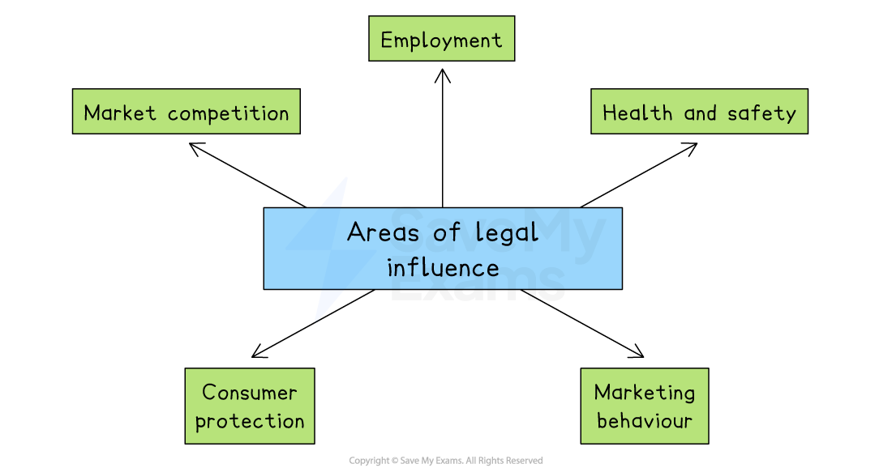

# Legal Influences

## An introduction to legal influences

> **Spec point** — `spcpt_BZNdJcNdkw4dNvwr`

## An introduction to legal influences

- Legal factors are **laws and regulations** that businesses must follow for a range of reasons, including:

  - To protect consumers from harmful substances
  - To protect consumers from misinformation
  - To ensure that businesses operate ethically
  - To ensure that business competition is healthy for society and does not become harmful or destructive
- Governments use laws to guide how businesses behave

  - This helps protect workers, consumers, and the wider economy
- The main areas of legal influence are shown on the diagram below

*Businesses are influenced by laws related to employment, health and safety, marketing behaviour, consumer protection and market competition.*

## Employment law

> **Spec point** — `spcpt_rBqWjHdqYZ5ZqPQf`

## Employment law

- Employee protection legislation **prevents exploitation of workers**
- It covers areas including

  - **Pay** and **working conditions**
  - **Equality** of employment rights for marginalised groups (e.g. those with disabilities) to avoid ***discrimination***
  - The right to belong to a  ***trade union**** *and take ***industrial action***
  - ***Contracts*** and termination of employment
  - Health and safety of employees and contractors

| Area of law | Typical coverage | Impact on business |
|---|---|---|
| **Pay and  working conditions** | - Minimum-wage levels - Limits on working hours, overtime and rest breaks - Safe working environment standards - Paid-leave entitlements (holidays, sick leave, parental leave) | - Employers must keep within legal limits or face fines and court action - Government inspections/audits check compliance - Firms may need to adjust shift patterns, rewrite contracts or upgrade staff facilities |
| **Equality of employment rights** | - Fair treatment regardless of gender, race, disability, religion, age or sexual orientation - Reasonable adjustments for disabled workers - Equal pay for equal work | - Recruitment, promotion and training must be merit-based - Job adverts and interviews must be fair and inclusive - Discrimination can lead to lawsuits, fines and reputational damage |
| **Right to belong to a trade union and take industrial action** | - Employees free to join a union to represent their interests - Collective-bargaining rights (negotiating pay and conditions) - Rules on lawful industrial action (e.g., strikes) | - Employers cannot punish or dismiss staff for union membership - Where required, firms must recognise and negotiate with union representatives - During strikes, legal procedures (ballots, notice periods) must be followed |
| **Contracts and termination of employment** | - Right to a written employment contract - Protection against unfair dismissal - Entitlement to notice periods, redundancy pay and the right to appeal a dismissal | - Employers must issue contracts and follow fair procedures when ending employment - Dismissals must be justified (e.g. misconduct, redundancy) - Ignoring fair procedures can lead to compensation claims and bad publicity |

## Health and safety law

> **Spec point** — `spcpt_ZN7bV9QjpKhxsyvJ`

## Health and safety law

- Health and safety law is intended to protect the **physical and mental wellbeing** of employees and contractors
- Laws in different countries typically cover

  - Provision of **adequate rest periods**
  - Acceptable workplace **temperature **and **noise levels**
  - Provision of **safety equipment**
  - Hygienic, safe and sanitary conditions
  - Manageable **workloads**
  - Safety procedures and equipment, e.g., **fire exits **and **first aid kits**
- To comply with health and safety laws, businesses need to

  - Train and supervise staff properly on how to work safely
  - Adjust working hours and ensure proper rest is taken
  - Arrange manuals, signage, and legally required safety documentation
  - Purchase and maintain personal protective equipment and safety tools
  - Create and follow a **health and safety policy** or *code of practice*
- Serious breaches of health and safety laws can lead to **investigations**, **fines **or **prosecution**.

  - Poor health and safety practices can also cause accidents, reduce staff morale and damage a business’s reputation

> **Case Study**
> **IronForge Engineering Ltd **
> 
> IronForge operates a busy metal fabrication plant. Workers often complain about
> 
> - High indoor temperatures
> - Loud machinery with no hearing protection
> - Lack of proper safety gear when cutting and welding
> - Long shifts without proper breaks
> 
> 
> 
> **Scenario**
> 
> After a serious accident where a worker was injured by a falling object, the business was reported to the local health and safety authority
> 
> The company was ordered to
> 
> - Install proper ventilation and provide ear protection
> - Reduce shift lengths and allow more frequent rest breaks
> - Provide hard hats, gloves, and protective clothing
> - Develop a written health and safety policy
> - Train all workers in equipment safety and emergency procedures
> 
> **Impact**
> 
> While the improvements increased costs at first, the business
> 
> - Avoided prosecution
> - Saw fewer accidents and reduced staff turnover
> - Gained a better reputation with clients and employees

## Marketing behaviour

> **Spec point** — `spcpt_tcBJXwtdq6gbVx4z`

## Marketing behaviour

- **Laws regulate marketing behaviour** and protect consumers from unfair, misleading or harmful practices
- They ensure that businesses advertise products **truthfully, responsibly and *****ethically***
- Marketing strategies must comply with legal standards in areas such as

  - Advertising content
  - Data protection
  - Pricing and promotions
  - Comparisons with competitors
- Failure to follow these laws can lead to **fines, legal action **or **reputational damage**

#### Areas of marketing law

| **Type of law** | **Explanation** |
|---|---|
| **False or misleading advertising** | - Businesses must not make claims that are untrue, exaggerated, or deceptive - Misleading marketing can damage trust and lead to legal penalties.    - E.g. A company claiming a health drink  cures illness without scientific evidence could face legal action |
| **Use of personal data in marketing** | - Laws control how businesses collect, store and use customer data - Customers have the right to know how data is used and can opt out of marketing communications |
| **Advertising to children** | - Some countries restrict how businesses market to children to protect them from harm    - E.g. A toy company may not be allowed to show unsafe play or unrealistic product effects in ads targeting children |
| **Unfair pricing** | - Businesses must not advertise very low prices or special offers that are unavailable or limited without stating so clearly |
| **Comparative and competitive advertising** | - Comparisons with competitors must be fair, truthful, and not designed to mislead or damage a rival’s reputation |

## Consumer law

> **Spec point** — `spcpt_6pFdv3HMGkYVRVSJ`

## Consumer law

- Consumer protection laws  **defend the rights of buyers** and ensure that businesses act **fairly, safely, and honestly**
- These laws  create trust in the market by making sure that products sold meet certain standards and that consumers are not misled
- Laws often cover

  - Product safety
  - Accuracy of information
  - Unfair contracts
  - Refunds or returns
  - Online and distance purchases
- If businesses fail to follow these laws, they can face legal action, financial penalties or reputational damage

#### Areas of consumer law

| **Type of law** | **Explanation** |
|---|---|
| **Product safety** | - Goods and services sold to consumers must be safe - They must meet manufacturing standards, use safe materials and quality checked |
| **Right to information** | - Clear, accurate product information, such as ingredients, materials, safety warnings, instructions and pricing, must be provided    - E.g. A food product must list all allergens and expiry dates clearly on the packaging |
| **Right to refunds, repairs or replacements** | - Consumers may be entitled to refund, repair or replacement of faulty goods |
| **Protection against unfair contract terms** | - Businesses cannot include terms in customer contracts that are unfair, unclear or one-sided |
| **Online and distance selling** | - Consumers have extra protections when buying online or by phone, including a 'cooling-off period' where they may cancel the order |

## Competition law

> **Spec point** — `spcpt_wZGthWW9MqkXY5Kp`

## Competition law

- **Competition law **helps ensure markets are open, fair and competitive
- Powerful companies are prevented from using their position to **dominate the market**
- Competition law can

  - Prevent *price fixing* and unfair *collusion*
  - Stop *mergers* or *takeovers* that reduce market competition
  - Ban abuse of *monopoly power*
- If a company breaks competition law, it may face **heavy fines, restrictions** or **forced break-up **of business operations

#### Laws affecting market competition

| **Type of law** | **Explanation** |
|---|---|
| **Ban on price fixing and *****cartels*** | - Businesses are not allowed to agree with competitors to fix prices, limit production, or divide up markets    - E.g. Two airlines agreeing to keep ticket prices high |
| **Control of mergers and takeovers** | - Governments may block or investigate mergers if they create a business that would dominate the market    - E.g. A proposed merger between two telecom giants might be stopped if it would leave only one major provider in the country |
| **Abuse of market power** | - A dominant business must not use its power to force out competitors unfairly, such as by setting extremely low prices or refusing to supply others    - E.g. A tech company refusing to let rival apps work on its platform could be investigated for abusing its position |
| **Access to markets for new entrants** | - Large firms cannot use tactics that block others from entering or growing in the market    - E.g. A supermarket chain forcing suppliers not to sell to rival stores could be breaking competition law |
