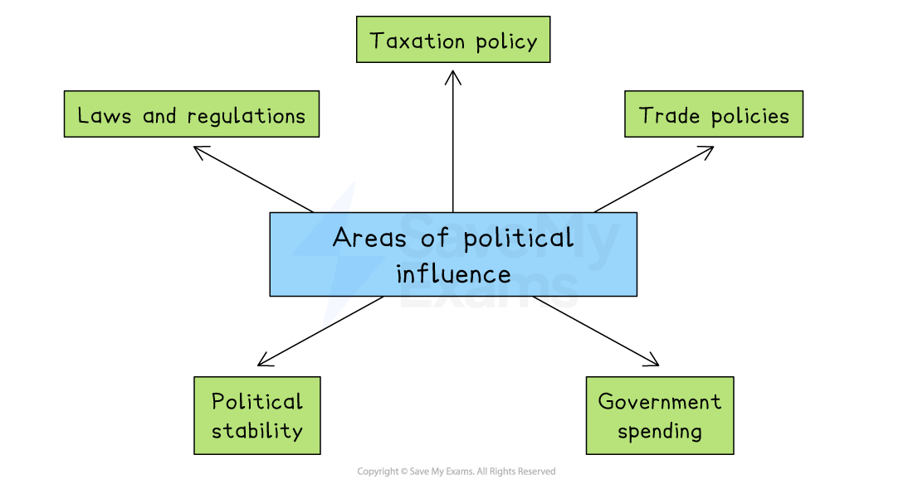

# Political Influences

## An introduction to political influences

> **Spec point** — `spcpt_FqSgb9QChgk7j38X`

## An introduction to political influences

- Political influences refer to the ways in which **government actions, decisions, and policies** can affect how a business operates

  - These can come from local, national or international governments

*Political influence on business comes from laws, regulations, tax policy, trade policy, government spending and stability*

- **Laws and regulations**

  - Businesses must follow rules related to health and safety, employment, consumer protection, and the environment
  - Breaking laws can lead to *fines*, damage to reputation or even being shut down
- **Taxation policy**

  - Governments decide how much tax businesses must pay
  - Higher taxes can reduce profits
  - Lower taxes may encourage investment or expansion
- **Trade policies**

  - Includes *tariffs*, *quotas*, and free trade agreements
  - These influence how easily businesses can buy and sell goods internationally
- **Government spending**

  - When governments invest in infrastructure, such as roads, hospitals and schools, certain businesses benefit
  - During economic downturns, governments may also support industries through *subsidies* or *grants*
- **Political stability**

  - Businesses prefer to operate in stable countries where laws and policies are predictable
  - In countries with unrest or frequent policy changes, there is more risk

> **Case Study**
> **Nestlé India and changing environmental regulations**
> 
> - In 2019, the Indian government introduced strict **environmental regulations** to reduce plastic waste
> - This included **phasing out single-use plastics**, such as plastic straws and wrappers, used in food and beverage packaging
> 
> **Responses**
> 
> - Nestlé India **responded** to the changing political environment by
> 
>   - **Re-designing packaging** for products, including Maggi noodles and chocolate bars
>   - **Investing in research** to develop recyclable and biodegradable materials
>   - **Working with suppliers** to source new eco-friendly packaging materials
>   - **Launching campaigns** to inform customers of its new sustainability efforts
> 
> **Impacts**
> 
> - **Costs increased** in the short term due to changes in materials and production
> - However, Nestlé improved its **brand image**, especially among environmentally aware consumers
> - The company avoided **legal penalties and reputational damage** by acting early

## Privatisation

> **Spec point** — `spcpt_j3Ntfq6Zbsnkryzp`

## Privatisation

- **Privatisation** occurs when government-owned firms are sold to the *private sector*

  - Examples of industries that are often privatised include transport, energy, telecommunications and healthcare services
- Many government-owned firms have been **partially privatised**

  - The government retains a share in them so they can influence decision-making and receive a share of the profits
  - e.g. Shares in **Singapore Airlines** are 55% government-owned and 45% privately owned

### Advantages of privatisation

#### 1. Raises government revenue

- Governments earn money from selling state-owned businesses
- Funds can be used to reduce debt or invest in public services

#### 2. Improves efficiency

- Private firms aim to cut waste, boost productivity and earn profits
- Often more innovative and customer-focused than public organisations

#### 3. Reduces government spending

- Running businesses is costly for governments
- Selling them reduces long-term financial pressure

#### 4. Encourages investment

- Private ownership attracts both domestic and foreign investors
- Can lead to more jobs and economic growth

  - E.g., Nigeria’s sale of NITEL helped expand mobile coverage

#### 5. Increases competition and choice

- Opens markets to new firms, giving consumers more options
- Can lead to better services and lower prices

  - E.g. Privatising parts of Australia's rail and electricity sectors led to lower prices for customers

### Disadvantages of privatisation

| **Disadvantage** | **Explanation** | **Example** |
|---|---|---|
| **Focus on profit over service** | - Private firms may prioritise profit rather than providing high-quality or universal services | - **US **private healthcare companies have been criticised for putting profit before patient care |
| **Loss of public control** | - Once sold, the government has limited control over how the service is run | - In **Argentina**, water services were privatised in the 1990s, leading to concerns over foreign control and rising prices |
| **Job losses** | - To cut costs, private firms may reduce staff or cut wages and benefits | - In **Greece**, privatisation during the financial crisis led to significant *redundancies* in the transport and energy sectors |
| **Unequal access** | - Services may become too expensive or be reduced in less profitable rural areas | - In **South Africa**, rural communities complained of reduced access after parts of the electricity sector were privatised |
| **Risk of private monopoly** | - If no competition exists, one firm may dominate and exploit consumers | - In **Russia**, the early 1990s saw the creation of powerful monopolies after rapid privatisation, especially in oil and gas |
| **Short-term thinking** | - Private firms may avoid long-term investment to boost short-term profits | - In **India**, some critics argued that privatised rail contractors cut maintenance budgets to save money, risking safety |

## Nationalisation

> **Spec point** — `spcpt_J7qDxG97qG6dKPmh`

## Nationalisation

- **Nationalisation** is when a **government takes ownership and control** of a business or industry from the private sector

  - This means the service or company is now **owned by the state** and run on behalf of the public
- Nationalisation usually happens in sectors that are considered **essential** or where private ownership has failed to meet the needs of society

### Advantages of nationalisation

- Nationalisation allows the government to directly **manage industries that are vital to the economy or national security**, such as transport, healthcare, or energy

  - This means it can set policies in the public interest, such as keeping prices affordable, ensuring services reach rural areas or responding quickly in times of crisis
- Unlike private firms, state-owned businesses don’t need to maximise profit for shareholders

  - This means services can be designed to **benefit** **citizens, workers and consumers** more fairly
  - Prices may be lower, access more equal and working conditions more secure
- When a business is nationalised, it may gain **financial stability** and access to **long-term government investment**

  - This can be especially helpful if the business was struggling under private ownership
  - Government backing also allows the company to focus on long-term goals, such as *infrastructure* development or environmental sustainability, without worrying about short-term profit pressures or investor demands

### Disadvantages of nationalisation

- Running a nationalised business can be very expensive

  - The government must fund day-to-day operations, invest in maintenance and improvements, and cover losses if the business isn’t profitable
  - This can place a **strain on public finances**, especially during economic downturns
- Without the pressure to make a profit or compete with rivals, nationalised businesses may become **less efficient**

  - They might have more *bureaucracy*, slower customer service, or fewer incentives to innovate
  - Customers and workers may experience delays, outdated technology, or inconsistent quality
- Nationalised businesses can be affected by **political pressure**, where decisions are made for short-term popularity rather than long-term success

  - Politicians may interfere in areas like pricing, recruitment or expansion, even if it goes against what’s best for the business
  - This can make planning and management difficult, especially as different governments often have diverse priorities

> **Case Study**
> **Nationalisation of YPF – Argentina’s Oil Giant**
> 
> **Scenario**
> 
> In 2012, the Argentine government made headlines when it nationalised 51% of YPF, the country’s largest oil company, which was majority-owned at the time by the Spanish firm Repsol. This dramatic shift brought a key energy asset back under state control
> 
> 
> 
> **Reasons for nationalisation**
> 
> - **Strategic industry control:** Oil and gas are essential to Argentina’s economy and energy independence. The government argued that letting a foreign company control such a vital sector was risky
> - **Falling investment: **Repsol was accused of failing to reinvest enough in Argentina's oil infrastructure. As a result, domestic production was declining, forcing the country to import more energy, worsening its trade balance
> - **Public interest and economic stability: **The government believed nationalisation would allow Argentina to boost production, lower fuel import bills, and make energy more affordable and accessible, especially in rural and underserved regions
> 
> **Outcome**
> 
> - **Short-term benefits:** Nationalisation helped stabilise energy supplies. The state could now steer investment toward long-term infrastructure goals and reduce reliance on imports
> - **Increased government control: **The move gave Argentina more control over pricing and supply, enabling subsidised fuel prices for domestic consumers
> - **Legal and financial fallout: **However, the nationalisation sparked international lawsuits. Argentina had to eventually compensate Repsol nearly \$5 billion, which strained public finances
> - **Efficiency concerns: **Critics noted that YPF's productivity improved slowly, and the firm faced issues with bureaucracy, political interference, and a lack of innovation—typical drawbacks associated with state-run enterprises
