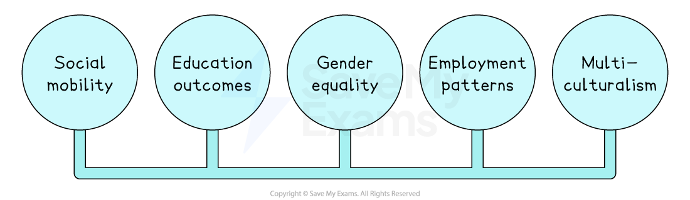
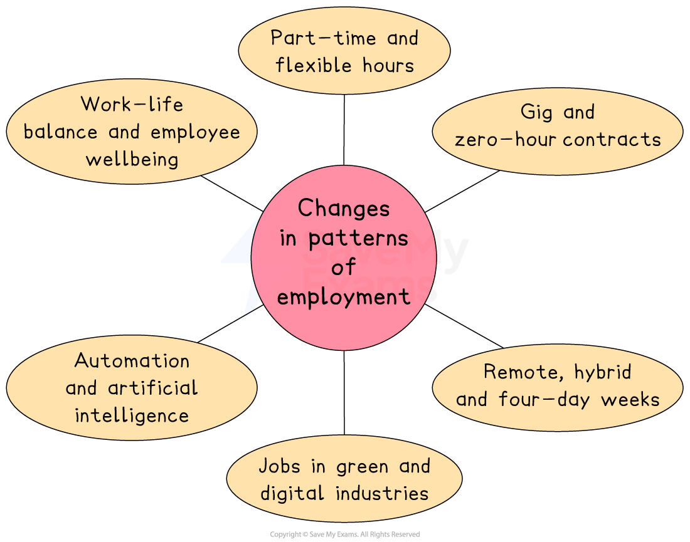

# Social Influences

## An introduction to social influences

> **Spec point** — `spcpt_24THBpW9wMJpDMkM`

## An introduction to social influences

- Social influences are **attitudes, values** and **culture **that affect business decisions

*Social mobility, education outcomes, gender equality, employment patterns and multiculturalism affect business decisions*

- High social mobility, good schooling, gender equality and varied work patterns give firms a larger, better-skilled labour pool
- Educated, multicultural and gender-inclusive societies increase spending power and mix viewpoints, helping businesses exploit new customer needs and create fresh ideas

## Social mobility

> **Spec point** — `spcpt_8Fs9PNVX7hqpSnrh`

## Social mobility

- Social mobility refers to how easily someone can climb from a low-income or low-status background to the middle or top of society

  - **Denmark** has the highest level of social mobility in the world
  - **India **has relatively low levels of social mobility

#### Ways social mobility affects business

| Impact on business | **High mobility ** | **Low mobility** |
|---|---|---|
| **Availability of skilled workers** | - Plenty of educated, healthy people to hire, so recruitment is easy and cheap | - A smaller skilled pool of labour, so firms compete, pay more or import talent |
| **Wages and labour costs** | - Pay gaps are smaller and predictable, so labour costs stay steady | - Big pay gaps emerge as low-skilled labour is cheap but top talent is expensive |
| **Size of the customer market** | - Many move into the middle class, so there is broad, reliable demand for goods and services | - Spending power sits with a few wealthy groups so firms target budget **or** luxury segments |
| **Start-ups and innovation** | - Anyone with a good idea can get education and funding, so more new firms are set up and fresh ideas generated | - Barriers in class, caste, location block ideas, so fewer businesses are set up and innovation is slower |

## Education outcomes

> **Spec point** — `spcpt_fJXNcjSyKVrdx4G9`

## Education outcomes

- Spending on good schools and skilled teachers in **Singapore **is very high
- In contrast, **South Africa** lacks education resources and quality problems hold learning back

#### How education levels affect business

| Impact on business | **High educational outcomes** | **Low educational outcomes** |
|---|---|---|
| **Skilled worker supply** | - A large pool of well-qualified staff, especially in maths and science, makes hiring easy | - A shortage of engineers, IT and health workers makes vacancies hard to fill |
| **Training and recruitment costs** | - New recruits arrive work-ready, so firms spend less time and money on basic training | - Companies must run extra training programmes or recruit overseas, raising costs |
| **Innovation and investment** | - Availability of talented workers attracts technology, biotech and finance firms to set up R&D and head offices | - Skills gaps make global investors cautious about setting up high-tech factories or research labs |
| **Consumer spending power** | - Graduate salaries create a broad middle class that buys a wide range of goods | - Many workers stuck in low-paid jobs limit demand for anything beyond essentials |

## Gender equality

> **Spec point** — `spcpt_xvBJ354VMPVQncjm`

## Gender equality

- Gender equality means **giving people of all genders the same rights, responsibilities, opportunities **and **respect**

  - Everyone can study, work, earn, own property and take part in decisions without *discrimination*
  - Rewards such as pay, promotion or investment are based on merit, not gender
- **Sweden** has a high level of gender equality, where women earn about 90% of men’s pay
- **Japan **has high levels of gender inequality, with a gender pay gap of around 22%, and only 14 % of company *directors *are women

#### How gender equality affects businesses

| Impact on business | **High gender equality** | **Low gender equality** |
|---|---|---|
| **Size of the talent pool** | - Women take part in every occupation, so firms can choose from almost the whole population when hiring | - Many skilled women are shut out of top jobs - Companies struggle to fill senior roles and may need to pay more to recruit |
| **Productivity and new ideas** | - Mixed-gender teams bring different views, leading to better problem-solving and faster innovation | - If almost everyone in a team is male, with similar backgrounds and experiences they may all think in the same way - This can slow down product design and decision-making |
| **Reputation with customers and investors** | - Equal-pay audits, flexible leave and gender-neutral adverts signal fairness - This strengthens the brand and is attractive to investors | - A large pay gap and few female directors hurt global image - Some investors demand change before investing |
| **Legal compliance and costs** | - Clear rules mean fewer discrimination claims | - Stock-exchange quotas and mandatory pay-gap reporting force rapid change - Firms that lag behind face fines or bad press |

## Patterns of employment

> **Spec point** — `spcpt_xPq3xN7HY258pBWn`

## Patterns of employment

- New technology, changing lifestyles and worker expectations mean that many jobs have changes significantly in recent years

  - Employees work shorter weeks, split their time between home and office, take on project-based jobs or rely on digital tools to complete tasks

#### Changes in patterns of employment

*Employment patterns have changed in recent years, with flexible arrangements, informal contracts and technology impacting the nature of job roles*

| Change | Explanation | Impact on business |
|---|---|---|
| **Growth of part-time and flexible hours** | - More employees work shorter weeks, vary start and finish times - They may work compressed hours to balance work with study, parenting or leisure | - Bigger talent pool includes parents, students and retirees - Rotas and payroll are more complex |
| **Expansion of gig and zero-hour contracts** | - Companies increasingly use project-based workers rather than employing permanent staff | - Lower fixed wage bills - Harder to build loyalty and maintain consistent quality |
| **Move to remote, hybrid and four-day weeks** | - Technology allows many roles to be done partly or fully from home, and some businesses have trialled 32-hour weeks | - Save money on office space - Can recruit staff from anywhere - Need effective online communication |
| **New jobs in green and digital industries** | - Demand is rising for skills in renewable energy, electric vehicles, *cybersecurity*, cloud services and e-commerce | - New markets open up - Shortage of skilled staff can push wages up |
| **Automation and artificial intelligence reshaping tasks** | - Routine or data-heavy activities are increasingly handled by robots, software or AI assistants | - Faster output and lower long-term costs - High up-front technology investment spending and staff retraining. |
| **Greater focus on work–life balance and employee wellbeing** | - Workers expect mental health support, flexible leave and meaningful work | - Better morale and fewer sick days - Extra cost if financial benefits are improved |

## Multiculturalism

> **Spec point** — `spcpt_7czTWZkcX6HsBxym`

## Multiculturalism

- A  **multicultural society **is one where many cultural, ethnic and religious groups live side by side and are recognised as equal

  - Customers, employees and suppliers may bring different languages, values, tastes and traditions

#### How multiculturalism shapes business decisions

| Decision | Typical responses from firms |
|---|---|
| **Product design and ranges** | - Adapting flavours, sizes or features to suit diverse preferences    - e.g. halal menus, skin-tone cosmetics and multilingual packaging |
| **Marketing and branding** | - Using inclusive images and language - Avoiding *stereotypes* - Scheduling promotional campaigns around festivals such as Diwali, Ramadan or Lunar New Year |
| **Customer service** | - Training staff in cultural sensitivity - Offering interpretation - Respecting religious dress or service needs |
| **Human resources** | - Recruiting from a wider talent pool - Supporting faith-based leave - Flexible dress codes |
| **Team communication** | - Clear guidelines on language use - Cross-cultural teamwork training and mentoring |
| **Location and supply chain** | - Setting up outlets in multicultural districts - Sourcing authentic ingredients - Partnering with minority-owned suppliers |
| **Legal compliance and reputation** | - Meeting equality laws and demonstrating corporate social responsibility |
