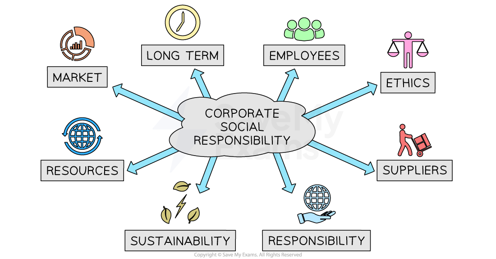

# The Impact of Corporate Social Responsibility

## The impact of corporate social responsibility on business

> **Spec point** — `spcpt_6VSbXZVV6r5R2pn8`

## The impact of corporate social responsibility on business

- **Corporate social responsibility (CSR) **refers to the concept that businesses have a responsibility to consider and positively impact society
- Companies **voluntarily integrate social and environmental concerns** into their business operations and interactions with stakeholders

#### Social responsibility goals

*Corporate social responsibility goals can be focused on a range of different stakeholders*

- CSR involves taking into account the** impact of business activities on various stakeholders**, including employees, customers, communities, the environment and society as a whole

#### Examples of socially responsible activities

| **Activity** | **Example** |
|---|---|
| **Sustainable sourcing of raw materials and components** | - **Patagonia** is moving its entire clothing range to 100 % recycled or renewable fibres - It publishes detailed, regularly updated supply-chain maps so anyone can check where materials come from |
| **Responsible marketing** | - **The LEGO Group** does not directly advertise to under-12s - It also limits data collection and send clear, age-appropriate messages in communication |
| **Protecting the environment** | - **Starbucks **gives customers a discount when they bring a clean reusable cup into its US and Canadian stores, cutting single-use waste |
| **Responsible customer service** | - **Costco **offers a  100% satisfaction guarantee - Products can be returned at any time for a full refund |

## Ethics and CSR

- Ethics relates to the **rights or wrongs **of making a strategic decision that are **beyond legal requirements**
- Some businesses adopt an **ethical code of practice** which informs decision-making and may set out how they

  - Behave responsibly with regards to the **environment** and avoid negative impacts on **animals**
  - Adopt **fair working practices**
  - Implement **equitable *****supply chains**** *
  - Takes steps to **eliminate *****corruption***
  - Adopt ethical accounting practices
  - **Avoid controversial products** or take steps to minimise their impact or access to them
- Many large companies carry out and publish annual **social audits **which provide an review of the steps being taken to meet their commitments

## The impact of implementing CSR

- Businesses experience a range of benefits as a result of implementing CSR

  - They attract long-term **loyalty from employees and customers**
  - Their approach provides a useful ***competitive advantage***
  - They receive the **support of the** **local community** and **local government**, especially if they share their aims
  - Employees are likely to be **motivated**, loyal and productive, as they are proud of working for a responsible firm
- However, **suppliers** and **competitors **often change their approach to ensure that they do not lose sales to more ethical rivals
- In addition, taking an ethical approach costs more and **may reduce the overall level of profits** if prices cannot be raised to compensate

> **Case Study**
> Fashion retailer **Uniqlo **has adopted an eco-friendly strategy in recent years
> 
> 
> 
> - It focuses on technologies that make the production of new clothing from **recycled materials** possible
> - It has invested significant sums in **energy-efficient production** facilities
> - It supports the campaign to **safeguard the islands and coastal regions** of Japan’s threatened Seto Inland Sea

## Community and pressure group needs

> **Spec point** — `spcpt_pMR75v8vcKB8mRgR`

## Community and pressure group needs

- A business's community is everyone touched by a its activities, including

  - Local residents
  - Employees and their families
  - Customers
  - Suppliers
  - Schools
  - Charities
  - Local government
- Winning **community support** gives a business a social licence to operate; without it, business projects can be delayed, boycotted or shut down

#### Why businesses should listen to their communities

| Benefit to the business | What can go wrong if ignored |
|---|---|
| - **Reputation and brand loyalty**    - Positive media coverage, word-of-mouth and higher customer retention | - Negative headlines, social-media backlash or long-term brand damage |
| - **Customer demand**    - Communities increasingly prefer ethical, eco-friendly and inclusive products | - Falling sales as people switch to rivals or start a *boycott* |
| - **Access to investment and new talent**    - Many investors and job-seekers look for responsible firms | - Higher cost of capital and difficulties in recruiting staff |

### Pressure groups

- A pressure group is an organisation that tries to **influence the decisions of businesses or governments** in favour of a particular cause, such as animal welfare, climate action, or workers' rights
- Common **tactics **used by pressure groups include

  - Public *petitions *and letter-writing campaigns
  - Social-media 'naming and shaming' or viral videos
  - Peaceful protests, *strikes, *or* sit-ins*
  - *Lobbying* politicians for new laws
  - Buying shares to speak at a company’s *AGM*
  - Legal action (e.g. climate lawsuits against oil firms)
- **Consumers **can act as a particularly powerful pressure group

  - **Buying behavior, e.g.,** choosing Fairtrade coffee or USDA-organic fruit, rewards ethical producers
  - **Social media, e.g.,** praising green firms and exposing polluters at low cost
  - **Direct feedback, e.g.,** e-mails, online reviews, polls and focus groups, tells firms which practices are unacceptable
  - **Boycotts, e.g.,** refusing to purchase from a harmful brand or deliberately supporting a responsible rival

#### Examples of pressure group influence

| Pressure group | Business impact |
|---|---|
| **Greenpeace** | - Engages in direct action at oil rigs and palm-oil plantations - Helped secure a worldwide ban on commercial whaling (1982) - Pushed major retailers to remove microbeads from toiletries (2018) |
| **Buglife** | - Halted a building development in 2015 that threatened a rare insect species, saving local biodiversity and forcing the developer to redesign plans |
| **Consumer boycott of Nike** | - Highlighted *sweatshop *labour, leading Nike to publish supplier lists and raise factory standards |
