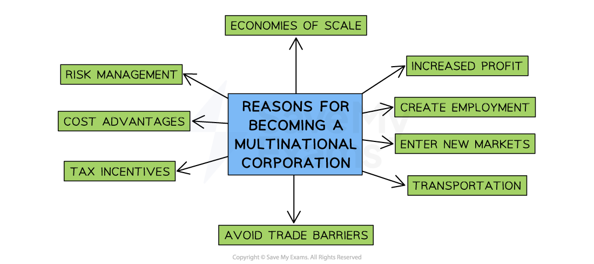
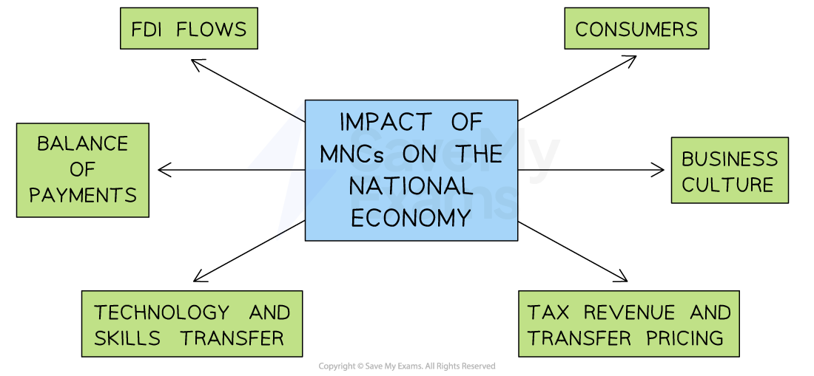

# The Impact of Multinationals

## An introduction to multinationals (MNCs)

> **Spec point** — `spcpt_MYrhcR78FcmmMVxZ`

## An introduction to multinationals (MNCs)

- **A multinational company (MNC)** is a business that is registered in one country but has **manufacturing operations or outlets** in different countries

  - E.g. Starbucks headquarters are in Washington, USA but they have 32,000 stores in 80 countries
- Factors such as ***globalisation*** and ***deregulation*** have contributed to the growth of MNCs
- MNCs choose locations based on factors such as **cost advantages** and access to markets

  - E.g. Nike originates from the USA but 50% of their manufacturing takes place in China, Vietnam and Indonesia due to the **lower production costs** in these countries

#### Reasons to become a multinational

*There are many benefits to becoming a globally recognised brand*

1. **Economies of scale**

  - As they operate globally, they are able to increase their output and benefit from lowered costs created by ***economies of scale***
2. **Increased profit**

  - Much of their profit is sent back to their home country
  
    - This point is debatable as many MNCs have ***offshore bank accounts*** and do not bring the profit back home
3. **Create employment**

  - New jobs are created in host countries each time a new facility is setup and this **raises income,** which helps to improve the standard of living in that country
4. **New markets**

  - MNCs can identify potential markets & begin to sell there
  - They can set up facilities close to their customers, reducing transportation costs
5. **Risk management**

  - By selling in many national markets, the **risk of failure** is reduced
  
    - E.g. a *recession *in one country can be offset by sales in a growing market elsewhere
6. **Tax incentives**

  - MNCs are able to increase profits by setting up in countries with **low corporation tax** rates or countries that offer MNCs ***tax breaks***
7. **Labour cost advantages**

  - Many businesses choose to locate production facilities in countries where labour costs are low
8. **Avoidance of barriers to trade**

  - MNCs can establish bases in countries that are operating ***protectionist*** measures and by doing so, they avoid the measures
  
    - e.g. A Chinese MNC may setup in the USA and produce there, thus avoiding ***import tariffs*** on  their products exported from China to the USA

## The advantages and disadvantages of hosting multinationals

> **Spec point** — `spcpt_VNvQHG3J65vy49jP`

## Advantages and disadvantages of hosting multinationals

- MNCs offer both advantages and disadvantages **to host countries** with regard to:

  - Employment, wages and working conditions
  - The impact on local businesses
  - The impact on the local community and environment

### Employment, wages and working conditions

- Multinational companies  can change a host country’s job market in positive and negative ways

| **Positive impacts** | **Negative impacts** |
|---|---|
| - **Job creation**    - Samsung’s Vietnam plant employs over 100,000 locals and boosted the region's electronics industry | - **Worker exploitation**    - The Rana Plaza collapse in Bangladesh revealed dangers when labour laws are poorly enforced |
| - **Higher wages than local firms**    - Toyota in Mexico pays above-average wages compared to local car workshops | - **Low wages by global standards**    - Apple suppliers in India pay near the legal minimum to keep costs low |
| - **Better working conditions**    - Unilever’s Kenyan tea sites offer protective gear and clinics not available in small local firms | - **Limited local hiring**    - Chinese projects in Kenya often bring in their own workers, reducing local job opportunities. |

### The impact on local businesses

- When a multinational company (MNC) sets up in a new country, its influence spreads beyond the jobs it creates directly
- Local firms can gain new customers, skills and partnership opportunities, but they can also face stronger competition for both workers and sales

#### Advantages and disadvantages of MNCs for local businesses

| **Advantages** | **Disadvantages** |
|---|---|
| - MNCs can **boost the local economy**,** **    - If workers receives higher wages, they may **spend more** on local products   - MNCs may **buy the services** of local businesses - Opportunities for** *****joint ventures*** and partnerships with MNCs who seek to gain knowledge of the local market    - Local firms may **learn new skills** and production methods to improve efficiency | - MNCs **reduce the supply of workers **available to local businesses if they offer better pay and working conditions - If MNCs are able to produce at a lower cost and **compete with local businesses**, they may lose local customers    - This may cause unemployment for workers of local businesses |

### The impact on local communities and the environment

- When a multinational company operates in a new area, its presence can reshape the whole community, not just the workplaces it builds

#### Advantages and disadvantages of MNCs for local communities and the environment

| **Advantages** | **Disadvantages ** |
|---|---|
| - Local residents may benefit from** job opportunities **and growth in the local economy - MNCs often invest to improve **infrastructure**    - Better roads, transportation and access to water and electricity help local communities - MNCs may have to pay taxes and ***business rates**** *to local councils/ authorities    - These funds may be reinvested back into the local community | - MNCs may cause **damage to local habitats and the environment **    - E.g. Shell has a track record of **oil pollution** in vulnerable communities in Nigeria - MNC's may leave **unsightly production facilities** behind once they have extracted useful resources and left the country |

## Relationships between governments and multinationals

> **Spec point** — `spcpt_hn922d2YtyMWP4PY`

## Relationships between governments and multinationals

- Many governments are in favour of MNCs establishing in their country, as there are **benefits** to the wider economy

#### The impact of MNCs on national economies

*MNCs impact several metrics in the national economy, including FDI flows and the balance of payments*

### Foreign direct investment (FDI) flows

- There will be an **inflow of money **into a country if a MNC decides to invest in a country through  ***foreign direct investment***

#### Advantages and disadvantages of FDI flows from MNCs

| **Advantages** | **Disadvantages** |
|---|---|
| - There is an** initial lump sum of money** that enters the country to pay for the investment    - If this money is **reinvested** **back into the local economy**, it may help to generate new jobs and boost economic growth | - Assets from the home country are now **owned (or partly owned)** by foreign businesses - Local firms or individuals who have sold the asset may not reinvest the money into the local economy but may **move it offshore** |

### Technology and skills transfer

- MNCs can bring new technologies and skills to local businesses

  - This helps** improve efficiency and productivity**, helping domestic businesses to become** more competitive** in national and international markets

### Consumers

- Customers in countries which host MNCs benefit from:

  - A ** wider choice of goods** and services
  - **Lower prices** if MNCs pass their cost advantages on in the form of lower prices
  - **Better quality** of goods and services
  - **Improved living standards,** as people may have higher incomes due to the job creation and the resulting reduction in unemployment
- However, MNCs can **push domestic businesses out of the market**, leaving customers with less choice

  - This may lead to MNCs exploiting customers with **higher prices** and **low quality products**, as they have limited choice

### Business culture

- Domestic businesses may be influenced by the  ***business culture*** of MNCs

  - E.g. In the 1990s, UK businesses adopted the working practices of Japanese businesses such as Nissan
  - Workplaces became more open, and employers copied ideas such as ***Kaizen*** and continuous improvement
- MNCs may also encourage a culture of **entrepreneurship**

  - This can help boost overall ***economic growth***
- However, MNCs may demonstrate** unethical behaviour** and have a company culture of exploitation

  - E.g. Bangladesh is used by many clothing brands to produce cheap clothes and many turn a blind eye to poor working conditions
  - This encourages local firms to** also ignore the working conditions**

### Tax revenue and transfer pricing

- The host country can earn significant tax revenue
- Governments can use this tax to invest in improving public services and infrastructure
- However, MNCs seek to maximise profits and often try to **reduce their tax liabilities**

  - ***Transfer pricing*** is a method used by MNCs to shift profits from where they are generated to countries with lower tax rates
