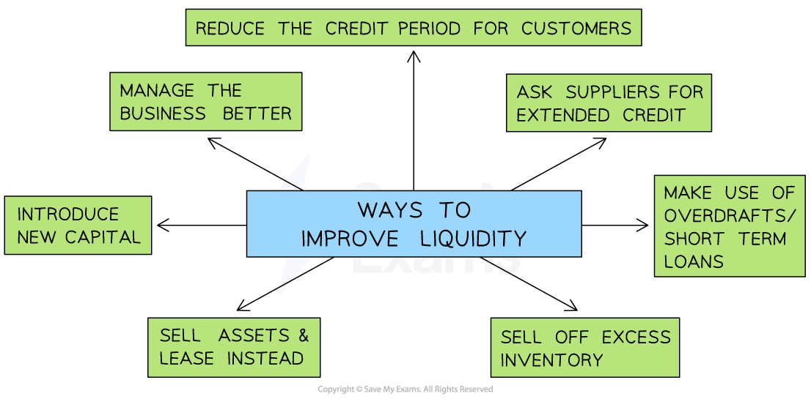

# Liquidity Ratios

## The meaning and importance of liquidity

> **Spec point** — `spcpt_zRSsfYcp4FqjF2wN`

## The meaning and importance of liquidity

- **Liquidity **is the** ability of a business to pay back its short-term debts**, e.g. its suppliers
- A businesses that cannot pay its debts is considered **insolvent**

  - If a business cannot pay its **suppliers, **raw materials or components may not be delivered and **production will be delayed**
  - If it cannot repay an ***overdraft***, **banking facilities may be withdrawn,** and its ***credit rating*** will suffer
  - ***Creditors*** may force it to stop trading and sell its ***assets*** so that the debts owed to them are repaid

## The current ratio

> **Spec point** — `spcpt_ZGMtTTSGzjRwMzps`

## The current ratio

- The Current Ratio is a **quick way** to measure *liquidity* and the outcome is **expressed as a ratio**
- All forms of *current asset *are considered in this ratio
- The current ratio is an effective **liquidity **measure for businesses that **hold little stock**
- The result indicates how well **current assets** **can cover short-term debt**
- It is calculated using the formula

$\mathrm{Current} \mathrm{ratio}=\frac{\mathrm{Current} \mathrm{assets}}{\mathrm{Current} \mathrm{liabilities}}\,\,=?:1$

> **Worked Example**
> Packer Sports Ltd has current assets of \$15,545, current liabilities of \$5,060 and an inventory figure of \$8,250.
> 
> **Calculate **Packer Sports Ltd’s current ratio.
> 
> [2]
> 
> **Step 1: Substitute the values into the equation**
> 
> $= \frac{\$ 15 , 545 }{\$ 5 , 060} 
> 
> = 3.07 : 1$       **(2)**
> 
> - **In this example, Packer Sports Ltd has \$3.07 of current assets to cover each \$1 of short-term debt**

## The acid test ratio

> **Spec point** — `spcpt_kyJ78BkjVXKBX7JJ`

## The acid test ratio

- The acid test ratio is a **precise and realistic** way to measure liquidity, especially for **businesses that hold large amounts of inventory**

  - It is **expressed as a ratio**
  - It is also known as the **liquid capital ratio**
  - The** least liquid** form of current assets (inventory) is deducted so the acid test ratio provides a more **realistic** measure of the businesses ability to **meet short-term debts quickly**
  
    - It often **takes time to sell inventory **so it is excluded
  - It is calculated using the formula $\mathrm{Acid} \mathrm{test} \mathrm{ratio}=\frac{\mathrm{Current} \mathrm{assets}-\mathrm{Inventory}}{\mathrm{Current} \mathrm{liabilities}}\,\,=?:1$

> **Worked Example**
> Packer Sports Ltd has current assets of \$15,545, current liabilities of \$5,060 and an inventory figure of \$8,250.
> 
> **Calculate **Packer Sports Ltd’s acid test ratio.
> 
> [3]
> 
> **Step 1: Subtract inventory from current assets **
> 
> $\$ 15 , 545 - \$ 8 , 250
> 
> = \$ 7 , 295$      **(1)**
> 
> **Step 1: Substitute the values into the equation**
> 
> $\text{Acid} \text{test} \text{ratio} = \frac{ \text{Current} \text{assets} - Inventory}{Current liabilities} 
> 
> = \frac{ \$ 7 , 295}{\$ 5 , 060} 
> 
> = 1.44$**(1)**
> 
> **Step 2: Express the outcome as a ratio**
> 
> $=1.44:1$   **(1)**
> 
> - **In this example, Packer Sports Ltd has \$1.44 of the most liquid current assets to cover each \$1 of short-term debt**

## Methods of improving liquidity

> **Spec point** — `spcpt_97bW9YCkGsWt97cN`

## Methods of improving liquidity

- A business will often need to take **quick, decisive steps** to improve their liquidity

#### Ways to improve liquidity

*Liquidity can be improved in a number of ways *

#### Methods to improve liquidity

| **Method** | **Explanation** |
|---|---|
| **Manage the business better** | - Use ***cash flow forecasts*** to identify potential cash flow issues before they arise and take appropriate action - **Budget** effectively and consider adopting ***zero budgeting*** to carefully control spending - Set clear **financial objectives** and look for ways to **reduce costs** and **increase income** wherever possible |
| **Reduce the credit period offered to customers** | - Collecting money owed from customers more quickly will **increase the level of current assets **in the business - **Customers may move to competing businesses** that offer better ***credit terms*** |
| **Ask suppliers for an extended repayment period, e.g an extension from 60 to 90 days** | - Current liabilities **will not be reduced** - The business can use cash it would have paid to suppliers for other purposes - Suppliers may be **unwilling** to extend credit terms |
| **Make use of *****overdraft**** ***facilities or short-term loans** | - Current liabilities will** increase** - The business can spend **more money than it has in its bank account** - Banks may be reluctant to lend to businesses with cash-flow problems |
| **Sell off excess inventory** | - Less liquid current assets will be reduced and **converted into more liquid forms of current asset **(e.g. cash) - Storage and security **costs may also be reduced** - Inventory may need to be **sold at a low price** to attract sales |
| **Sell assets and lease fixed assets instead **(e.g. ***sale & leaseback***) | - Both **current assets and current liabilities will increase** - The business will continue to **have the use of assets** but must make regular payments to the leasing company |
| **Introduce new capital and reduce ***drawings ***out of the business** | - Current assets will be **increased**  - New capital may be **introduced by the owner **or from **additional investors**    - This may result in the ***dilution of control*** of the business |
