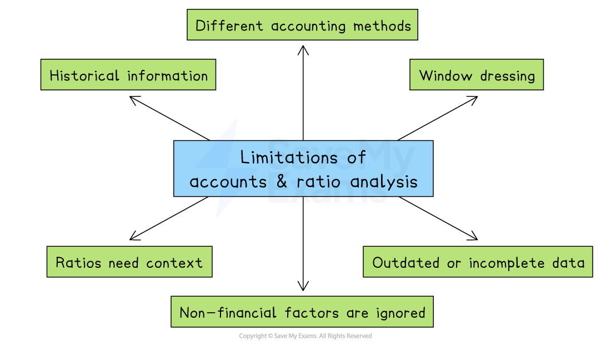

# Using Ratio Analysis To Make Strategic Decisions

## Assessing business performance over time

> **Spec point** — `spcpt_GWyNCN5PrjVzfksX`

## Assessing business performance over time

- **Ratio analysis** involves comparing financial figures from the accounts to create meaningful measurements of ***profitability*****, *****liquidity**** *and ***efficiency***
- When ratios are tracked **over several time periods**, they help identify trends in a business’s performance
- Ratio analysis:

  1. **Identifies improvements or problems**
  
    - By comparing ratios year-on-year, businesses can see if performance is getting better or worse
    - For example, a rising profit margin suggests improved profitability, while a falling current ratio may signal cash flow issues
  2. **Supports decision-making**
  
    - Trends revealed through ratio analysis help managers decide whether to expand, cut costs, raise finance or change strategy
  3. **Highlights consistency or instability**
  
    - Stable ratios suggest a reliable and well-managed business, while sudden changes may point to risks or changing conditions

> **Case Study**
> 
> 
> **Loma Catering Ltd** is a mid-sized catering company. based in Gaborone, Botswana, specialising in corporate and event catering
> 
> Over the past two years, the business has seen its ***gross profit margin***** rise from 40% to 45%**. This improvement came from two key changes
> 
> - **Raising prices slightly** on premium event packages
> - **Reducing food waste** through better portion planning and supplier negotiations
> 
> However, during the same period, Loma’s *gearing ratio* increased sharply, rising from 28% to 60%. This happened after the company took out a large loan to invest in a fleet of delivery vehicles and build a new commercial kitchen
> 
> While the improved gross profit margin shows that the business is becoming more efficient and profitable, the rise in gearing means it is now heavily reliant on borrowed finance, increasing its financial risk
> 
> **Outcome**
> 
> Loma's management is now focusing on **generating enough *****retained profit*** to fund future expansion without increasing debt

## Comparing business performance with competitors

> **Spec point** — `spcpt_gnQrwx6wFyWB69gk`

## Comparing business performance with competitors

- **Ratio analysis** can also be used to compare a business’s performance with that of other firms in the same industry

  1. ***Benchmarks *****performance**
  
    - Comparing ratios helps businesses judge whether they are performing above or below the industry average
  2. **Reveals strengths and weaknesses**
  
    - A higher ***return on capital employed (ROCE)*** than a rival suggests better use of investment
    - A lower ***current ratio*** may show weaker short-term financial health
  3. **Supports strategic planning**
  
    - If a competitor has stronger profitability or better cost control, the business can investigate and improve its own operations to stay competitive

## Ratios and debt and equity decisions

> **Spec point** — `spcpt_8c7JD8cHPSf9BrXM`

## Ratios and debt and equity decisions

- When a business chooses** how to finance its operations**, it directly affects several key ratios used in analysing performance
- These choices can change how the business appears in terms of **risk**, **profitability**, and **financial strength**

### The impact of debt and equity decisions on ratios

#### 1. Gearing ratio

- Taking on more debt increases the gearing ratio

  - This indicates greater financial risk and a higher dependency on borrowed funds
- Using *equity *reduces gearing

  - This indicates a more stable capital structure with lower financial risk

#### 2. Return on capital employed (ROCE)

- Raising equity increases capital employed

  - This can reduce ROCE unless profits rise too
- Using debt may lead to a higher ROCE if the borrowed funds increase profits

  - However,  this approach carries greater financial risk

#### 3. Dividend cover

- More debt means higher *interest *payments, which reduce net profit

  - This may lower the *dividend cover*, making dividend payments less sustainable
- Raising finance through equity avoids interest costs and may result in a higher dividend cover

  - This suggests more secure payouts,  though profits must be shared among more shareholders

## Ratios and dividend strategy

> **Spec point** — `spcpt_9BGSgsSTKZ6VP7Fc`

## Ratios and dividend strategy

- **Dividend strategy** is how a business decides:

  - How much profit to return to shareholders as *dividends*
  - How much profit to keep (retain) in the business for future investment

### How does the dividend strategy affect key ratios?

#### 1. Return on capital employed (ROCE)

- If more profits are retained (fewer dividends paid), **capital employed** increases
- This could **lower ROCE**, unless operating profit increases due to reinvestment

  - E.g. When KohliTech Plc, an Indian technology firm, reduced dividends to invest in innovation, ROCE fell in the short term but rose later when profits increased

#### 2. Current ratio and acid test ratios

- Paying high dividends reduces **cash**, a key current asset
- This may **reduce liquidity**, making it harder to pay short-term debts

  - E.g.  South African supermarket chain Choppies paid large dividends to its shareholders before the pandemic and, as a result, struggled with *cash flow* when sales dropped in the early part of 2021

#### 3. Price/earnings ratio

- A change in dividend strategy doesn't directly affect the price/earnings ratio

  - However, lower dividends may worry investors, reducing **share price**, which lowers the ratio
  - If reinvestment leads to higher profits, *share price* may rise, increasing the ratio over time

## Business growth and ratio results

> **Spec point** — `spcpt_dpwVFjKc4PtpVsC4`

## Business growth and ratio results

- When a business grows, whether by increasing sales, opening new branches, acquiring other firms or expanding into new markets, it can have an impact on a range of financial ratios

#### The impact of business growth on selected ratios

| **Ratio** | **Explanation** |
|---|---|
| **Return on capital employed** | - Business growth often requires extra funding (loans or equity), increasing capital employed - If profit doesn’t rise quickly, ROCE can decrease, suggesting lower efficiency in using capital |
| **Current ratio** | - Growth might lead to increased short-term borrowing or spending on *inventory *and wages - This can reduce liquidity, causing the current ratio to fall, which signals cash pressure |
| **Inventory turnover** | - A growing business may build up more stock to meet demand or launch new products that sell slower - This can lead to a fall in *inventory turnover*, indicating slower sales or overstocking |
| **Price/earnings ratio** | - If growth creates optimism, the share price may rise, increasing the *price/earnings ratio* - But if growth causes uncertainty (e.g. high risk or debt), the share price might fall, lowering the price/earnings ratio |

## Other business strategies and ratio results

> **Spec point** — `spcpt_f5fdDpxVxZXS9WwG`

## Other business strategies and ratio results

### 1. Cost-cutting strategy

- A business might reduce its costs by lowering wages, using cheaper materials, or cutting back on *overheads *like advertising or travel

| **Ratio** | **Explanation** |
|---|---|
| **Profit margin ** | - Cost-cutting lowers expenses, which can **increase profit margin** if revenue stays the same |
| Inventory turnover | - If cost-cutting involves buying cheaper or slower-selling inventory, it can cause stock to move more slowly - This may **reduce inventory turnover**, showing reduced efficiency |

### 2. Paying higher dividends

- A business may decide to return more profits to shareholders by increasing dividends

| **Ratio** | **Explanation** |
|---|---|
| **Current ratio** | - Higher dividends reduce cash, a key part of *current assets* - This may cause the current ratio to fall, suggesting weaker short-term financial health |
| Price/earnings ratio | - Paying higher dividends can attract investors, boosting the share price - If earnings stay stable, the price/earnings ratio might increase due to rising market confidence |

## Limitations of using published accounts and ratio analysis in decision making

> **Spec point** — `spcpt_v9KX6njF8VM4KhYb`

## Limitations of using published accounts and ratio analysis in decision-making

- Published accounts (like the income statement and statement of financial position) and ratio analysis are useful tools
- However, they should **never be the only tools** used when making strategic decisions
- A business should always consider the full picture, including market trends, people, and future risks

*Published accounts and ratio analysis have a range of limitations, including the need for context and the fact that non-financial factors are ignored*

### Key limitations of using accounts and ratio analysis to make decisions

#### Historical information

- Accounts are based on **past performance**, not the future
- Ratios reflect what has happened — not what will happen next

#### Non-financial factors are ignored

- Ratios and accounts don’t include **qualitative factors** such as

  - Staff morale
  - Customer loyalty
  - Brand reputation
  - *Innovation *and leadership
- These factors can have a significant impact on business success, so ignoring them means only a partial picture of a business is gained

#### Different accounting methods

- Businesses can choose different methods for things like *depreciation *or valuing inventory
- This makes it **difficult to compare** companies directly

#### Window dressing

- Some businesses try to make their accounts **look better than they really are**
- For example, delaying bill payments or boosting end-of-year sales temporarily

#### Outdated or incomplete data

- Published accounts may be **up to 12 months old** by the time decisions are made
- The impact of important recent events, such as losing a major contract or the impact of an external *economic downturn*, might not yet be evident

#### Ratios need context

- A ratio on its own is not very useful
- In order for financial performance data to be meaningful, a business must compare it to

  - Past performance (trends)
  - Industry averages
  - Similar businesses
