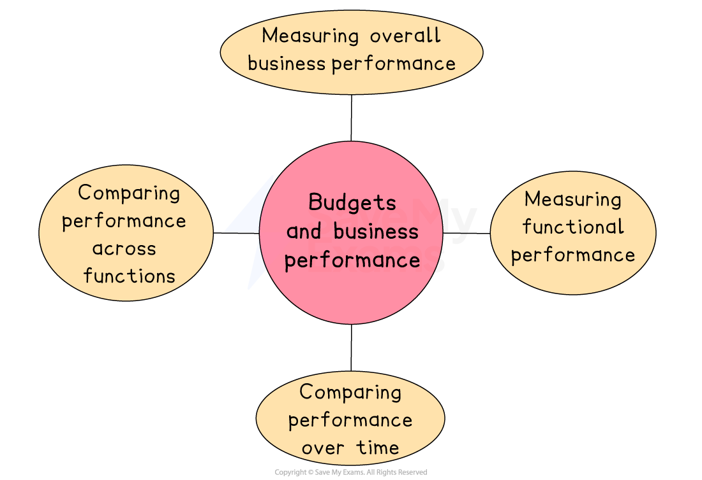

# Using Budgets Effectively

## An introduction to budgets

> **Spec point** — `spcpt_PhwzKXch6sY2gh8c`

## An introduction to budgets

- A budget is a **financial plan **that a business (or department in the business) sets regarding costs and revenue

  - The budget is usually closely aligned with the **business objectives**

*Budgets can be used to compare overall business performance and compare functional performance over time*

### Measuring performance with budgets

#### Measuring overall business performance

- Budgets allow managers to assess how well the whole business is performing

  - **Compare actual income and expenses** with budgeted figures to identify profit levels, cost control, or overspending
  - Helps judge if the business is meeting its **financial goals**, such as revenue targets or profit margins
  - ***Variances**** *help explain good or poor performance

#### Measuring functional performance

- Each function, e.g. marketing, operations, HR, usually has its own budget

  - Comparing **actual department spending and results** with the budget shows how well each area is performing
  - Helps hold managers accountable for **cost control and meeting targets**
  - Encourages **efficient use of resources** within each function

#### Comparing performance over time

- Budgets help track performance **year-on-year **or **month-on-month**
- Businesses can spot trends, such as rising costs or improving efficiency
- Helps with long-term planning and forecasting

#### Comparing performance across functions

- Budgets help compare different departments **at the same time**, even if their roles are different
- This supports fair decision-making on things like ***bonuses***, ***promotions ***or **extra funding**

## Types of budgets

> **Spec point** — `spcpt_rkj8ySdMtxRCPcDs`

## Types of budgets

### 1. Incremental budgets

- An **incremental budget** is based on last year’s figures, with small adjustments made to reflect expected changes

  - Changes could include *inflation*, wage rises or modest increases in sales and costs

#### Evaluating the use of incremental budgets

| **Advantages** | **Disadvantages** |
|---|---|
| - **Quick and easy to prepare**    - Last year’s figures with small adjustments are used, saving time and effort | - **Carry forward inefficiencies**    - Past mistakes or unnecessary spending can be repeated. |
| - **Stable and predictable**    - They are suitable for well-established businesses with consistent operations and costs | - **Discourage innovation**    - Departments may stick to old habits rather than improving or reviewing spending |

### 2. Flexible budgets

- A **flexible budget** is adjusted depending on the level of output or sales

  - Instead of using one fixed figure, it shows what income and expenses should look like at different levels of activity

#### Evaluating the use of flexible budgets

| **Advantages** | **Disadvantages** |
|---|---|
| - **Adapt to changes in activity**    - Budgets can be adjusted based on actual output or sales, giving a more accurate picture of performance | - **More complex to prepare**    - They** **require detailed data and strong forecasting, which can take time and skill |
| - **Better control and planning**    - Managers can compare actual performance to the correct budget level, helping to identify efficiency or overspending | - **It is not suitable for all businesses**    - It may not be needed in small firms with steady, predictable activity levels |

### 3. Zero budgeting

- **Zero budgeting** is when every department or manager must **justify all spending **

  - Rather than using the previous year’s budget as a starting point, each cost must be reviewed and approved individually

#### Evaluating the use of zero budgeting

| **Advantages** | **Disadvantages** |
|---|---|
| - **Encourages cost control**    - Every cost must be justified, which helps reduce waste and unnecessary spending | - **Time-consuming** - Each department must explain all costs from scratch, making it a slow process |
| - **Promotes careful planning**    - It forces managers to think critically about what they actually need and prioritise spending. | - **May demotivate staff**    - Constant questioning of expenses can feel discouraging or lead to underfunding important areas |

## The use of budgets

> **Spec point** — `spcpt_tHGX29nKMyPf2b4w`

## The use of budgets

- Budgets can play an important role in the day-to-day management of a business
- They help with **planning**, **decision-making**, **control**, and monitoring of  **non-financial performance**

### Ways budgets are used

#### Allocating resources

- Budgets help businesses decide where money and resources should be focused
- Each department receives funding based on its needs and priorities, ensuring efficient use

#### Control within a business

- Budgets set clear financial limits to help prevent overspending
- Managers are accountable for staying within their budget, which improves discipline and control

#### Monitoring non-financial performance

- Budgets can track spending on non-financial goals like customer service, training, or *sustainability*
- This ensures resources support wider business objectives

## Variances

> **Spec point** — `spcpt_tvBZWjGwzsDBT984`

## Variances

- Once budgets have been set, managers carry out **variance analysis** to compare actual performance to the targets set in the budget

  - A **budget variance** is a **difference between the figure budgeted and the actual figure achieved** by the end of the budgetary period
- **Variance analysis** seeks to determine the reasons for the differences between the actual figures and the budgeted figures

#### Types of variance

| Favourable (F) | Adverse (A) |
|---|---|
| - This is where the actual figure achieved is **better than **the budgeted figure    - A favourable variance in a** costs budget** is where the actual figure is **lower **than the budgeted figure   - A favourable variance in a** revenue **or **profit budget** is where the actual figure is **higher **than the budgeted figure | - This is where the actual figure achieved is** worse than** the budgeted figure    - An adverse variance in a **costs **budget is where the actual figure is **higher** than the budgeted figure   - An adverse variance in a **revenue **or **profit budget** is where the actual figure is **lower **than the budgeted figure |

## Calculating and interpreting variances

> **Spec point** — `spcpt_Yh4pS8Qnnb4NZY4P`

## Calculating and interpreting variances

- A budget variance is calculated by subtracting the budgeted figure from the actual figure

$\mathrm{Revenue} \mathrm{variance}=\mathrm{Actual} \mathrm{revenue}-\mathrm{Budgeted} \mathrm{revenue}$

$\mathrm{Cost} \mathrm{variance}=\mathrm{Actual} \mathrm{cost}-\mathrm{Budgeted} \mathrm{cost}$

$\mathrm{Profit} \mathrm{variance}=\mathrm{Actual} \mathrm{profit}-\mathrm{Budgeted} \mathrm{profit}$

> **Worked Example**
> **Selected financial information for Barwicks PLC (2024)**
> 
> |   | £**m** |
> |---|---|
> | Budgeted sales revenue | 12,460 |
> | Actual sales revenue | 13,718 |
> | Budgeted total costs | 8,420 |
> | Actual total costs | 10,627 |
> 
> Using the data, **calculate **the total profit variance for Barwicks PLC in 2024. You are advised to show your working.
> 
> (4)
> 
> **Step 1: Calculate budgeted profit for 2024**
> 
> `equals space £ 12 comma 460 space minus space £ 8 comma 420
> 
> equals space £ 4 comma 040`       ** ****(1)**
> 
> **Step 2: Calculate actual profit for 2024**
> 
> `equals space £ 13 comma 718 space minus space £ 10 comma 627
> 
> equals space £ 3 comma 091`       ** ****(1)**
> 
> **Step 3: Subtract budgeted profit from the actual profit for 2024**
> 
> `equals space £ 3 comma 091 space minus space £ 4 comma 040
> 
> equals space minus £ 949 space`       ** ****(1)**
> 
> **Step 4: Identify the nature of the variance**
> 
> - In this case, the variance is **adverse **because the actual profit for 2024 is lower than the budgeted profit for the year
> - The correct answer is** £949 A**       ** ****(1)**

## Evaluating budgets

> **Spec point** — `spcpt_ZPcdZxjWCYvzZpMX`

## Evaluating budgets

- Budgets can be useful management tools because they help **maintain financial control **by monitoring income and expenditure

  - This allows managers to spot potential overspending or cash flow problems early
- Budgets also help **measure performance **by setting financial targets that can be compared with actual results

  - This makes it easier to assess how well a department or the whole business is performing and whether corrective action is needed.
- However, budgets are** based on forecasts and assumptions**, which means managers make inappropriate decisions if market conditions change or if estimates are wrong
- Strict budgets may **reduce flexibility**

  - Managers may feel restricted and unable to respond quickly to unexpected opportunities or urgent problems if they are required to stick closely to a fixed spending plan

#### Advantages and disadvantages of budgeting

| Advantages | Disadvantages |
|---|---|
| - A budget shows every department how much they can spend and what sales targets to hit, so activities line up with overall business objectives | - Gathering data, negotiating figures and revising budgets can take up management time, especially for smaller firms |
| - Preset spending limits highlight overspending quickly and encourage managers to look for savings | - Once set, budgets can discourage managers from seizing unexpected opportunities or reacting quickly to market changes |
| - Comparing actual results with budgeted figures pinpoints good and poor performance and can provide evidence for *bonuses*, promotions or identifying training needs | - Managers may overestimate cost forecasts or understate sales to make targets easier to beat, reducing the budget’s accuracy |
