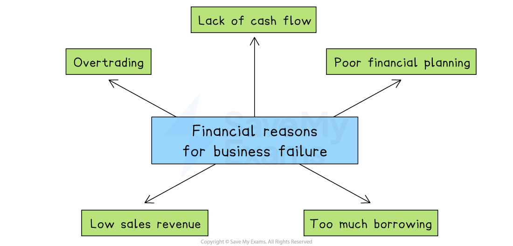

# The Need for Business Finance

## Why businesses need finance

> **Spec point** — `spcpt_7bXkBjYkz9x6CHPH`

## Why do businesses need finance?

- Businesses need finance to **get started**, allow them** to grow** and **fund continuing activity**

  - Finance may be needed for **capital expenditure, **which is spending on *fixed assets* such as equipment, buildings, IT equipment and vehicles
  - Similarly, finance is required for **operating expenditure**,** **spending on raw materials or day-to-day expenses, such as wages or ***utilities***

*Business finance is needed to meet short-term and long-term needs and can be used to set up or grow a business*

### Why business finance is needed

#### 1. Start-up finance

- Start-up finance funds fixed assets and ***current assets*** such as inventory before a business can begin trading
- The amount needed is identified in the ***business plan***

  - Owners often invest their **own capital** into a new business
  - Some small new business owners obtain a **start-up loan** to cover initial costs

#### 2. Finance for growth

- As a business grows, it may need to purchase ***capital equipment***

  - It may require more **machinery, buildings, IT infrastructure** or **vehicles**, which help the business to increase output
- If a business wants to grow by **developing new products**, large amounts may need to be invested in ***research and development (R&D)***

  - E.g. **Apple**'s annual R&D expenses for 2023 were \$29.915bn, a 13.96% increase from 2022, to invest heavily in artificial intelligence (AI) and product ***innovation***

#### 3. Working capital

- Finance is required for ***working capital***, day-to-day spending on raw materials, wages or utilities
- Having a** steady flow of working capital **is essential

  - Without working capital, the business would be **unable to cover its regular expenses**
  - It may suffer ***cash-flow*** problems, which could lead to business failure

## Short-term and long-term finance needs

> **Spec point** — `spcpt_tXDBP5sfZs2wf2CF`

## Short-term and long-term finance needs

### Short-term finance needs

- **Short-term** sources of finance are needed to **meet regular costs** such as **paying for** **utilities**,** suppliers** and employee **wages**

  - They are likely to be relatively** small amounts** and are rarely needed beyond a year
- Important short-term finance needs include **marketing costs** and **recruitment costs**

  - These are closely linked to short-term business ***objectives***
- Where ***revenue*** from sales does not cover these expenses, sources such as ***overdrafts*** or ***trade credit*** may be useful

### Long-term finance needs

- Longer-term sources of finance are needed to fund the **purchase of *****non-current assets*** such as buildings and other types of ***capital resources*** or to **acquire other businesses**

  - These are likely to be **large sums** that may be required for a significant period of time
- Where ***retained profit*** is not sufficient to meet these needs, businesses may consider taking out long-term ***loans***, ***mortgages*** or raising ***share capital***

## Cash versus profit

> **Spec point** — `spcpt_kHmXTBMTxQvrjGtM`

## Cash versus profit

- **Profit** is the **difference between revenue generated and total business costs** during a specific period of time

  - Profit is an important indicator of a company's **financial health** and long-term ***sustainability***, as it helps to assess the effectiveness of a company's operations
- **Cash** is measured by taking into account the full range of **money flowing in and out of a business**

  - This includes revenue from sales, operating expenses, investments, loans, and any other cash-related transactions
  - It performs a variety of functions in a business
  
    - It is used to **cover regular *****operating expenses*** such as workers' pay, supplier invoices and overheads such as rent and utility bills
    - It can also be used to** meet unexpected expenses,** such as the replacement of broken equipment

#### Profit versus cash flow

*Profit and Cash-flow are two distinct terms. A business that does not make a profit in the long run will cease to trade*

- While a business may ultimately** make a profit**, they may **lack cash **at times

  - Some customers may not have paid them yet
  - They may have paid some large bills
- **Cash-poor** businesses will struggle to pay suppliers, employees and operating expenses

  - This is called **insolvency**
  
    - Lifestyle retailer Joules announced plans** **to **liquidate** in December 2022 as a result of cash-flow difficulties, despite making a profit of £2.6 million during the previous year

## Business failure and finance

> **Spec point** — `spcpt_JczSNbc4Xtj5YvRk`

## Business failure and finance

- Financial problems are one of the most common causes of business failure, especially for small and new businesses

  - Without sufficient finance, even a business with effective financial planning, good products and healthy *demand *may fail due to poor cash flow or unpaid debts

*Business failure can be a result of lack of cash flow, too much borrowing and overtrading*

### Financial reasons for business failure

#### Lack of cash flow

- A business may be profitable on paper but still run out of cash
- If customers delay payments or unexpected bills arise, the business may not have enough money to pay suppliers or wages

#### Poor financial planning

- If a business does not forecast *cash flow* accurately or *budget* properly, it may overspend or run out of money
- Poor planning can lead to missed loan repayments or unpaid bills

#### Too much borrowing

- Relying heavily on loans or *overdrafts *increases pressure on the business to make regular repayments
- High *interest* costs can add to financial stress, especially if revenue falls

#### Low sales revenue

- If the business is not generating enough income from sales, it may not cover its costs
- This is a particular risk if demand is *seasonal*, falls unexpectedly or pricing is too low

#### Overtrading

- This happens when **a business grows too quickly** without enough capital to support its expansion
- It may take on large orders or open new branches but run out of cash before it receives payments from customers
