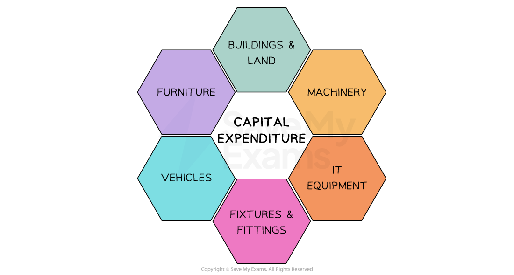
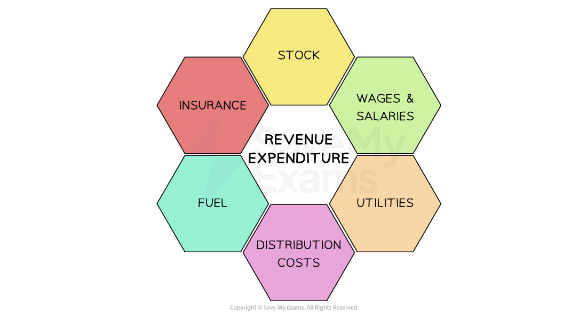

# Working Capital

## The meaning and importance of working capital

> **Spec point** — `spcpt_HNWhbrWzNffV6Xcp`

## The meaning and importance of working capital

- Working capital is the money that a business has available to **fund its day-to-day activities**
- It is described as the **lifeblood of a business** because a** **lack of working capital can quickly lead to **business failure** if it **cannot meet its immediate financial obligations**
- Working capital is a monetary value and is calculated using the formula

$\mathrm{Working} \mathrm{capital}=\mathrm{Current} \mathrm{assets}-\mathrm{Current} \mathrm{liabilities}$

> **Worked Example**
> Rondat Components is a heating components business based in Malmö. It has been struggling to control its level of stock
> 
> Its customers are Scandinavia’s leading gas boiler manufacturers, who require Rondat Components to supply products ‘just in time’. As a result, Rondat must hold large amounts of varied stock to ensure that customer needs can be met
> 
> Rondat Components offers its customers 90-days trade credit
> 
> **Financial Information for Rondat Components**
> 
> |   | **2024**  **€m** | **2023**  **€m** |
> |---|---|---|
> | **Stock** | 8.1 | 7.2 |
> | **Debtors** | 2.2 | 3.1 |
> | **Cash** | 0.9 | 1.2 |
> | **Short-term loan** | 6.4 | 4.4 |
> | **Creditors** | 5.1 | 5.9 |
> 
> **Calculate **Rondat Components’ working capital in 2023 and 2024.
> 
> (3)
> 
> **Step 1: Identify and calculate current assets and current liabilities for 2024 and 2023**
> 
> Current assets      `table row cell 2024 space end cell equals cell space € 8.1 straight m space plus space € 2.2 straight m space plus space € 0.9 straight m space equals space € 11.2 straight m end cell row cell 2023 space end cell equals cell space € 7.2 straight m space plus space € 3.1 straight m space plus space € 1.2 straight m space equals space € 11.5 straight m end cell end table`**        ****[1]**
> 
> Current liabilities            `table row cell 2024 space end cell equals cell space € 6.4 straight m space plus space € 5.1 straight m space equals space € 11.5 straight m space space end cell row cell 2023 space end cell equals cell space € 4.4 straight m space plus space € 5.9 straight m space equals space € 10.3 straight m end cell end table` **        ****[1]**
> 
> **Step 2: Subtract current liabilities from current assets for 2024 and 2023**
> 
> `table row cell 2024 space space space space end cell equals cell space space space space space € 11.2 straight m space minus space € 11.5 straight m space space space space space equals space space space space left parenthesis € 0.3 straight m right parenthesis space space end cell row cell 2023 space space space space end cell equals cell space space space space space € 11.5 straight m space minus space € 10.3 straight m space space space space space equals space space space space € 1.2 straight m end cell end table`**              ****[1]**

### Why is working capital important?

- Cash is the **most *****liquid***** **of a business's current assets and can be used to settle ***debts*** immediately
- Effective management of working capital involves careful cash management

  - Debtors and stock are **less liquid**
  - Businesses that are struggling with a lack of working capital may look to **convert these current assets into cash as quickly as possible** by, for example,  selling stock at lower prices or purposefully chasing payment from customers
- A business can have **too much working capital**

  - If a business is **holding large amounts of cash**, it is likely to be **missing out** on the benefits of investing it in fixed assets or investments
- This may represent a significant ***opportunity cost*****,** especially when interest rates are high

  - If a business is **holding large amounts of stock** it may incur **extra storage costs**, such as security and insurance costs, and could use the cash ‘tied up’ in this stock for other purposes

## Managing trade receivables and trade payables

> **Spec point** — `spcpt_KXYs3vhZv69J9YkC`

## Managing trade receivables and trade payables

- **Trade receivables** is money owed to a business by its customers for goods or services already delivered but not yet paid for
- **Trade payables** is money a business owes to its suppliers for goods or services received but not yet paid for
- Maintaining the right **balance** **between trade receivables and trade payables**  is essential for maintaining sufficient **working capital**

#### Managing trade receivables effectively

- Effective management of trade receivables helps get cash into the business  quickly, improving *liquidity *and reducing the risk of *bad debt*
- Ways to manage trade receivables effectively include

  - **Set clear payment terms** (e.g. 30 days) to avoid long delays in receiving money
  - **Send *****invoices *****promptly** and follow up on late payments with reminders
  - **Offer early payment incentives** such as small discounts to encourage customers to pay faster
  - **Check customer***** creditworthiness*** before offering credit, especially to new buyers
  - **Limit credit to high-risk customers** or require *deposits *upfront

#### Managing trade payables effectively

- Managing payables well allows the business to keep more cash on hand while meeting its obligations on time
- Ways to manage trade payables effectively include

  - **Take full advantage of credit periods** without paying late or damaging relationships
  - **Avoid paying too early** unless there’s a benefit, like a discount for early payment
  - **Maintain good relationships with suppliers** to possibly negotiate longer payment terms
  - **Track upcoming payments** to avoid missed deadlines and *late payment fees*

## Capital and revenue expenditure

> **Spec point** — `spcpt_RWbdmzpzh25JMpBF`

## Capital and revenue expenditure

- Capital expenditure is business **spending on *****non-current assets***

  - These are assets which will be **used many times** and **for more than one year**

#### Capital expenditure uses

*Examples of current assets for which capital expenditure is required*

- **Revenue expenditure **is spending on goods and services that a business **uses in the short-term** as part of its **normal trading activities**

#### Revenue expenditure uses

*Examples of day to day costs for which revenue expenditure is required*
