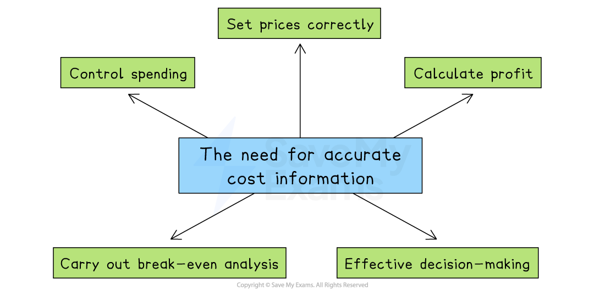
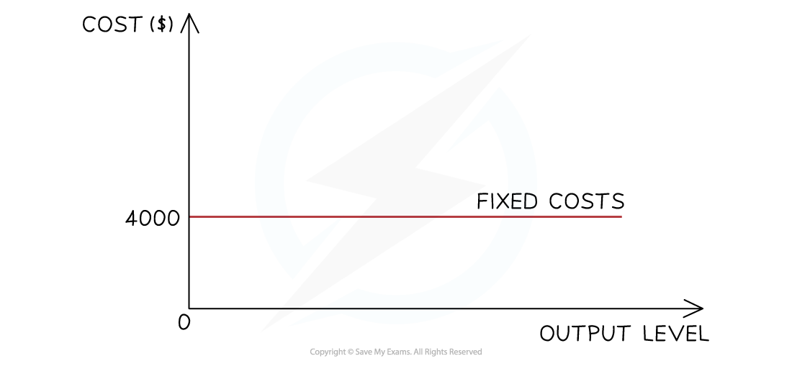
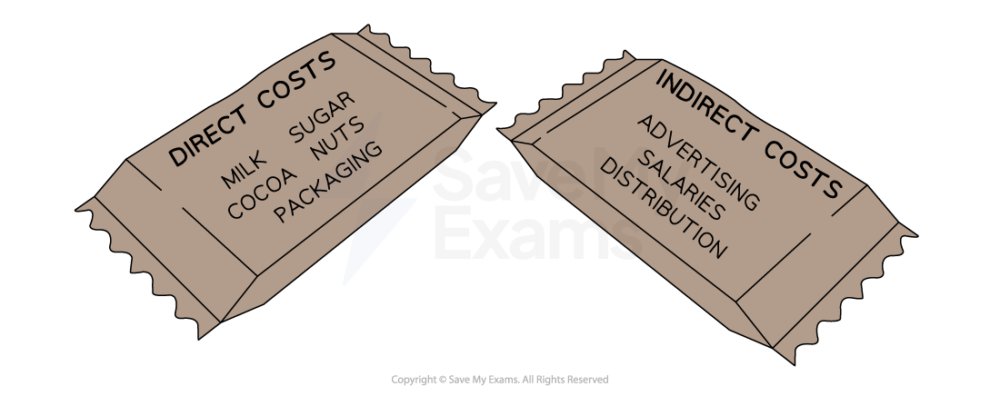

# Cost Information

## The need for accurate cost information

> **Spec point** — `spcpt_9vmsBxtkgwcxXFNK`

## The need for accurate cost information

- Cost information refers to data about all the costs involved in producing and selling a product

#### Why is accurate cost information needed?

*Accurate cost information is needed to set prices, calculate profit, make decisions, calculate break-even and control spending*

- **To set prices correctly**

  - If a business underestimates its costs, it may set prices too low and make a *loss*
  - Overestimating costs may lead to prices that are too high, reducing *demand*
- **To calculate profit**

  - Accurate costs help calculate* gross profit* and *net profit*, important for judging performance
- **For decision-making**

  - Managers use cost data to decide whether to
  
    - Launch a new product
    - Continue or stop production
    - Change suppliers or production methods
- **To carry out break-even analysis**

  - This helps decide how many units need to be sold to cover all costs.
  - Accurate costs make break-even analysis more reliable
- **To control spending**

  - Comparing actual costs with *budgets *helps identify areas of overspending and take action

## Types of costs

> **Spec point** — `spcpt_GRyk9VgNsXD2Dnpw`

## Types of costs

- In preparing goods and services for sale, businesses** incur a range of costs**
- These costs can be broken into different categories

### Fixed costs

- Fixed costs do not change according to output
- These have to be paid whether the output is zero or 5,000

  - Examples include rent, management salaries, insurance and bank loan repayments

- Fixed costs in this instance are \$4,000

### Variable costs

- Variable costs **rise proportionally with output**
- These increase as output rises and decrease as output falls

  - Examples include raw material costs and wages of workers directly involved in production and packaging
- At some point, a business may benefit from a ***purchasing economies***, so the rise will no longer be proportional

### Total costs

- Total costs is the **combination of all fixed and variable costs **involved in producing a certain level of output
- Total costs **cannot be zero**, as all organisations have some level of fixed costs

### An alternative way to classify costs

#### Direct costs

- These are costs that can be **directly traced to a specific product, service, or department**
- They relate **specifically and exclusively** to the production of a particular item
- **Direct costs can be fixed or variable**

  - For example, a one-off licence fee for a software product is a **direct fixed cost** if it applies only to that product
- Examples of direct costs include:

  - The cost of raw materials used to make a table
  - Wages paid to factory workers assembling a specific product
  - Packaging for a single product line

#### Indirect costs

- Indirect costs are **costs that cannot be traced directly to a specific product, job, or service**

  - They support overall operations and are shared across departments or products
  - These costs are necessary for production or business operations, but they are **not directly linked** to any one unit of output
- **Indirect costs can also be fixed or variable**

  - For example, the monthly rent paid for a shared office space is an **indirect fixed cost**, as it supports multiple departments but does not vary with output
- Examples of indirect costs include:

  - Rent and utility bills for a factory or office
  - Salaries of supervisors or administrative staff
  - Office supplies and insurance
  - Depreciation of machinery used across several product lines

*Examples of direct and indirect costs for a chocolate manufacturer*

#### Comparison: direct vs indirect costs

| Feature | **Direct costs** | **Indirect costs** |
|---|---|---|
| Traceability | - Directly linked to one product/job | - Shared across products/departments |
| Examples | - Raw materials, direct labour | - Rent, admin wages, factory lighting |
| Can be fixed or variable? | - Yes | - Yes |

## Using cost information to make decisions

> **Spec point** — `spcpt_rxvD8RBBgBSybTwT`

## Using cost information to make decisions

- Cost data helps businesses make key decisions

### Total costs (TC)

- Total costs information can be used to assess **how much money is needed to produce at a certain level **and is vital for** budgeting** and **cash flow forecasting**

> **Worked Example**
> 
> 
> SupaJuice produces 12,400 bottles of its premium fruit juice drink each month.
> 
> - It incurs monthly fixed costs (e.g. rent, salaries) of \$25,700
> - Variable costs per unit (e.g. bottles, fruit) of \$1.24
> 
> **Calculate **the business's annual total costs.
> 
> (3)
> 
> **Step 1: Calculate monthly variable costs**
> 
> `equals space 12 comma 400 space cross times space $ 1.24
> 
> equals space $ 15 comma 376`       **(1)**
> 
> **Step 2: Calculate monthly total costs**
> 
> `equals space $ 15 comma 376 space plus space $ 25 comma 700
> 
> equals space $ 41 comma 076`       **(1)**
> 
> **Step 3: Calculate annual total costs**
> 
> `equals space $ 41 comma 076 space cross times space 12 space months
> 
> equals space $ 492 comma 912`       **(1)**

### Average costs (AC)

- Average cost is the **cost of producing one unit** of output, calcualted using the formula

$\mathrm{Average} \mathrm{cost}=\mathrm{Total} \mathrm{cost}\div\mathrm{Quantity} \mathrm{of} \mathrm{output}$

- The average cost helps a businesses set prices that cover costs and leave room for profit
- It is also used to compare *efficiency *over time or between different products

> **Worked Example**
> Supajuice has been approached by a large supermarket chain that wants to buy a large volume of its juice each month. The supermarket chain is willing to pay \$2.95 for each bottle.
> 
> **Explain **whether SupaJuice should accept the supermarket's offer.
> 
> (3)
> 
> **Step 1: Calculate the average cost of producing each bottle**
> 
> `equals space Monthly space total space cost space divided by space Monthly space output
> 
> equals $ 41 comma 076 space divided by space 12 comma 400 space bottles
> 
> equals space $ 3.31`        **(1)**
> 
> **Step 2: State your answer and give a reason**
> 
> - SupaJuice should **not **accept the supermarket's offer **(1)**, as it would make a loss of \$0.36 (\$2.95 - \$3.31) on each bottle **(1)**

### Marginal cost (MC)

- Marginal cost is the **cost of producing one extra unit** of output, calculated using the formula

$\mathrm{Marginal} \mathrm{cost}=\mathrm{Change} \mathrm{in} \mathrm{total} \mathrm{cost}\div\mathrm{Change} \mathrm{in} \mathrm{quantity}$

- The marginal cost helps a business decide whether producing extra units is profitable
- It is a key consideration for decisions about increasing production, pricing, and entering new markets
- It can also be used for **special order pricing** and decisions about increasing output

> **Worked Example**
> SupaJuice is considering increasing its output from 12,400 to 13,000 bottles per month. This will increase monthly total costs by \$2,750.
> 
> **Explain **whether SupaJuice should increase its output if it sells each bottle of juice for \$4.75.
> 
> **Step 1: Calculate the marginal cost**
> 
> `equals space $ 2 comma 750 space divided by space 600 space bottles
> 
> equals space $ 4.58`        **(1)**
> 
> **Step 2: State your answer and give a reason**
> 
> - SupaJuice **should **increase output **(1)**, as the marginal cost is \$0.17 (\$4.75 - \$4.58) less than the selling price, allowing a profit to be made on each bottle sold **(1)**

## Using cost information to make pricing decisions

> **Spec point** — `spcpt_TcvK6PdX4BdgC2Fr`

## Using cost information to make pricing decisions

- Cost information can help shape a business’s entire** pricing strategy**, including how to respond to competition, customer demand and market conditions

### Cost information and pricing decisions

#### Setting a minimum price point

- Accurate cost data ensures prices are set above total or marginal cost
- This prevents selling at a loss and is especially important for new products where cost estimates may change as production increases

  - E.g. A small electronics company launching a smart speaker knows its unit cost is \$40 and avoids pricing below that, even during a *promotion*

#### Choosing between pricing strategies

- Businesses choose strategies like *penetration pricing*, *skimming*, or *competitive pricing*
- Cost information helps assess whether these options are financially sustainable

#### Adjusting prices when costs change

- When input costs, such as raw materials or wages, rise, cost data helps decide whether to increase prices or reduce other costs while keeping prices stable

#### Responding to competitors' prices

- Cost information helps businesses know how low they can reduce prices in response to rivals without making a loss
- This is essential in *price wars* or competitive markets

#### Planning discounts and promotions

- Even during sales or promotions, businesses must at least cover variable costs
- Accurate cost information prevents making a loss as a result of short-term discounts

## Using cost information to monitor and improve business performance

> **Spec point** — `spcpt_42k7hYtSPhfFdTFH`

## Using cost information to monitor and improve business performance

- Cost information is a **vital tool for monitoring business performance**
- It helps businesses

  - Track profitability
  - Set and measure performance targets
  - Identify problems early
  - Make better decisions for the future
  - Become more efficient and competitive

#### Uses of cost information in relation to business performance

| **Use** | **Explanation** |
|---|---|
| **Calculate and monitor profits** | - Businesses use cost data to calculate **gross profit **and **net profit**, and then compare them over time or between products. - This shows how well the business is performing financially |
| **Calculate profit margins** | - Calculating ***gross profit margin*** and ***net profit margin*** helps measure profitability as a percentage of sales - This is useful for comparing performance between departments, products or time periods |
| **Set performance targets** | - Managers use cost and profit data to set targets for departments or teams, e.g. reduce costs by 5% or improve profit margins - These targets help guide decision-making and performance management. |
| **Identify areas of inefficiency** | - By comparing actual costs with budgeted costs, businesses can spot where they are overspending or wasting resources |
| **Support decision-making and planning** | - Cost data helps businesses decide whether to launch new products, enter new markets or increase production - If predicted costs are too high, plans may be revised or cancelled |
| **Reduce waste and improve efficiency** | - Cost analysis can highlight areas of waste in labour, materials or energy - This helps improve efficiency and lower costs over time |
