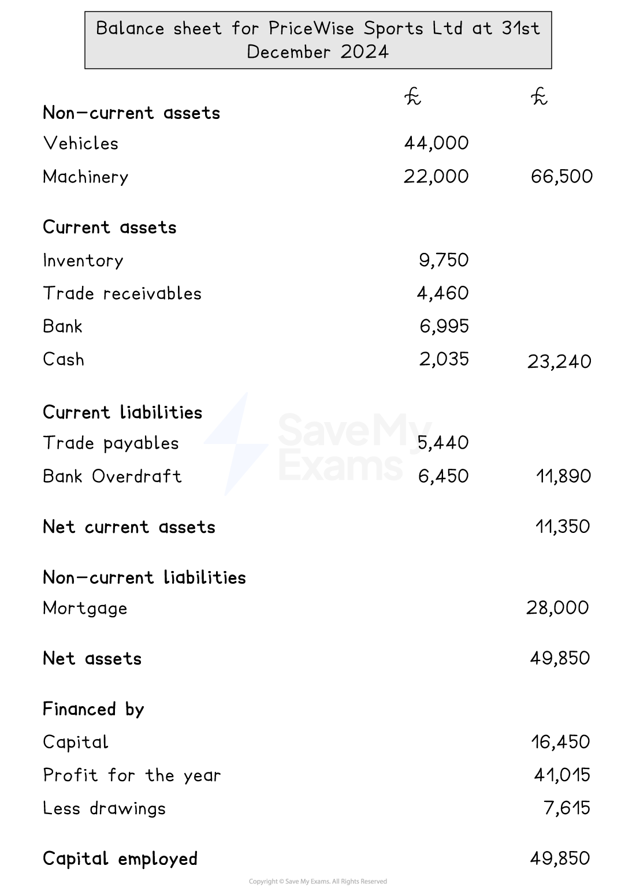

# Statement of Financial Position

## The purpose of the statement of financial position

> **Spec point** — `spcpt_vW9Gxv7HgcH5SM8V`

## The purpose of the statement of financial position

- The **statement of financial position** provides a snapshot of a business’s financial position at a given point in time

  - It is often called the **balance sheet**
- It shows what the business **owns (assets)**, what it **owes (liabilities)**, and how it is **funded (capital and reserves)**
- It contains the financial information required to draw conclusions about the ***liquidity *****of the business**

## The structure of the statement of financial position

> **Spec point** — `spcpt_fQq5xV8NnmRxhVrR`

## The structure of the statement of financial position

- The statement of financial position details the following elements at a **specific point in time**

| Assets |
|---|
| - **Non-current assets** are  items owned by a business for the long-term, such as machinery and buildings - **Current assets **are items that a business owns that can be converted to cash quickly , usually within 12 months, comprised of inventory, trade receivables and cash - **Total assets** = Non-current assets + Current assets |

| Liabilities |
|---|
| - **Current liabilities** is money a business owes that is due to be settled within 12 months, including trade payables and short-term borrowing, such as overdrafts - **Non-current liabilities** is money a business owes, such as a loan or mortgage, that does not need to be paid back for at least 12 months - **Net current assets** = Current assets - Current liabilities - **Net assets** is a calculation of the value of a business, calculated using the formula  $(\mathrm{Non}-\mathrm{current} \mathrm{assets}+\mathrm{Current} \mathrm{assets})-(\mathrm{Current} \mathrm{liabilities}+\mathrm{Non}-\mathrm{current} \mathrm{liabilities})$ |

| Capital structure |
|---|
| - **Equity **(or owners' capital) is money invested in the business by its owner(s) - **Profit for the year **is the profit after tax generated in the last financial year - **Capital employed**  is the total finance invested in the operations of a business |

### A statement of financial position showing key elements

*The statement of financial position (balance sheet) shows a business's assets, liabilities and capital structure at a point in time*

- In this example, **drawings** refers to the money (capital) removed from the business by its owner(s)

## Amending the statement of financial position

> **Spec point** — `spcpt_RwvnxZgFdRhJ8hzP`

## Amending the statement of financial position

- A change to one section of the statement of financial position has an impact on other sections

> **Worked Example**
> Pershore Plumbers Ltd's accountant has sent the interim statement of financial position to Helen, the business owner. She has been asked to check the statement before it is sent to Companies House
> 
> **Pershore Plumbers Ltd - Statement of financial position at 31st March 2025**
> 
> 
> 
> Helen identifies three errors
> 
> - Depreciation was £24,100
> - An inventory check on 31st March 2025 valued stock at £26,400
> - Long-term borrowing increased to £25,000 as the business took out a further small loan
> 
> **Recalculate **the statement of financial position to reflect these changes.
> 
> (6)
> 
> **Step 1: Update non-current liabilities given the change to depreciation**
> 
> `Non minus current space assets space equals space Asset space value space minus space Depreciation
> 
> equals space £ 142 comma 700 space minus space £ 24 comma 100
> 
> equals space £ 118 comma 600`       **(1)**
> 
> **Step 2: Update current assets given the change in stock valuation**
> 
> `Current space assets space equals space Cash space plus space Debtors plus space Stock
> 
> equals space £ 30 comma 260 space plus space £ 26 comma 630 space plus space £ 26 comma 400
> 
> equals space £ 83 comma 290`       **(1)**
> 
> **Step 3: Update total assets given these changes**
> 
> `Total space assets space equals space Non minus current space assets space plus space Current space assets
> 
> equals space £ 118 comma 600 space plus space £ 83 comma 290
> 
> equals space £ 201 comma 890`       **(1)**
> 
> **Step 4: Update non-current liabilities given the increase in long-term borrowing**
> 
> `equals space £ 20 comma 000 space plus space £ 5 comma 000
> 
> equals space £ 25 comma 000`
> 
> **Step 5: Update total liabilities**
> 
> `Total space liabilities space equals space Current space liabilities space plus space Non space current space liabilities
> 
> equals space £ 20 comma 150 plus space £ 25 comma 000
> 
> equals space £ 45 comma 150`       **(1)**
> 
> **Step 6: Update net assets given these changes**
> 
> `Net space assets space equals space Total space assets space minus space Total space liabilities
> 
> equals space £ 201 comma 890 space minus space £ 45 comma 150
> 
> equals space £ 156 comma 740`       **(1)**
> 
> **Step 7: Update share capital to balance equity with net assets**
> 
> `equals space £ 156 comma 740 space minus space £ 101 comma 290
> 
> equals space £ 55 comma 450`       **(1)**
> 
> **Pershore Plumbers Ltd - Updated statement of financial position at 31st March 2025**
> 
> 

## The relationship between the statement of profit and loss and the statement of financial position

> **Spec point** — `spcpt_fJGp7gq5jWsVxvH8`

## The relationship between the statement of profit and loss and the statement of financial position

- The **statement of profit and loss** and the **statement of financial position** are closely linked, and several items appear in both or affect each other

  - E.g. Profit identified in the statement of profit and loss is transferred to the **equity** section of the statement of financial position under **retained earnings (profit)**
- **Profit or loss** made in one period directly affects  **equity** in the statement of financial position.

  - Items like *depreciation*, taxation and sales don’t just affect profit, they also change the values of **assets **and **liabilities**

### Relationships between items

| **Item** | **Where it appears** | **Relationship** |
|---|---|---|
| **Profit for the year** | - Bottom of the statement of profit and loss | - Added to **retained earnings** in the **equity **section of the statement of financial position |
| **Dividends** | - Often shown after profit in the profit and loss statement | - Subtracted from profit and also reduces **retained earnings** in the statement of financial position |
| **Retained earnings** | - Not shown in the profit and loss, but affected by it | - Built up from past profits (after tax and dividends) and shown in the **equity **section of the statement of financial position |
| **Expenses (e.g. depreciation)** | - Statement of profit and loss | - May reduce the **value of assets** (e.g. machinery) in the statement of financial position |
| **Taxation** | - Deducted in the profit and loss statement | - If unpaid, it appears as a **current liability** in the statement of financial position |
| **Sales revenue** | - Top of the profit and loss statement | - Can increase **cash** or **receivables** in the statement of financial position |
| **Purchases / cost of sales** | - Profit and loss statement | - May reduce **inventory** or increase **payables** in the statement of financial position |
