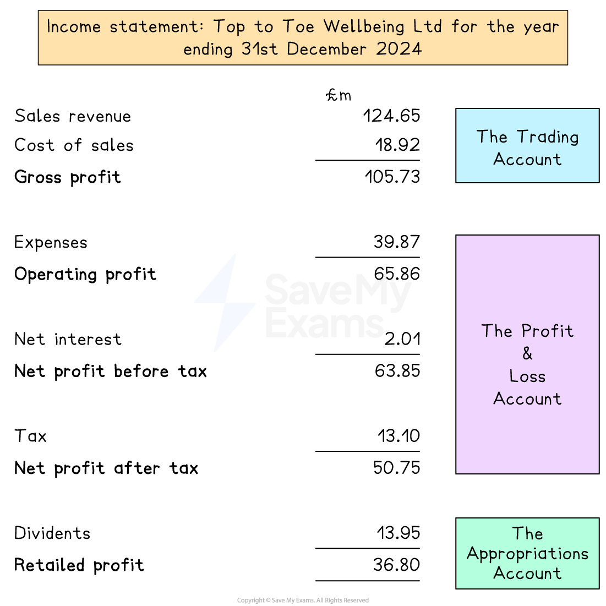

# Statement of Profit or Loss

## The purpose of the statement of profit or loss

> **Spec point** — `spcpt_FmzvBBvfDr2kzfPW`

## The purpose of the statement of profit or loss

- The **statement of profit or loss **shows the **income** and **expenditure **of a business over a period of time - usually a year - and identifies the amount of **profit** made

### Statement of profit or loss: key terminology and calculations

| **Term** | **Explanation** |
|---|---|
| **Sales revenue** | - Money generated through selling goods and services - Calculated using the formula  $\mathrm{Price}\times\mathrm{Quantity}$ |
| **Cost of sales** | - The cost of producing or buying in the goods actually sold by the business during a time period. - Also called **cost of goods sold** - Includes raw materials, packaging and direct labour |
| **Gross profit** | - Made when **sales revenue is greater than the cost of sales**. - Calculated using the formula  $\mathrm{Sales} \mathrm{revenue}--\mathrm{Cost} \mathrm{of} \mathrm{sales}$ |
| **Expenses** | - Non-direct costs a business incurs during normal operations, also called **overheads** - Includes salaries, rent, advertising, utilities and depreciation |
| **Profit from operations** | - Profit made after all direct and indirect costs are deducted from revenue - Calculated using the formula  `Sales revenue – (Cost of sales+Expenses)` |
| **Taxation** | - The amount of money paid to the government based on profit, usually called **corporation tax** - Subtracted after profit from operations to determine final profit |
| **Profit for the year** | - Profit remaining **after tax has been deducted** - This is the amount available to be distributed to shareholders or retained in the business - Calculated using the formula  $\mathrm{Profit} \mathrm{from} \mathrm{operations}--\mathrm{Taxation}$ |
| **Dividends** | - The portion of profit **paid to shareholders** as a reward for their investment |
| **Retained earnings** | - Profit **kept within the business** to be used as a source of finance for future investment or growth |

## The structure of the statement of profit or loss

> **Spec point** — `spcpt_hySwTDshsbJ6FWJJ`

## The structure of the statement of profit or loss

- The statement of profit or loss is divided into three parts

  - The **trading account**
  - The **profit and loss account**
  - The **appropriation account**

#### An example income statement

*An example income statement, showing the trading account, profit and loss account and appropriations account*

### The trading account

- The **trading account** is where the ***cost of sales*** is deducted from ***sales revenue*** to calculate the **gross profit**

  - In 2024 Top to Toe Wellbeing Limited's sales revenue was £124.65m and its cost of sales were £18.92m
  
    - The **gross profit **for the period was therefore

`equals space £ 124.65 straight m space minus space £ 18.92 straight m space

equals space £ 105.73 straight m`

### The profit and loss account

- The **profit and loss account** deducts a series of ***expenses*** to determine the **operating profit **for the period `equals space £ 105.73 straight m space minus space £ 39.87 straight m space

equals space £ 65.86 straight m` `equals space £ 65.86 straight m space minus space £ 2.01 straight m space

equals space £ 63.85 straight m`

  - In 2024 gross profit was £105.73m and expenses were £39.87m
  
    - The **operating profit** was therefore

  - The business also paid £2.01m interest
  
    - The **profit before tax** was therefore

  - The business also paid £13.10m tax
  
    - The **profit after tax for the period** was therefore

`equals space £ 63.85 straight m space minus space £ 13.10 straight m space

equals space £ 50.75 straight m`

### The appropriations account

- The **appropriations account** shows how profits are distributed for the period

  - In 2024 Head to Toe Wellbeing Limited distributed £13.95m to shareholders as ***dividends***
  
    - £36.80m was therefore **retained as profit**

## Amending the statement of profit or loss

> **Spec point** — `spcpt_CvbNYDkT8wYBcYPx`

## Amending the statement of profit or loss

- Making a change to one section of the statement of profit or loss has an impact on other sections

> **Worked Example**
> Pershore Plumbers Ltd's accountant has sent the interim statement of profit and loss to Helen, the business owner. She has been asked to check the statement before it is sent to Companies House
> 
> #### Pershore Plumbers Ltd - Statement of profit or loss for the year ending 31st March 2025
> 
> 
> 
> Helen identifies three errors
> 
> - Sales revenue for the period was actually £889,540
> - The business received a tax refund of £12,220 during the year
> - The business paid dividends of £220,500 to shareholders
> 
> **Recalculate **the statement of profit or loss to reflect these changes.
> 
> (4)
> 
> **Step 1: Calculate gross profit given the updated revenue figure**
> 
> `Gross space profit space equals space Revenue space minus space Cost space of space sales
> 
> equals space £ 889 comma 540 space minus space £ 310 comma 510
> 
> equals space £ 579 comma 030`       **(1)**
> 
> **Step 2: Recalculate operating profit**
> 
> `Operating space profit space equals Gross space profit space minus space Expenses
> 
> equals space £ 579 comma 030 space minus space £ 202 comma 630
> 
> equals space £ 376 comma 400`       **(1)**
> 
> **Step 3: Calculate profit for the year given the tax refund**
> 
> `Tax space equals space £ 66 comma 930 space minus space £ 12 comma 220 space equals space £ 54 comma 710
> 
> Profit space for space the space year space equals space Operating space profit space minus space Tax
> 
> equals space £ 376 comma 500 space minus space £ 54 comma 710
> 
> equals space £ 321 comma 790`       **(1)**
> 
> **Step 4: Calculate retained profit given updated dividends**
> 
> `Retained space profit space equals space Profit space for space the space year space minus space Dividends
> 
> equals space £ 321 comma 690 space minus space £ 220 comma 500
> 
> equals space £ 101 comma 190`       **(1)**
> 
> #### Pershore Plumbers Ltd - Updated statement of profit or loss for the year ending 31st March 2025
> 
> 
