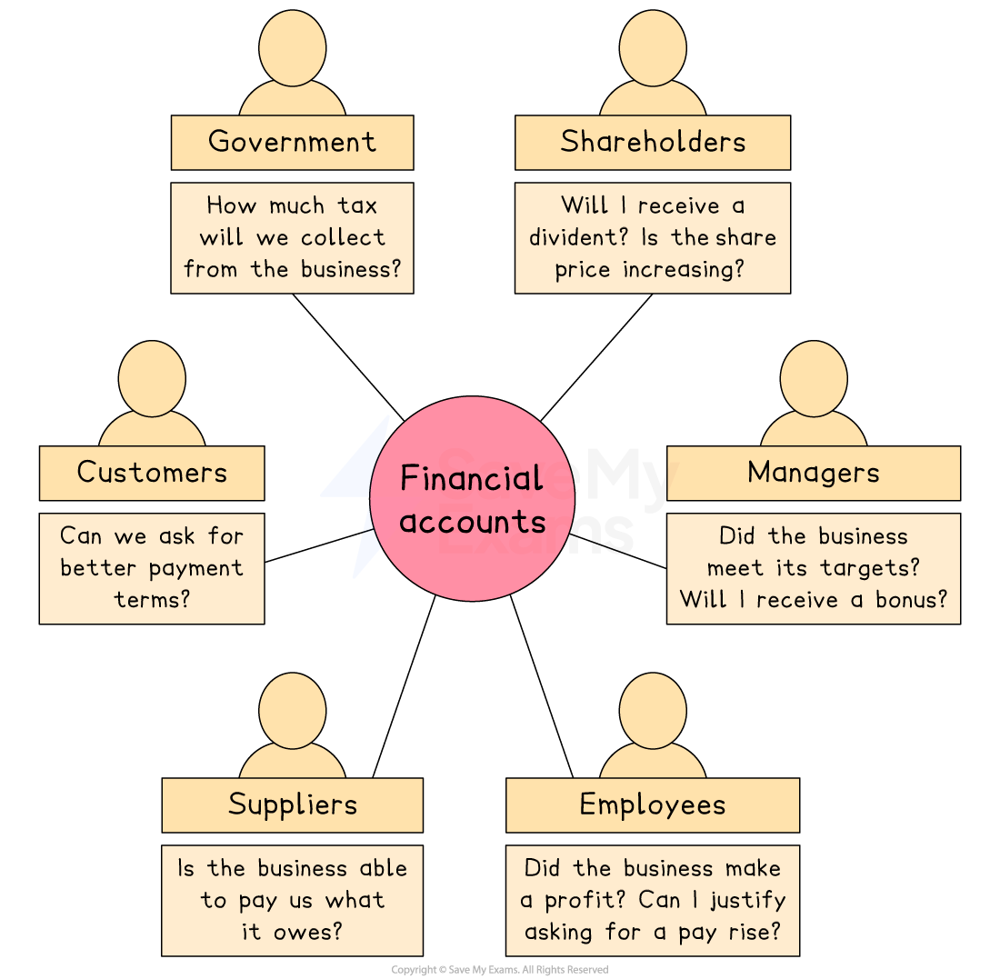

# Using Financial Statements Effectively

## An introduction to financial statements

> **Spec point** — `spcpt_XQgkDBQppFnTzzjC`

## An introduction to financial statements

- Financial statements can be used to help a business determine **how successful** it has been in **achieving its *****objectives*** over a given period of time
- ***Stakeholders*** can use financial statements to answer a range of questions

#### Stakeholder use of financial accounts

*Financial accounts can help stakeholders answer a range of questions*

- At the **end of the financial year**, companies must produce a set of financial statements that include two key documents

  - The **statement of profit or loss** shows the ***revenue*** earned, **costs** incurred and** *****profit*** (or loss) made by the company over the previous year
  - The **statement of financial position** shows the ***assets*** owned,** *****liabilities*** owed and ***net worth*** of the business at a particular point in time (usually the last day of the accounting period)
- These financial statements must be **submitted to the relevant government agency** and can usually be **viewed by any interested party**
- ***Sole traders*** and ***partnerships**** *also commonly produce these documents in order to** assess their performance**

## The Annual Report

> **Spec point** — `spcpt_mFCGrhd75ZsM8kyj`

## The Annual Report

- Companies compile **financial statements** in a larger document called the **Annual Report**

  - Public limited companies publish very detailed, professionally designed documents
- Along with the financial statements, the Annual Report also usually contains

  - A **letter from the chairman** or ***board of directors*** as well as a statement from the ***CEO***
  - A current **profile of the company**, including core objectives, recent successes and future plans
  - An overview of ***corporate social responsibility*** strategies
  - Other financial documents, such as a ***cash flow statement***
  - Details of **key personnel**, including remuneration of senior managers and changes to the board of directors
  - ***Shares*** and ***dividends*** issued
  - The appointed ***auditor***'s report

#### Stakeholder use of the Annual Report

| **Stakeholder** | **Use of the Annual Report** |
|---|---|
| **Directors and managers** | - Assess business performance over a specific period of time - Compare performance to previous periods - Budgeting and target-setting for departments and individuals - Supporting strategic decision-making |
| **Employees** | - Determining the stability of the business to establish whether their jobs are secure - Discovering future business plans to support their career decisions - Supporting a claim for increased pay |
| **Shareholders** | - Assess the ***return on their investment*** in the company - Assess business performance to determine potential for continued investment - Understand the level of dividend they will receive |
| **Government** | - Determine the amount of ***tax*** a company is required to pay - Assess business stability to determine its ability to continue to employ workers - Ensure that legal requirements are met in the compilation of accounts |
| **Suppliers** | - Assess the the liquidity of a company to determine whether it is able to pay for goods it orders - Determine whether the company is ***creditworthy*** |
| **Local community** | - Assess business stability to determine its ability to continue to employ workers - Investigate the company's commitment to locally-relevant aspects of corporate social responsibility, such as minimising pollution |

> **Exam Hint**
> The focus of this topic is the ways in which stakeholders use financial information from the financial accounts and annual report. Don't worry too much about remembering the structure and contents of financial statements.

### Limitations of the Annual Report

#### 1. For investors or shareholders

- **The Annual Report is outdated and backward-looking**

  - It reflects past performance, often months old, which may not help investors make timely decisions
- **Biased presentation**

  - Information is often selected to present the business in the best possible light, possibly camouflaging financial weaknesses or risks

#### 2. For employees

- **The Annual Report lacks detail on job security or working conditions**

  - The report doesn't reveal whether jobs are at risk, or what it’s like to work in the business
- **It lacks employee perspective**

  - It reflects only senior management’s view, with no insight into morale, satisfaction, or staff concerns

#### 3. For suppliers

- **The Annual Report provides little insight into payment reliability**

  - Reports don’t show if the business pays its suppliers fairly or on time
- **Unclear future demand**

  - Suppliers cannot rely on the report to understand future purchasing levels or changes in sourcing strategy
