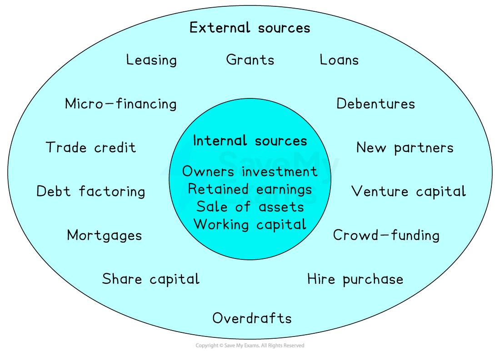

# Internal Sources of Finance

## An introduction to sources of finance

> **Spec point** — `spcpt_Rj79DGRnvmB3k8VB`

## An introduction to sources of finance

- Businesses have **different sources of finance** available to them

  - When the finance comes from inside the business, it is called an** internal source of finance**
  - When the finance comes from outside the business, it is called an **external source of finance**

#### Internal and external sources of finance

*The range of internal and external sources of finance available to businesses*

## Owners investment

> **Spec point** — `spcpt_FmwxHQzHB2v8ydZG`

## Owner's investment

- Owners' investment is a key source of funds when a** business starts up**

  - Owners may introduce their savings or another lump sum, e.g. money received following a ***redundancy***
- Owners may invest more as the **business grows** or if there is a specific need, e.g. a short-term ***cash-flow*** problem

#### Evaluating owner's investment

| **Advantages** | **Disadvantages** |
|---|---|
| - No interest has to be paid, making it a cheap source of finance - It may not need to be repaid, reducing pressure on cash flow - It gives the owner full control, as there is no need to involve banks or external investors - It is suitable for small start-ups that may not qualify for loans | - The owner may not have enough savings to meet all business needs - Using personal funds increases the owner's financial risk - Relying on owner's funds may limit future growth if additional funds are needed but not available - If the business fails, the owner could lose all the money they invested |

## Retained earnings

> **Spec point** — `spcpt_SwfQQHpXbZ5ZBvtn`

## Retained earnings

- This is profit generated in previous years and not distributed to owners that is **reinvested **in the business
- This is a cheap source of finance, as it **does not involve borrowing** and associated ***interest*** and arrangement fees
- The ***opportunity cost*** of investing the money back into the business is that ***shareholders***** do not receive extra profit** for their investments

#### Evaluating the use of retained earnings

| **Advantages** | **Disadvantages** |
|---|---|
| - No interest or repayments are required, making it a cost-effective source of finance - The owners maintains full ownership and control of the business - It can be accessed quickly, without needing approval from banks or investors - It helps fund growth without increasing debt | - It may not be available if the business has not made enough profit - Using retained profit means there is less money available for dividends or reserves - Relying too heavily on retained profit can limit reinvestment in other key areas - It is not suitable for start-ups or new businesses with little or no retained earnings |

## Sale of unwanted assets

> **Spec point** — `spcpt_5swFS3RXNpkmkpn9`

## Sale of unwanted assets

- Selling *fixed assets *that are no longer required, such as machinery, land or buildings, generates finance
- Businesses use this method for a range of reasons

  - To raise **cash quickly** without taking on debt
  - To **free up capital** tied up in unused or outdated assets
  - To support **short-term cash flow** needs or fund new investment

#### Evaluating raising finance by selling unwanted assets

| **Advantages** | **Disadvantages** |
|---|---|
| - No interest or repayments are required, making it a cost-free source of finance - It frees up cash tied up in underused or unwanted assets - It can reduce maintenance and storage costs for unused equipment | - It is not a regular or reliable source of finance, as it depends on having surplus assets - It may not raise much money if the asset is old or has lost value - Once sold, the asset cannot be used again, which may affect operations |

## Sale and leaseback of non-current assets

> **Spec point** — `spcpt_KKMwySbtmDJ7nGJg`

## Sale and leaseback of non-current assets

- A **non-current asset **is an interchangeable term with fixed asset
- A **sale and leaseback arrangement **may be made if a business wants to continue to use an asset but needs cash

  - The business **sells an asset**, such as a building, for which it receives cash
  - The business then **rents the asset **from the new owners or a specialist leasing company
  
    - E.g. in early 2023, Sainsbury’s announced that it was in talks to **sell some of its prime retail property** for £500m, which it would then **lease back** from the new owners, LXi Reit

#### Evaluating sale and leaseback of non-current assets

| **Advantages** | **Disadvantages** |
|---|---|
| - It provides an immediate cash injection without giving up use of the asset - It frees up capital tied in non-current assets such as buildings or equipment - It is useful for raising finance without taking on a traditional loan - It can improve *liquidity* while allowing the business to continue using key assets | - The business must pay regular lease payments, adding to running costs - Over time, the total lease payments may exceed the original value of the asset - The business no longer owns the asset, which may reduce its value on the *balance sheet* - The lease agreement may have conditions or limits on how the asset can be used e.g. mileage limits for vehicles |

## Working capital

> **Spec point** — `spcpt_wRvkRVx965VDB2q6`

## Working capital

- **Working capital** is the **money a business has available for day-to-day operations**, such as paying wages, suppliers, and utility bills
- A business can **adjust the way it manages working capital** to free up cash and improve its short-term financial position without needing to borrow money

  - **Delaying payment to suppliers** gives the business more time to hold onto cash
  - **Reducing stock levels** means less money is tied up in unsold goods
  - **Speeding up payments from customers** brings in cash more quickly
  - **Using existing cash reserves** to cover expenses

#### Evaluating working capital as a source of finance

| **Advantages** | **Disadvantages** |
|---|---|
| - It frees up internal funds without needing loans or paying* interest* - It improves short-term cash flow and liquidity - It allows faster access to finance compared to applying for external funding - It can be used flexibly by adjusting *receivables*, payables or stock levels | - It may reduce stock levels or delay supplier payments, which can affect operations - Over-reliance on working capital can strain supplier relationships or damage *credit terms* - Reducing working capital too much can lead to cash shortages or missed payments - It is not suitable for large or long-term investments |

- Further notes on managing working capital can be reviewed [here](https://www.savemyexams.com/a-level/business/cie/23/revision-notes/finance-and-accounting/business-finance/working-capital/)

## Internal sources of finance and business ownership

> **Spec point** — `spcpt_nMjkDn56nrtGcy5k`

## Internal sources of finance and business ownership

- The type of business ownership, such as a ***sole trader***, ***partnership***, or ***limited company***, can influence which internal sources of finance are available and suitable

  - **Sole traders and partnerships** tend to rely more on **owner's investment** and **working capital** because they often have limited retained profit and fewer fixed assets to sell

> **Case Study**
> **Ali’s Mobile Repairs**
> 
> 
> 
> - Ali’s Mobile Repairs is a small **sole trader **business based in Nairobi
> - Ali needs money to buy new tools but doesn’t want to take out a loan
> - As a sole trader, he decides to use **his own savings** (owners’ investment) and delays a stock order by a week to free up some **working capital**

- **Companies **are more likely to use **retained profit**, **sale of fixed assets**, or **sale and leaseback**, as they operate on a larger scale and have more internal resources

> **Case Study**
> **Ecosap Ltd**
> 
> 
> 
> - Ecosap Ltd is a medium-sized Netherlands-based fruit wholesaler
> - The **private limited company** wants to upgrade its cold storage systems
> - It decides to fund this by using **retained profit** from the previous year and selling an **unused delivery van** (sale of fixed assets)
