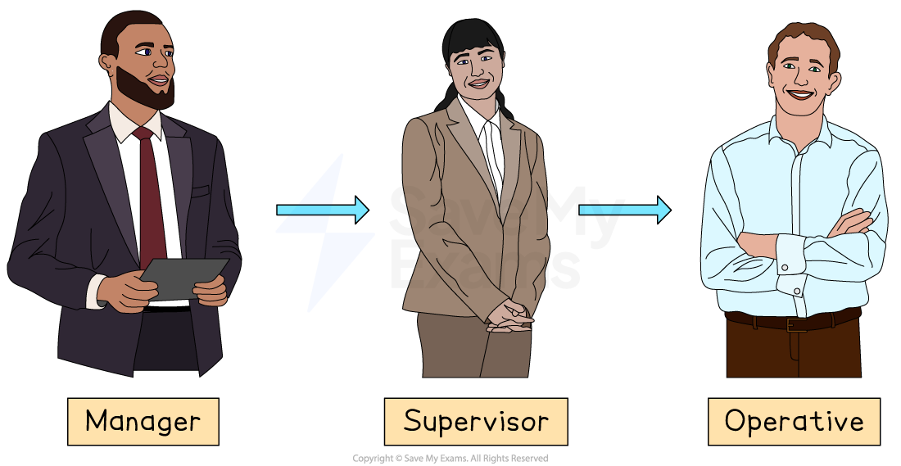
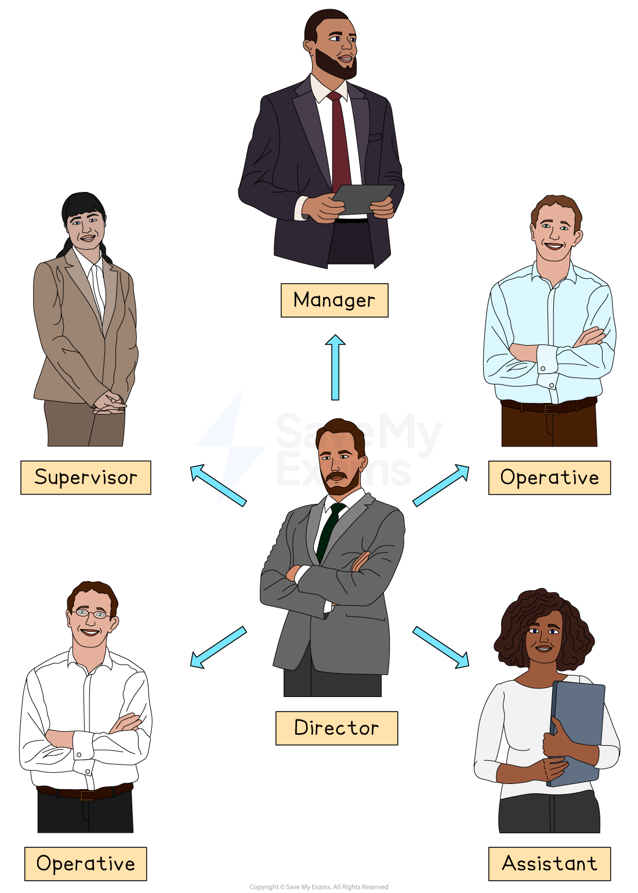
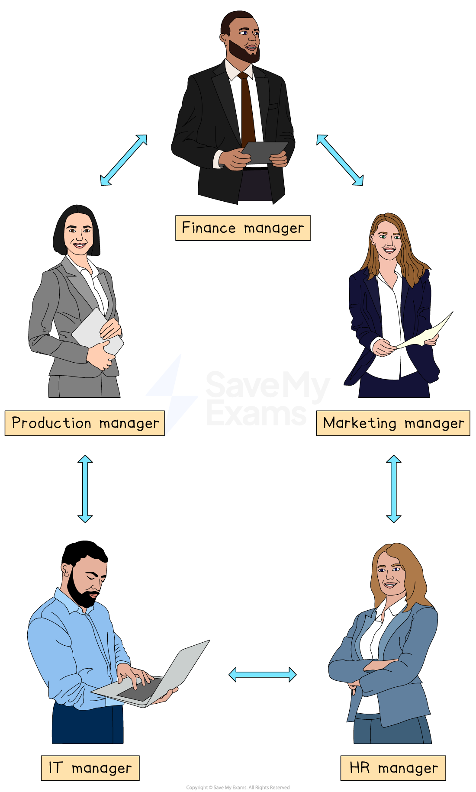

# Channels of Communication

## How communication works within a business

> **Spec point** — `spcpt_rY5t9WbB6bgR2zZD`

## Formal communication

- Formal communication is the **planned** **way** a business shares information

  - It is written down or recorded, so there is **proof **of what was communicated
- Formal communication happens differently depending on the type of communication network
- A **communication network** refers to the **patterns or structures** through which information flows within an organisation — in other words, **who communicates with whom** and **how**

### Communication networks

#### 1. Chain communication

*Messages pass up or down the hierarchy*

- The message travels step-by-step up or down the *hierarchy*, following the *chain of command*
- Chain communication suits tall, rule-bound organisations, such as the armed forces

  - There is clear *authority *and *accountability*
  - It is easy to trace who said what
- However, it is slow, as passing the message through each layer adds time

  - Details can be distorted as they pass along
  - Lower levels may feel left out of decisions

#### 2. Wheel communication

*The message comes from the centre of the business*

- One central leader receives information from, and sends instructions to, every other member
- This approach is suitable when rapid decisions are needed, such as in emergencies

  - The leader has the full picture, so messages stay consistent
- However, the message sender can suffer from *information overload*, as there is over-dependence on one person

  - As there is little sharing between outer members, important ideas may be missed

#### 3. Circle communication

*The message is passed around the group*

- People of equal rank speak or pass the message in turn around the group
- This approach builds team spirit and trust

  - Everyone is heard , so it is good for brainstorming and problem-solving
- However, it may be slow to reach a decision and there is no single leader to break deadlocks

  - The message may have to travel a long way to reach the right person

#### Benefits of formal communication

| **Benefit** | **Explanation** | **Example** |
|---|---|---|
| **Clear instructions** | - Formal documents state the exact steps, deadlines and who is responsible - Staff do not have to guess or ask several people, so tasks are done the same way on every shift and in every location | - A production manager gives operators a** checklist** to follow before the machines run - Errors are reduced and product quality remains stable |
| **A record is kept** | - Saving messages as emails, *minutes *or forms creates proof of what was decided and who agreed - Managers can trace problems and settle arguments because the date and wording are stored | - A customer claims a delivery was late; the logistics team shows the ***despatch note*** email to prove the goods left on time |
| **Fairness** | - Formal channels like the *intranet*, noticeboards or newsletters send the same information to all employees at once - *Overtime *offers, training places or job vacancies are open to everyone, not just close friends of the boss | - A shop manager posts the **weekly rota** on the staff portal instead of handing it to favourite supervisors, so each worker can plan ahead |
| **Legal protection** | - Laws often require firms to keep contracts, policies and safety records; these documents act as legal evidence if *audited *or taken to court - They show the company followed proper rules and gave clear warnings | - After an accident on-site, a business can show the worker’s **signed safety training record** to prove correct training was given, reducing possible *fines* |

## One- and two-way communication

> **Spec point** — `spcpt_3SVFfYFxzwHVTNjB`

## One- and two-way communication

- **One-way communication **is where information moves **from sender to receiver only**

  - The listener or reader does not reply
- It is typically used for **announcements** and **important instructions**, e.g., fire alarms, where speed or clarity matters more than feedback

  - It delivers a **single, consistent message **to many people quickly, with no debate to slow it down
  - However, the receiver cannot ask questions, so **misunderstandings **can occur
- **Two-way communication is where a **message is **sent and then replied to**

  - This creates a *feedback loop* between sender and receiver
- It is typically used for** team meetings**,** customer-service chats **and ***appraisal *****interviews**, and situations where understanding and agreement are vital

  - Feedback confirms the message has been understood and lets both sides share ideas, which can improve decisions and morale
  - However, it takes more time and, if poorly managed, may lead to arguments or information overload

## Vertical and horizontal communication

> **Spec point** — `spcpt_WRFBS6zjj3b9mCbG`

## Vertical and horizontal communication

- **Vertical communication** involves **information moving up and down the hierarchy**, between managers and the levels above or below them
- It is typically used to communicate targets from directors to supervisors (downward) or progress reports from the *shop floor* to management (upward)

  - It keeps the **chain of command clear **and ensures decisions and feedback reach the right level
  - However, it can be** slow**, and **messages may get distorted** or filtered as they pass through several layers
- **Horizontal communication** is where messages are shared between people on the same organisational level, often across departments

  - E.g. the marketing manager may communicate with the finance manager about a promotional *campaign budget*
- It can **speed up problem-solving **and **teamwork** by letting peers share information directly
- However, if not copied upward, **senior managers may be unaware** of agreements, causing confusion later
