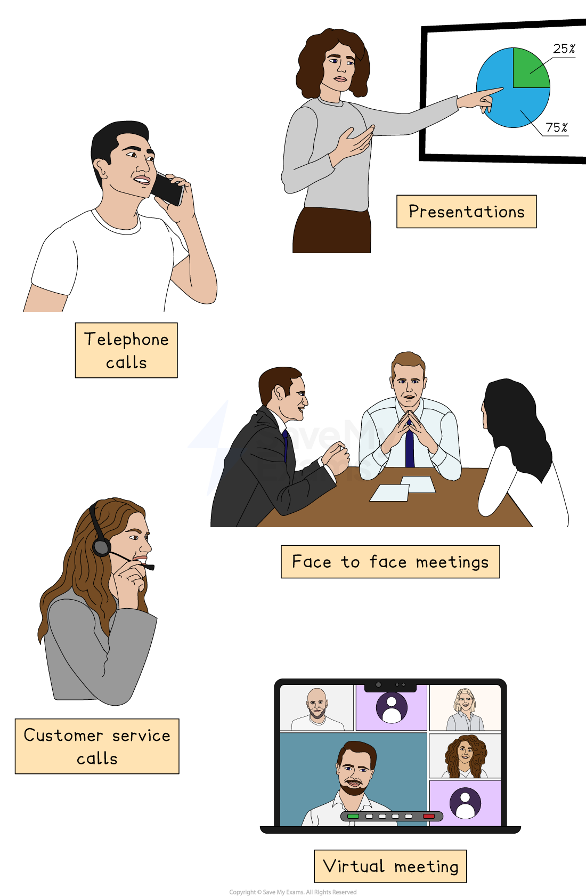

# Methods of communication

## Spoken communication

> **Spec point** — `spcpt_ySKjrND4Dmj3wP2P`

## Spoken communication

- **Spoken communication** is the process of sharing information using the voice
- It includes both formal and informal conversations and can happen face-to-face or through devices such as phones or video calls
- It is often supported by *body language*, tone, and gestures, which help convey meaning

#### Examples of spoken communication in a business

*Spoken communication includes meetings, telephone calls and presentations*

- **Team meetings**

  - Employees and managers discuss progress or upcoming projects
- **Telephone calls**

  - Used to speak with customers, suppliers or colleagues
- **Presentations**

  - A manager explains a new strategy to staff, often using software to share images, graphs and illustrations
- **Video conferences**

  - Staff from different locations join a virtual meeting
- **Informal chats**

  - Quick updates or feedback shared between co-workers during the working day
- **Customer service calls**

  - Staff answering customer questions or solving problems

#### Strengths and weaknesses of spoken communication

| **Strengths** | **Weaknesses** |
|---|---|
| - Quick and immediate, as it allows instant feedback | - Can be easily misunderstood, especially if instructions are complex |
| - Builds relationships through tone and emotion | - Not always recorded, which can lead to confusion or memory issues |
| - Flexible, as it allows questions and clarification | - Background noise or other distractions can reduce effectiveness |
| - Suitable for sensitive or personal topics | - Hard to share with many people at once without a formal structure |
| - Encourages teamwork and motivation as it creates a human connection between people | - Relies on good listening skills to ensure information is not missed |

## Written communication

> **Spec point** — `spcpt_Psc4b5CJQFNgq4Y8`

## Written communication

- **Written communication** is the sharing of information through written words, either on paper or digitally
- It includes anything that can be read, such as emails, reports, letters, notices, or messages sent through digital apps
- Written communication is often used when the message needs to be clear, permanent, or shared with several people

### Examples of written communication

- **Emails**

  - May be used for daily updates, requests or instructions between employees and managers
- **Business reports**

  - These are usually formal documents outlining results, plans or research
- **Notices and memos**

  - These can be used for internal announcements about meetings, policy changes or deadlines
- **Agendas and minutes of meetings**

  - These record what will be or has been discussed in face-to-face or virtual meetings
- **Letters**

  - These may be used for formal communication with external *stakeholders* such as customers, suppliers or job applicants
- **Contracts and agreements**

  - These are legal documents confirming terms and conditions

#### Strengths and weaknesses of written communication

| **Strengths** | **Weaknesses** |
|---|---|
| - Creates a permanent record that can be referred to later | - Can be time-consuming to write and read |
| - Helps ensure accuracy and clarity, especially for complex topics | - No immediate feedback, as delays in clarification may cause problems |
| - Can be easily shared with multiple people | - The tone can be misunderstood or seem too formal |
| - Suitable for formal communication and legal documents | - People may ignore or overlook written messages |
| - Useful across different time zones or when people are unavailable | - Lacks the personal touch of face-to-face or spoken communication |

## Electronic communication

> **Spec point** — `spcpt_7prHMkRKwDWBMPvN`

## Electronic communication

- **Electronic communication** is the use of digital technology to send and receive messages
- It includes written, spoken, or visual communication shared using electronic devices such as **computers, smartphones **or **tablets**
- It allows quick and efficient contact within and outside the business, across any location or time zone

## Examples of electronic communication

- **Emails:**

  - Fast written messages that can be sent to individuals or groups
- **Video calls **(e.g. Zoom, Microsoft Teams)

  - *Real-time* spoken and visual meetings
- **Instant messaging apps **(e.g. Slack, WhatsApp)

  - Quick, informal messages between staff
- **Company websites**

  - These are used to provide information to customers, investors and the general public
- **Social media **(e.g. LinkedIn, Instagram)

  - This can be used to promote the business and interact with external audiences
- **Internal platforms**

  - These include *intranets* that can be used to share updates, documents and announcements with employees

#### Strengths and weaknesses of electronic communication

| **Strengths** | **Weaknesses** |
|---|---|
| - Fast and efficient, as messages can be sent instantly anywhere | - May lead to *information overload* as a result of too many messages or emails |
| - Can combine text, images, audio and video | - Can be impersonal, reducing human connection |
| - Supports remote working and international communication | - Technical problems, such as system crashes or poor internet connection, can cause delays |
| - Easy to store and retrieve as messages can be saved and reviewed | - Security risks due to data breaches or *hacking* of sensitive information |
| - Helps with collaboration through shared documents or group chats | - Employees may ignore or misunderstand messages if they are poorly written |

## Visual communication

> **Spec point** — `spcpt_5yGsqCsdQ8kfy8QC`

## Visual communication

- **Visual communication** is the use of images, symbols, charts or other visual elements to convey information
- It helps to simplify complex ideas and make messages easier to understand and remember
- Visuals are often used alongside spoken or written communication to strengthen the message

### Examples of visual communication

- **Graphs, charts and infographics**

  - These are often used in reports or presentations to show trends, sales data or performance
- **Logos and branding**

  - These provide a visual identity of the business that creates instant recognition
- **Training videos or animations**

  - These can help employees understand how to use equipment or follow procedures
- **Presentations (e.g. PowerPoint)**

  - Software used in meetings or *pitches* to illustrate key points
- **Signs and symbols**

  - These can include health and safety signs, arrows or labels around the workplace, providing instructions or information

#### Strengths and weaknesses of visual communication

| **Strengths** | **Weaknesses** |
|---|---|
| - It can make complex information easier to understand | - It can be misinterpreted if visuals aren’t clear or well-designed |
| - It helps people remember information better than text alone | - Some messages need explanation, which visuals alone can’t provide |
| - It can be engaging and eye-catching, especially for presentations or marketing | - It can be costly and time-consuming to produce high-quality visuals |
| - It is useful for people with low literacy or language barriers | - Not all employees may have access to or skills with design tools |
