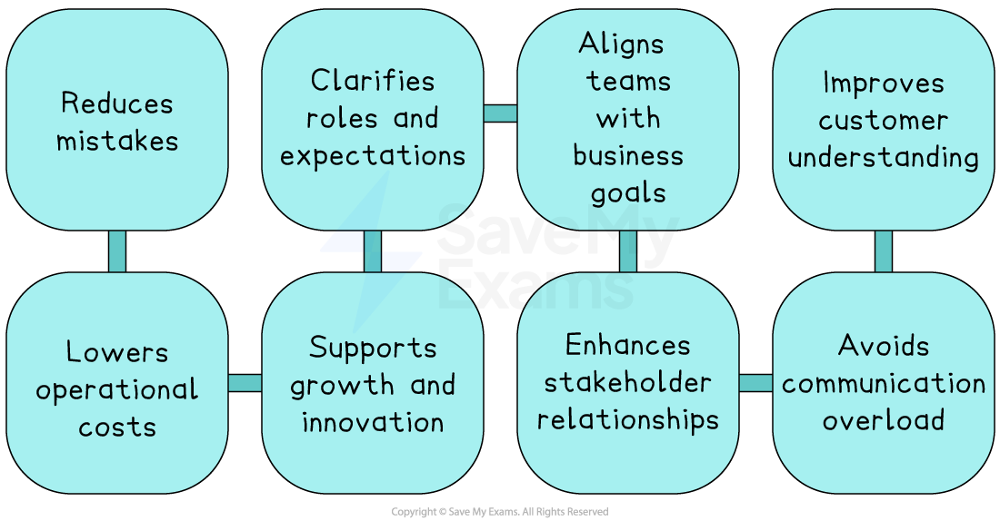

# Purposes of Communication

## The purpose of communication

> **Spec point** — `spcpt_nkvJxBXCTtTB2tRk`

## The purpose of communication

- **Communication **is the successful transfer of messages between sender(s) and receiver(s)

### Internal communication

- **Internal communication** is the exchange of messages between two or more members of the same organisation

  - It helps to ensure the business runs smoothly, as it allows departments, teams and individuals to share information, make decisions and work towards common goals

#### Situations where internal communication is needed

- **Coordination**

  - Ensures departments, like marketing, operations and finance, are aligned and working together effectively
  
    - E.g. a team meeting to plan a product launch
- **Motivation and morale**

  - Keeps employees informed about company plans and progress, which can increase engagement and job satisfaction
  
    - E.g. a training session introducing a new computer system
- **Decision-making**

  - Allows managers and employees to exchange ideas, give feedback, and make well-informed choices
- **Delegation and instructions**

  - Managers communicate tasks clearly to staff so that work is done efficiently and correctly
  
    - E.g. a manager emailing staff about new safety procedures.
- **Performance management**

  - Used for *appraisal*, giving praise or constructive feedback, and setting targets
- **Problem-solving**

  - Helps resolve issues quickly through open dialogue and collaboration

### External communication

- **External communication** is the exchange of message(s) between an organisation and external stakeholders such as customers, suppliers or investors

  - It helps a business build and maintain good relationships with people or groups outside the organisation who have an interest in the business.

#### Situations where external communication is needed

| **Purpose** | **Explanation** |
|---|---|
| **Customer relations** | - Communicating clearly with customers to meet their needs, handle complaints, and promote products or services |
| **Supplier coordination** | - Arranging delivery times, negotiating prices, or discussing quality standards |
| **Investor confidence** | - Providing accurate financial and strategic information to *shareholders* or potential investors |
| **Legal and regulatory compliance** | - Ensuring the business meets legal obligations by responding to government or legal bodies |
| **Public image and *****PR*** | - Promoting a positive reputation and *brand image* through media, social platforms, or advertising |

## The importance of communication

> **Spec point** — `spcpt_4Rq3CRrtnKvp4MPj`

## The importance of communication

- Effective communication ensures that **clear messages are sent**, **received**, **understood **and **acted upon** in the way intended
- **Effective communication should be**

  - Clear and *unambiguous*
  - Appropriate to the context and to the sender
  - Sent to the correct receiver in an accessible format
  - Timely and contain only the required amount of detail

### The benefits of effective communication

*Effective communication reduces mistakes. clarifies employees' roles and responsibilities and improves stakeholder relationships*

- **Reduces mistakes**

  - Clear instructions and feedback between managers and staff help reduce errors, which saves time and improves efficiency
- **Clarifies roles and expectations**

  - When communication is effective, everyone knows their responsibilities
  - This increases accountability and helps teams work more productively
- **Aligns the team with business goals**

  - Communicating the company’s values and objectives ensures all employees are working towards the same targets
- **Improves customer understanding**

  - By providing accurate and clear information about products or services, businesses can improve customer satisfaction and reduce complaints
- **Lowers operational costs**

  - Good communication avoids misunderstandings and delays
  - This helps a business operate more efficiently and reduce unnecessary expenses
- **Supports growth and innovation**

  - When communication flows well, businesses can spot and act on new opportunities quickly, such as launching new products or entering new markets
- **Improves stakeholder relationships**

  - Managers must manage communication channels carefully to ensure the right people stay informed
  - This builds trust with key groups such as investors, employees and suppliers
- **Avoids communication overload**

  - A 2021 survey of US workers found over one-third were overwhelmed by excessive emails, which made them consider leaving
  - Managing the volume of communication is vital to protect employee wellbeing and retention
