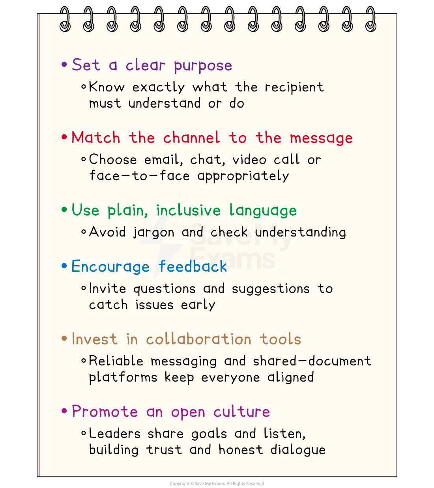

# The Role of Management in Facilitating Communication

## The role of informal communications

> **Spec point** — `spcpt_rkNh99b83PC6255T`

## The role of informal communications

- Informal communication is the **casual, unofficial** way that people in a business share information

  - It is **not planned or written down** in official records
  - The style is friendly and conversational, often using everyday language
  - Messages travel **outside the formal chain of command**, so they can move quickly across levels and departments
- Informal communication can occur in a range of situations, including

  - **Water-cooler chats**
  
    - Quick conversations in the corridor, kitchen or staff room
  - **Instant-messaging or group apps**
  
    - Short texts or emoji exchanges on WhatsApp, WeChat, Slack, etc
  - **Social gatherings**
  
    - Talking during lunch breaks, team socials or company sports events

#### Benefits and risks of informal communication

| **Benefits** | **Risks** |
|---|---|
| - **Fast information flow**    - Staff can warn each other of a problem immediately, without waiting for formal meetings | - **Rumours and gossip**    - Wrong facts can spread quickly, damaging *morale *or reputation |
| - **Builds team spirit**    - Friendly chat helps people feel connected, boosting motivation and cooperation | - **No written record**    - Decisions made informally may be forgotten or disputed later |
| - **Encourages ideas**    - Casual talk makes employees more willing to share creative suggestions | - **Can bypass managers**    - Important issues might skip the chain of command, leaving leaders unaware |
| - **Reduces stress**    - A quick joke or personal story can ease tension during busy periods | - **Exclusion risk**    - Staff who are not part of the social circle may feel left out or unfairly treated |

## Communication and business efficiency

> **Spec point** — `spcpt_YGxVDnRfcH3qDsWK`

## Communication and business efficiency

- Clear, timely and two-way communication is vital for an efficient business

  - It can can save time, cut costs or raise output when managed well

#### How communication affects business efficiency

| Aspect | Impact on efficiency | Example |
|---|---|---|
| **Clarity and accuracy** | - Clear, jargon-free messages reduce mistakes and the amount of rework | - A warehouse worker  picks the right items first time when orders are precise |
| **Speed of information flow** | - Fast, real-time updates shorten decision times and reduce bottlenecks | - A WhatsApp alert warns drivers of a traffic jam, rerouting deliveries instantly |
| **Feedback channels** | - Two-way communication surfaces problems early, so fixes are quicker and cheaper | - Factory operators report a loose bolt before it causes a costly machine stop |
| **Cross-department coordination** | - Shared platforms (e.g. Slack, Teams) align schedules and resources, avoiding duplication | - Marketing and production compare launch dates, preventing excess inventory building up |
| **Employee engagement** | - Open, respectful dialogue boosts morale and effort, raising output per worker | - A suggestion box in a Kenyan tea plant cuts water waste by 10%. |
| **Customer and  supplier links** | - Timely, transparent updates build trust and streamline the supply chain | - A Chinese electronics firm shares live stock data with suppliers, reducing lead times |

## Ways of improving communication

> **Spec point** — `spcpt_cyzXPBhDd4G6vcD9`

## Ways of improving communication

- As communication is crucial to improving efficiency, managers should take steps to improve the way information moves around and outside of a business

#### Steps managers can take to improve communication

- Sending a **clear message **through the **most suitable channel**, whether email, chat, video or face-to-face, reduces errors and speeds up decisions

  - This saves a business time and money
- Encouraging** two-way**,** inclusive dialogue **by using **plain language** and inviting **feedback **brings problems to light early

  - It can also encourage new ideas and keep employees motivated.
- Equipping teams with **modern digital tools** for chat, video calls and shared files keeps everyone coordinated, wherever they work

  - This improves customer service and helps achieve faster growth
