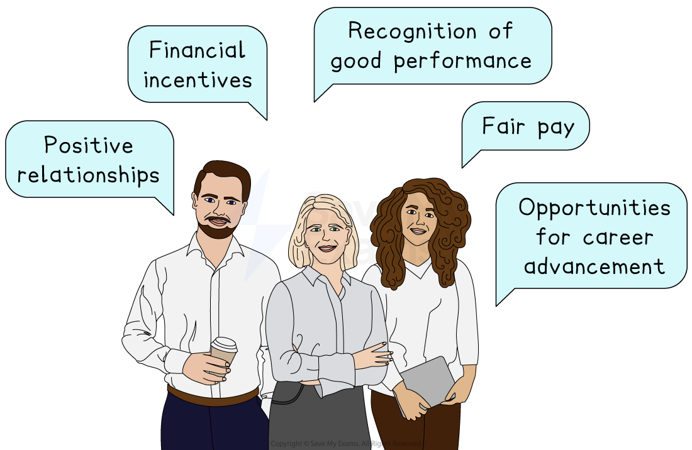

# Employee Morale and Welfare

## HRM, employee morale and welfare

> **Spec point** — `spcpt_RJ5fT57vqQq4YTbC`

## HRM, employee morale and welfare

### Morale

- **Morale** refers to the overall attitude and satisfaction employees feel towards their workplace

  - High morale typically leads to increased *productivity*, creativity and loyalty
- The human resource management (HRM) function is often tasked with ensuring good employee morale and welfare

### Factors that boost employee morale

*Factors that boost morale include fair pay, recognition of good performance and positive worker-manager relationships*

- ** Fair pay and financial incentives**

  - Offering fair salaries and extra financial rewards, such as *bonuses *or *profit sharing*, motivates employees, making them feel valued and fairly treated
- **Opportunities for career advancement and personal growth**

  - Employees become motivated when they see clear opportunities to progress within a business, developing new skills and taking on greater responsibilities
- **Recognition of good performance and achievements**

  - Regularly acknowledging employees' achievements boosts *self-esteem *and motivation and encourages continued high performance
- **Positive relationships among staff and management**

  - Good relationships within the workplace create trust and mutual respect, improving communication and cooperation across the business

### Welfare

- Employee welfare relates to measures businesses take to ensure the health, safety and wellbeing of their staff
- Businesses that look after employees’ welfare often experience higher productivity, lower *staff turnover* and fewer days lost due to illness

#### Examples of employee welfare measures

| **Measure** | **Explanation** |
|---|---|
| **Health insurance and medical benefits** | - Providing health insurance ensures employees have access to necessary medical care - This improves well-being- and reduces *absenteeism* |
| **Safe and pleasant working conditions** | - Safe, comfortable workplaces prevent accidents and reduce *stress* - This increases employee satisfaction and productivity |
| **Training on health and safety** | - Regular health and safety training reduces workplace risks and *empowers *employees to handle situations effectively - This improves worker confidence and gives them peace of mind |
| **Mental health support and counselling** | - Offering mental health resources helps employees manage stress and anxiety - This improves their *resilience* and may improve productivity |

### Work-life balance

- Work-life balance refers to employees’ ability to balance work responsibilities with their personal life
- Effective HRM policies ensure employees have manageable workloads and sufficient personal time, improving morale, motivation and *staff retention*

#### Ways businesses can promote a good work-life balance

| **Measure** | **Explanation** | **Example** |
|---|---|---|
| **Flexible working hours or remote working** | - Allowing employees to choose working hours or work from home gives them control over their schedules - This reduces stress and improves job satisfaction | - **Spotify **allows employees globally to work remotely, promoting productivity and better time management |
| **Paid parental leave** | - Offering paid *parental leave* supports employees during significant life changes - This helps balance family responsibilities and careers | - **Netflix **provides up to 52 weeks paid parental leave for employees worldwide, encouraging staff retention and loyalty |
| **Holiday entitlement and encouragement to take breaks** | - Ensuring employees take regular holidays and breaks reduces *burnout *and boosts overall health and productivity | - **Daimler **actively encourages employees across its global branches use all of their annual leave entitlement to recharge and maintain productivity |
| **Employee assistance programmes** | - Providing access to confidential professional support services helps employees manage personal, emotional, or financial challenges | - **Tesco **gives its staff access to counselling and financial advice, supporting their overall well-being |

## The impact of diversity and equality in the workplace

> **Spec point** — `spcpt_bgwNCsN5WhhhKDRz`

## The impact of diversity and equality in the workplace

- **Diversity** means recognising, valuing, and respecting differences among people in the workplace

  - This includes characteristics such as gender, race, ethnicity, religion, age, disability and sexual orientation
- **Equality** means treating all employees fairly and ensuring everyone has the same opportunities, regardless of personal characteristics, and creating workplaces free from *discrimination*

### The importance of diversity and equality to employees

- **Promotes fairness and reduces discrimination**

  - Emphasising equality ensures that everyone has the same opportunities and reduces unfair treatment or *bias *based on personal characteristics
- **Enhances job satisfaction, morale and motivation**

  - When employees see diversity and equality valued in their workplace, they become happier, more engaged and enthusiastic about their work
- **Provides equal opportunities for career development**

  - Equality in the workplace ensures all employees can progress their careers based on skills and merit, rather than background or identity

#### The impact of diversity and equality on business

| Advantages | Disadvantages |
|---|---|
| - A wider range of ideas and perspectives improves creativity and problem-solving | - Possible *communication barriers* due to cultural differences, leading to conflict or misunderstandings if differences aren’t managed effectively |
| - Enhanced reputation, attracting talented employees and improving *staff retention* | - Initial implementation costs for diversity training and policies |
| - Better understanding of diverse customer groups, boosting market appeal | - Challenges in balancing different employee needs and expectations |
| - Reduced legal risks and fewer discrimination claims, reducing costs | - Risk of *tokenism*, where diversity efforts feel superficial rather than genuine |

> **Case Study**
> **Adidas – successfully promoting diversity and equality**
> 
> Adidas is a global sportswear company based in Germany, known for its popular footwear, clothing, and accessories. By actively promoting diversity and equality, Adidas has not only built a happier workplace but also strengthened its global brand
> 
> 
> 
> **Diversity and equality measures**
> 
> - **Equal pay policies**
> 
>   - Adidas ensures employees receive fair pay regardless of gender or background
> - **Diverse recruitment**
> 
>   - It actively recruits people from different cultures, genders and abilities, making its workforce diverse
> - **Inclusive training**
> 
>   - Adidas provides training programmes to help staff understand the importance of equality and respect among team members
> - **Supporting female leaders**
> 
>   - Adidas actively encourages and supports women to become leaders, aiming for a balance in management roles globally
> 
> **Impact on the business**
> 
> - **Better teamwork**
> 
>   - Employees from different backgrounds work together effectively, bringing fresh ideas and solutions
> - **Improved brand image**
> 
>   - Customers see Adidas as a fair and *inclusive *company, increasing loyalty and attracting more buyers worldwide
> - **Motivated employees**
> 
>   - Workers feel valued and respected, leading to high morale and low staff turnover
